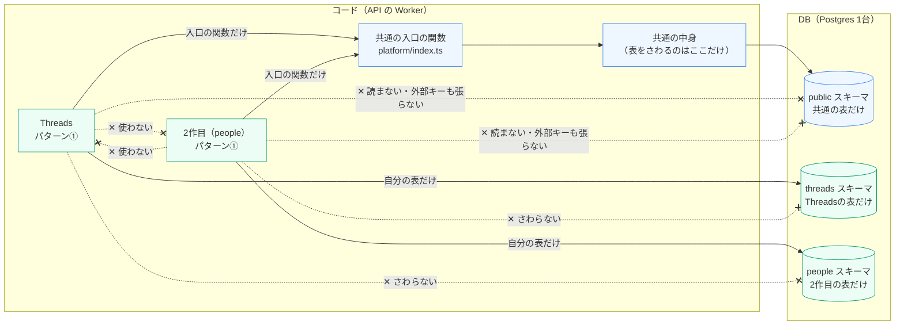
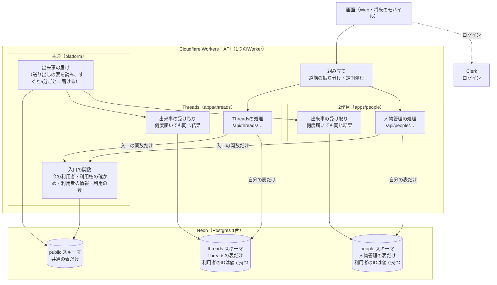
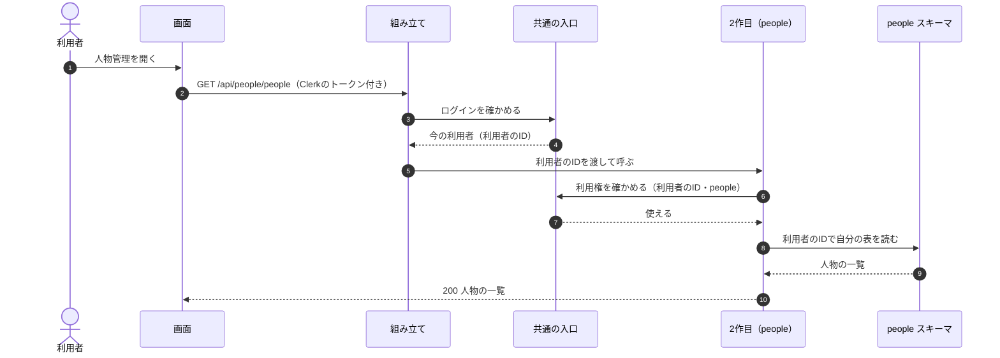
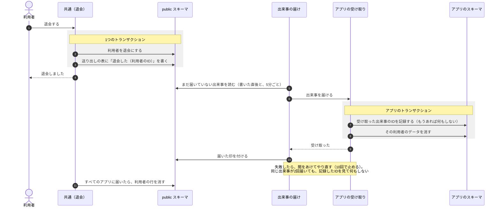
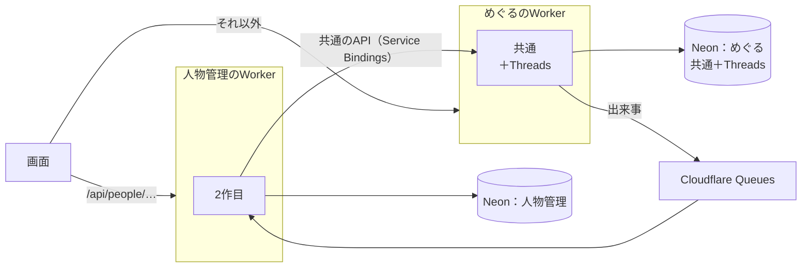

# アプリを分けて作る決まり（2作目から）

**決めた日**：2026-11-12 | **更新**：2026-11-13（Threadsもパターン①にそろえた。029） | **対象**：すべてのアプリ（API・DB・Web） | **Threads**：パターン①にそろえた（下の「Threadsの扱い」）

めぐるのアプリ（Threadsと2作目以降）は、モジュラーモノリスの**パターン①**（アプリごとにDBを持ち、DBのトランザクション以外の方法で一貫性を保つ）で作る。あとでアプリを別のWorker・別のDBに切り出し、マイクロサービスにしやすくするためである。

> **今後、マイクロサービスにしていく可能性がある**（2026-11-12）。アプリが増えて、アプリごとに出す時期・使う量・担当が分かれてきたら、アプリを1つずつ切り出す。そのときに作り直しにならないよう、2作目からは最初から切り出せる形で作る。いつ・どのアプリから切り出すかは、まだ決めていない（6章）。

027・028のめぐるは**パターン②**（DBを共有し、DBのトランザクションで一貫性を保つ）だった。2作目より前に、Threadsも029（`specs/meguru/029-threads-pattern1`）でパターン①にそろえた。2作目からのアプリは、Threadsを実例にして同じ形で作る（5章）。

- モジュールの種類・依存の向き・入口の決まりは[docs/module-map.md](./module-map.md)（ここはその上に足す決まり）
- プロダクト全体の形とアプリを並行して作る決まりは[docs/product-structure.md](./product-structure.md) 6
- パターン①・②の分け方は、[モジュラーモノリスのパターン（Qiita）](https://qiita.com/k-kanno/items/0fd88fb7146ea29e7b77)に合わせた

## 1. 決まり

| 相手 | アプリからのさわり方 |
|---|---|
| **ほかのアプリ** | コードもDBも、一切さわらない（読む・書く・外部キー・JOIN・トランザクションのどれも） |
| **共通**（ログイン・利用者・利用権・料金） | DBは直接さわらない。**利用者のIDを値として持つだけ**で、外部キーは張らない。名前・利用権などが要るときは、共通の入口の関数を呼ぶ（切り出したあとは、そこがAPIの呼び出しに変わる） |
| **自分** | 自分の表だけを持つ。表はPostgresの中の**アプリ専用のスキーマ**（例：Threadsは`threads`、2作目は`people`）に置く |

- **共通をまたぐトランザクションは使わない**。共通で起きたこと（退会など）は、共通が「出来事」を出し、アプリがあとから受け取って自分のデータを直す（3章）。
- **出来事の受け取りは、何度届いても同じ結果になるように作る**（同じ出来事が2回届くことがある）。失敗したら、やり直せるようにする。
- **アプリのAPIの道筋は、アプリの名前の下に置く**（例：`/api/people/…`）。切り出すとき、道筋だけで振り分けられる。
- **アプリをまたぐ集計は、DBをJOINせず、それぞれのAPIから集める**。
- **DBのサーバーは、最初は分けない**。同じNeonのPostgresの中で、スキーマを分ける。表とトランザクションを共有しなければ、パターン①の考え方は守れる。サーバーを分けるのは、切り出すとき。
- **画面（Web・将来のモバイル）は、アプリのAPIだけを使う**（[product-structure.md](./product-structure.md) 6「モバイル化を見込んで技術を選ぶ」）。

## 2. 全体の形

### 2-1. モジュールの境界（コードとDB）

どのモジュールが、どこまでさわってよいか。Threadsも2作目も同じパターン①で、**共通の表は直接さわらず、自分のスキーマと共通の入口の関数だけを使う**。

| 線 | 意味 |
|---|---|
| 実線の矢印 | 使ってよい向き |
| 点線の ✕ | 使ってはいけない向き |
| 緑 | パターン①のアプリ（Threads・2作目）と、その専用のスキーマ。自分のスキーマと、共通の入口の関数だけ |
| 青 | 共通と`public`スキーマ。共通の表をさわるのは共通の中身だけで、アプリには入口の関数で見せる |

| 境界 | 守り方 |
|---|---|
| アプリ同士（コード） | ESLint の規則が止める（[module-map.md](./module-map.md) 1-5） |
| アプリ → 共通の表（コード） | ESLint の規則が、Threadsを含むすべてのアプリで`platform/schema`の読みこみを止める（4章「自動のチェック」） |
| 共通 → アプリの表（コード） | ESLint の規則が止める（共通で起きたことは出来事で伝える） |
| アプリ → ほかのスキーマ（DB） | アプリの表は自分のスキーマにだけ置き、外部キーを張らない（Threadsと共通の間の外部キーは0本）。切り出すときは、DB の利用者（ロール）をスキーマごとに分けて、ほかのスキーマを読めないようにする |

### 2-2. 全体の構成

今のめぐる（Threads）と、2作目（例：人物管理 `people`）を足したあとの形。Workerは1つのまま、中で分ける。

- 実線の向きが、使ってよい向き。アプリ（Threads・2作目）から`public`スキーマへの線はない。
- 出来事は、共通が書いたあとすぐに届け、届かなかった分は5分ごとの定期処理でやり直す（029で決めた。Cloudflare Queuesは今は使わない。6章）。

## 3. 動きの流れ

### 3-1. 2作目のAPIを呼ぶとき

利用者と利用権は、共通の入口の関数から受け取る。2作目は共通の表を読まない。

- 2作目は、利用者のIDを`user_id`の列に値として持つ。`users`の表に外部キーは張らない。
- 名前など共通の情報が要るときも、共通の入口の関数を呼ぶ（2作目の表に写して持たない）。
- Threadsも同じ流れで動く。たとえば`GET /api/threads/me`（`apps/api/src/apps/threads/me/threads-me.ts`）は、利用権を`loadAppEntitlements`、名前を`peopleNames`で受け取り、自分の表だけを読む。

### 3-2. 退会したとき（共通で起きたことを、アプリが知る）

共通は、自分の表を直すのと同じトランザクションで「出来事」を送り出しの表に書く（outbox）。そのあとで、登録されたアプリの受け取りに届け、アプリはあとから自分のデータを消す。Threadsは029から、この流れで退会の片づけをしている。

- 退会の画面は、アプリの片づけを待たずに終わる。アプリのデータは、少し遅れて（10分以内に）消える（結果として揃う）。届くまでの間、退会した人の持ち物は誰にも見せない（利用権の`withdrawn`）。
- Threadsの受け取りは`apps/api/src/apps/threads/events/received-events.ts`（出来事のIDを`threads.received_events`に記録する）、片づけの中身は`apps/threads/accounts/withdrawal-cleanup.ts`。届ける仕組みは`platform/events/events.ts`（[module-map.md](./module-map.md) 1-4）。

### 3-3. 切り出したあと（マイクロサービス）

今後マイクロサービスにしていくときの形。2作目を別のWorkerと別のDBに移しても、2作目の中身はほとんど変わらない。入口の関数の呼び出しがAPIの呼び出しに、DBの接続先が新しいDBに変わるだけになる。

### 3-4. マイクロサービスにしていく道のり

一度にすべてを分けず、必要になったアプリから1つずつ切り出す。

| 段階 | 形 | 変わること |
|---|---|---|
| 今 | Worker 1つ・Postgres 1台。Threadsもパターン①（`threads`スキーマ・共通は入口の関数・出来事。029） | — |
| 2作目から | Worker 1つ・Postgres 1台。新しいアプリもパターン①（専用のスキーマ・共通は入口の関数・出来事） | 新しいアプリは、Threadsを実例にして同じ形で作る |
| 切り出し | 切り出すアプリだけ、別のWorker・別のDBに移す | 入口の関数 → 共通のAPI（Service Bindings）、DBの接続先、マイグレーションの置き場所、デプロイ |
| その先 | 共通（ログイン・利用者・利用権・料金）も、1つのサービスとして独り立ちさせるかを決める | — |

**切り出しを考えるきっかけ**（どれか1つで、すぐ切り出すわけではない）

- アプリごとに、出す時期をずらしたい（1つのアプリの不具合で、ほかのアプリのリリースを止めたくない）
- 1つのアプリだけ、使う量（リクエスト・DB）が大きく、ほかに影響する
- アプリごとに担当の人やチームが分かれた
- アプリを別に売る・別のインフラで動かす必要が出た

## 4. 作るときの具体的な決まり

| 項目 | 決まり |
|---|---|
| 表の置き場所 | Drizzleの`pgSchema("<アプリ>")`で、アプリ専用のスキーマに置く。`apps/<アプリ>/schema.ts`は、共通の表（`platform/schema`）を読まない（Threadsの例：`apps/api/src/apps/threads/schema.ts`の`pgSchema("threads")`） |
| 利用者のID | `user_id uuid NOT NULL`（外部キーなし）と、検索用の索引。テストのグループなど共通のIDも同じ |
| 共通の入口 | 今の利用者・利用権の確かめ・利用者の情報を返す関数を、`platform/index.ts`から受け取る（029で作った：`currentUser`・`loadAppEntitlement(s)`・`loadAppFeatures`・`peopleNames`・`peopleProfiles`・`searchPeople`など。中身は共通の表を読むが、アプリには表を見せない） |
| 出来事 | 共通の送り出しの表（`platform_events`）に書き、書いたあとすぐと5分ごとの定期処理で、登録された受け取りに届ける（`platform/events/events.ts`）。受け取りは出来事のIDを自分の表に記録して重複をはじく。失敗は間をあけてやり直し、10回失敗したら`failed`で止めて、表（`platform_event_deliveries`）とログに残す。受け取りは`registerConsumer`で登録する（Threadsの例：`apps/threads/register.ts`・`apps/threads/events/received-events.ts`） |
| 利用の数 | 料金の数と「使っているか」を、`reportUsage`で共通へ伝える（Threadsの例：`apps/threads/accounts/usage.ts`。アカウントを作る・消す・チームに入る・抜けるたびと、毎日の数え直し）。共通の`/api/me`の「使っているアプリ」は、ここから決まる |
| 機能と上限 | 名前・表示名・範囲はアプリが決め、`registerAppFeatures`・`registerAppLimits`で共通に登録する（Threadsの例：`apps/threads/registry.ts`）。運営の画面は`GET /api/operator/app-registry`で一覧を読むので、外枠にアプリの名前を書かない |
| APIの道筋 | `/api/<アプリ>/…`。アプリの「自分」の情報は`/api/<アプリ>/me`から返し、共通の`/api/me`には入れない（Threadsの例：`/api/threads/me`＝`apps/threads/me/threads-me.ts`） |
| 画面 | APIの呼び出しとキャッシュのキーは`apps/web/src/apps/<アプリ>/lib/`に置き、共通の`lib/api-client.ts`・`lib/query.ts`には置かない（Threadsの例：`apps/web/src/apps/threads/lib/`の`api.ts`・`query-keys.ts`・`use-threads-me.ts`）。退会の確かめに出す中身は、`AppModule`の`withdrawalPreview`で外枠に渡す |
| マイグレーション | 今は同じ`apps/api/drizzle/`の1列で作る（並行するときの決まりは[product-structure.md](./product-structure.md) 6）。切り出すときに、アプリのマイグレーションを分ける |
| 自動のチェック | ESLintの規則（`eslint-rules/module-boundaries.js`）が、Threadsを含むすべてのアプリで`platform/schema`の読みこみを止める（`appToPlatformSchema`）。2作目を足しても、設定は要らない |

## 5. Threadsの扱い

Threadsも、2作目より前に、029（`specs/meguru/029-threads-pattern1`）でパターン①にそろえた。利用者から見える動き・画面・料金は変えていない。2作目・3作目は、次のThreadsの実例をなぞって作る。

| 何 | Threadsの実例 |
|---|---|
| 表の置き場所 | `apps/api/src/apps/threads/schema.ts`。`pgSchema("threads")`で、スキーマ`threads`に34表を置く。共通の表との外部キーは0本で、利用者のIDは値で持つ |
| 共通の入口の関数 | 利用権は`loadAppEntitlement(s)`、名前は`peopleNames`など（`platform/index.ts`）。共通の表の定義は読まない（ESLintが止める） |
| 出来事の受け取り | `apps/threads/events/received-events.ts`。`user.withdrawn`で自分のデータを片づけ（`accounts/withdrawal-cleanup.ts`）、`limits.changed`で自動投稿を起こす。登録は`apps/threads/register.ts`の`registerThreads()` |
| 利用の数 | `apps/threads/accounts/usage.ts`から`reportUsage`を呼ぶ |
| APIの道筋 | すべて`/api/threads/…`の下。Threadsの「自分」は`/api/threads/me`（`apps/threads/me/threads-me.ts`） |
| 画面 | `apps/web/src/apps/threads/lib/`（`api.ts`の`threadsApi`・`query-keys.ts`の`threadsQueryKeys`・`use-threads-me.ts`の`useThreadsMe`）。退会の確かめは`withdrawalPreview` |

- 027で共通に置いていた`accounts`・`memberships`・チーム・権限の判定・活動の記録は、Threadsの持ち物にした（[module-map.md](./module-map.md) 2-2）。
- 共通の処理と同じトランザクションでアプリの処理を呼ぶ「知らせ」はなくし、出来事に置き換えた（[module-map.md](./module-map.md) 1-4）。
- Metaに登録したURL（`/api/threads/callback`・`/api/threads/webhooks/…`など）と`/api/data-deletion`は、登録し直さないよう、今のまま残した。

## 6. まだ決めていないこと

| 項目 | いつ決めるか |
|---|---|
| 出来事の送り方 | 029で決めた：送り出しの表を、書いた直後と5分ごとの定期処理で読んで届ける（10分以内）。Cloudflare Queuesは、出来事が増えたときか切り出すときに考える |
| 共通の入口の関数の形（何を返すか・まとめて受け取るか） | 029でThreadsの分を作った（`platform/index.ts`）。2作目で足りないものは、2作目の計画のときに足す |
| 利用権と料金の持ち方（アプリごとの契約か、まとめ買いか） | 2作目の計画のとき（[product-structure.md](./product-structure.md) 7） |
| マイクロサービスにする時期と、どのアプリから切り出すか | 3-4のきっかけが見えたとき |
| 切り出したあとのログイン（Clerkのトークンをそれぞれで確かめるか）と、共通のAPIの形 | 切り出すとき |

## 7. この文書の更新

- 2作目を作って決まりが具体的になったら、同じPRでこの文書と[module-map.md](./module-map.md)を直す。
- パターンを変える（たとえば2作目もパターン②にする）ときは、[Constitution](../.specify/memory/constitution.md)の「アプリのデータの分け方」も直す。
