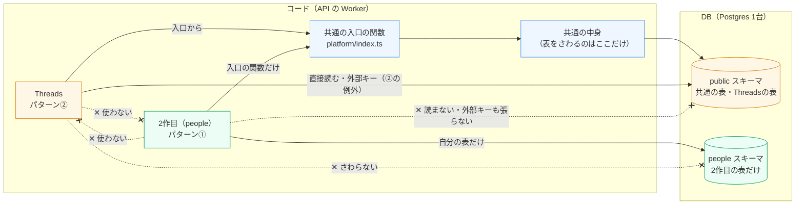
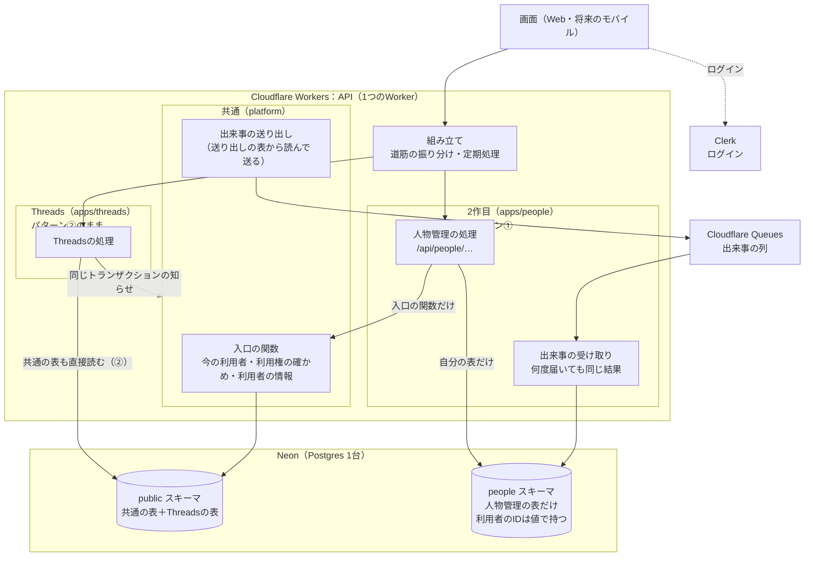
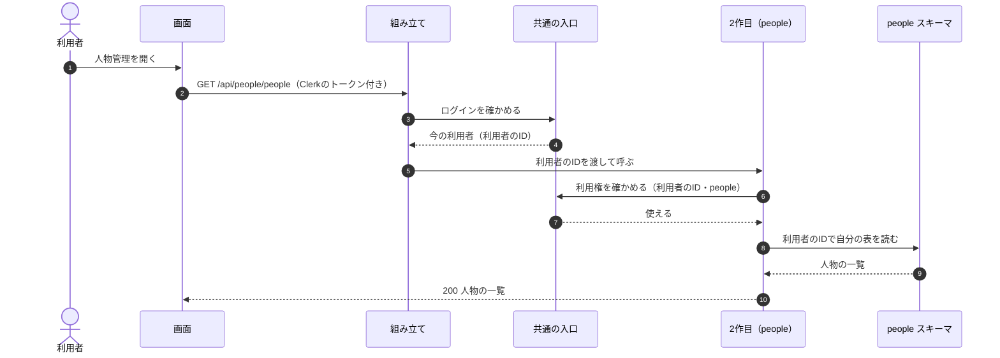
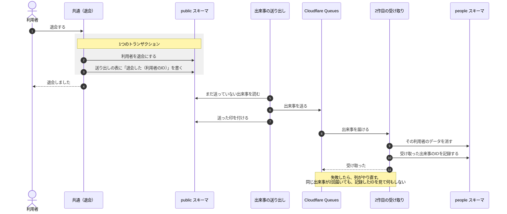

# アプリを分けて作る決まり（2作目から）

**決めた日**：2026-11-12 | **対象**：2作目以降のアプリ（API・DB・Web） | **Threads**：今のまま（下の「Threadsの扱い」）

2作目以降のアプリは、モジュラーモノリスの**パターン①**（アプリごとにDBを持ち、DBのトランザクション以外の方法で一貫性を保つ）で作る。あとでアプリを別のWorker・別のDBに切り出し、マイクロサービスにしやすくするためである。

> **今後、マイクロサービスにしていく可能性がある**（2026-11-12）。アプリが増えて、アプリごとに出す時期・使う量・担当が分かれてきたら、アプリを1つずつ切り出す。そのときに作り直しにならないよう、2作目からは最初から切り出せる形で作る。いつ・どのアプリから切り出すかは、まだ決めていない（6章）。

今のめぐる（027・028）は**パターン②**（DBを共有し、DBのトランザクションで一貫性を保つ）で、Threadsはそのまま残す。新しいアプリだけを、この文書の決まりで作る。

- モジュールの種類・依存の向き・入口の決まりは[docs/module-map.md](./module-map.md)（ここはその上に足す決まり）
- プロダクト全体の形とアプリを並行して作る決まりは[docs/product-structure.md](./product-structure.md) 6
- パターン①・②の分け方は、[モジュラーモノリスのパターン（Qiita）](https://qiita.com/k-kanno/items/0fd88fb7146ea29e7b77)に合わせた

## 1. 決まり

| 相手 | アプリからのさわり方 |
|---|---|
| **ほかのアプリ** | コードもDBも、一切さわらない（読む・書く・外部キー・JOIN・トランザクションのどれも） |
| **共通**（ログイン・利用者・利用権・料金・チーム） | DBは直接さわらない。**利用者のIDを値として持つだけ**で、外部キーは張らない。名前・利用権などが要るときは、共通の入口の関数を呼ぶ（切り出したあとは、そこがAPIの呼び出しに変わる） |
| **自分** | 自分の表だけを持つ。表はPostgresの中の**アプリ専用のスキーマ**（例：`people`）に置く |

- **共通をまたぐトランザクションは使わない**。共通で起きたこと（退会など）は、共通が「出来事」を出し、アプリがあとから受け取って自分のデータを直す（3章）。
- **出来事の受け取りは、何度届いても同じ結果になるように作る**（同じ出来事が2回届くことがある）。失敗したら、やり直せるようにする。
- **アプリのAPIの道筋は、アプリの名前の下に置く**（例：`/api/people/…`）。切り出すとき、道筋だけで振り分けられる。
- **アプリをまたぐ集計は、DBをJOINせず、それぞれのAPIから集める**。
- **DBのサーバーは、最初は分けない**。同じNeonのPostgresの中で、スキーマを分ける。表とトランザクションを共有しなければ、パターン①の考え方は守れる。サーバーを分けるのは、切り出すとき。
- **画面（Web・将来のモバイル）は、アプリのAPIだけを使う**（[product-structure.md](./product-structure.md) 6「モバイル化を見込んで技術を選ぶ」）。

## 2. 全体の形

### 2-1. モジュールの境界（コードとDB）

どのモジュールが、どこまでさわってよいか。Threads（パターン②）と2作目（パターン①）の違いは、**共通の表を直接さわるかどうか**。

| 線 | 意味 |
|---|---|
| 実線の矢印 | 使ってよい向き |
| 点線の ✕ | 使ってはいけない向き |
| 橙 | パターン②（Threads。共通の表を直接読み、同じトランザクションで動く） |
| 緑 | パターン①（2作目から。自分のスキーマと、共通の入口の関数だけ） |
| 青 | 共通。共通の表をさわるのは共通の中身だけで、アプリには入口の関数で見せる |

| 境界 | 守り方 |
|---|---|
| アプリ同士（コード） | ESLint の規則が止める（[module-map.md](./module-map.md) 1-5） |
| 2作目 → 共通の表（コード） | 2作目を足すときに ESLint の規則を足す（4章「自動のチェック」） |
| 2作目 → ほかのスキーマ（DB） | 2作目の表は自分のスキーマにだけ置き、外部キーを張らない。切り出すときは、DB の利用者（ロール）をスキーマごとに分けて、ほかのスキーマを読めないようにする |

### 2-2. 全体の構成

今のめぐると、2作目（例：人物管理 `people`）を足したあとの形。Workerは1つのまま、中で分ける。

- 実線の向きが、使ってよい向き。2作目から`public`スキーマへの線はない。
- Threadsは、共通の表を直接読み、共通と同じトランザクションで動く（パターン②。作り直さない）。

## 3. 動きの流れ

### 3-1. 2作目のAPIを呼ぶとき

利用者と利用権は、共通の入口の関数から受け取る。2作目は共通の表を読まない。

- 2作目は、利用者のIDを`user_id`の列に値として持つ。`users`の表に外部キーは張らない。
- 名前など共通の情報が要るときも、共通の入口の関数を呼ぶ（2作目の表に写して持たない）。

### 3-2. 退会したとき（共通で起きたことを、2作目が知る）

共通は、自分の表を直すのと同じトランザクションで「出来事」を送り出しの表に書く（outbox）。送り出しはそのあとで列に送り、2作目はあとから受け取って自分のデータを消す。

- 退会の画面は、2作目の片づけを待たずに終わる。2作目のデータは、少し遅れて消える（結果として揃う）。
- Threadsの片づけは、今までどおり同じトランザクションの「知らせ」（[module-map.md](./module-map.md) 1-4）で行う。

### 3-3. 切り出したあと（マイクロサービス）

今後マイクロサービスにしていくときの形。2作目を別のWorkerと別のDBに移しても、2作目の中身はほとんど変わらない。入口の関数の呼び出しがAPIの呼び出しに、DBの接続先が新しいDBに変わるだけになる。

```mermaid
flowchart LR
  web["画面"]
  subgraph core["めぐるのWorker"]
    platform2["共通<br/>＋Threads"]
  end
  subgraph memoWorker["人物管理のWorker"]
    memo2["2作目"]
  end
  queue2["Cloudflare Queues"]
  db1[("Neon：めぐる<br/>共通＋Threads")]
  db2[("Neon：人物管理")]

  web -- "/api/people/…" --> memoWorker
  web -- "それ以外" --> core
  memo2 -- "共通のAPI（Service Bindings）" --> platform2
  platform2 --> db1
  memo2 --> db2
  platform2 -- "出来事" --> queue2
  queue2 --> memo2
```

### 3-4. マイクロサービスにしていく道のり

一度にすべてを分けず、必要になったアプリから1つずつ切り出す。

| 段階 | 形 | 変わること |
|---|---|---|
| 今 | Worker 1つ・Postgres 1台。Threadsはパターン② | — |
| 2作目から | Worker 1つ・Postgres 1台。新しいアプリはパターン①（専用のスキーマ・共通は入口の関数・出来事） | 新しいアプリだけ、この文書の決まりで作る |
| 切り出し | 切り出すアプリだけ、別のWorker・別のDBに移す | 入口の関数 → 共通のAPI（Service Bindings）、DBの接続先、マイグレーションの置き場所、デプロイ |
| その先 | 共通（ログイン・利用者・利用権・料金）も、1つのサービスとして独り立ちさせるかを決める | Threadsをパターン①に寄せるかも、このときに決める |

**切り出しを考えるきっかけ**（どれか1つで、すぐ切り出すわけではない）

- アプリごとに、出す時期をずらしたい（1つのアプリの不具合で、ほかのアプリのリリースを止めたくない）
- 1つのアプリだけ、使う量（リクエスト・DB）が大きく、ほかに影響する
- アプリごとに担当の人やチームが分かれた
- アプリを別に売る・別のインフラで動かす必要が出た

## 4. 作るときの具体的な決まり

| 項目 | 決まり |
|---|---|
| 表の置き場所 | Drizzleの`pgSchema("<アプリ>")`で、アプリ専用のスキーマに置く。`apps/<アプリ>/schema.ts`は、共通の表（`platform/schema`）を読まない |
| 利用者のID | `user_id uuid NOT NULL`（外部キーなし）と、検索用の索引。チームなど共通のIDも同じ |
| 共通の入口 | 今の利用者・利用権の確かめ・利用者の情報を返す関数を、`platform/index.ts`から出す（2作目で作る。中身は共通の表を読むが、アプリには表を見せない） |
| 出来事 | 共通の送り出しの表（outbox）とCloudflare Queuesで送る。受け取りは出来事のIDで重複をはじき、失敗はやり直し、何度も失敗したものは別の列（dead letter）に残す（2作目で作る） |
| APIの道筋 | `/api/<アプリ>/…` |
| マイグレーション | 今は同じ`apps/api/drizzle/`の1列で作る（並行するときの決まりは[product-structure.md](./product-structure.md) 6）。切り出すときに、アプリのマイグレーションを分ける |
| 自動のチェック | 2作目を足すとき、ESLintの規則（`eslint-rules/module-boundaries.js`）に「Threads以外のアプリは`platform/schema`を読まない」を足す |

## 5. Threadsの扱い

Threadsは、パターン②のまま残す。作り直しはしない。

- 共通の表（`users`・`accounts`）を直接読み、外部キーも張っている。
- 共通の表の決まった列を書き換える（[module-map.md](./module-map.md) 3）。
- 共通の処理と同じトランザクションの「知らせ」で動く（[module-map.md](./module-map.md) 1-4）。

切り出しの候補になったときに、2作目と同じ形に寄せるかを決める。

## 6. まだ決めていないこと

| 項目 | いつ決めるか |
|---|---|
| 出来事の送り方（Cloudflare Queuesか、定期処理で送り出しの表を読むだけにするか） | 2作目の計画のとき（出来事の数と、遅れてよい時間を見て） |
| 共通の入口の関数の形（何を返すか・まとめて受け取るか） | 2作目の計画のとき |
| 利用権と料金の持ち方（アプリごとの契約か、まとめ買いか） | 2作目の計画のとき（[product-structure.md](./product-structure.md) 7） |
| マイクロサービスにする時期と、どのアプリから切り出すか | 3-4のきっかけが見えたとき |
| 切り出したあとのログイン（Clerkのトークンをそれぞれで確かめるか）と、共通のAPIの形 | 切り出すとき |

## 7. この文書の更新

- 2作目を作って決まりが具体的になったら、同じPRでこの文書と[module-map.md](./module-map.md)を直す。
- パターンを変える（たとえば2作目もパターン②にする）ときは、[Constitution](../.specify/memory/constitution.md)の「アプリのデータの分け方」も直す。
