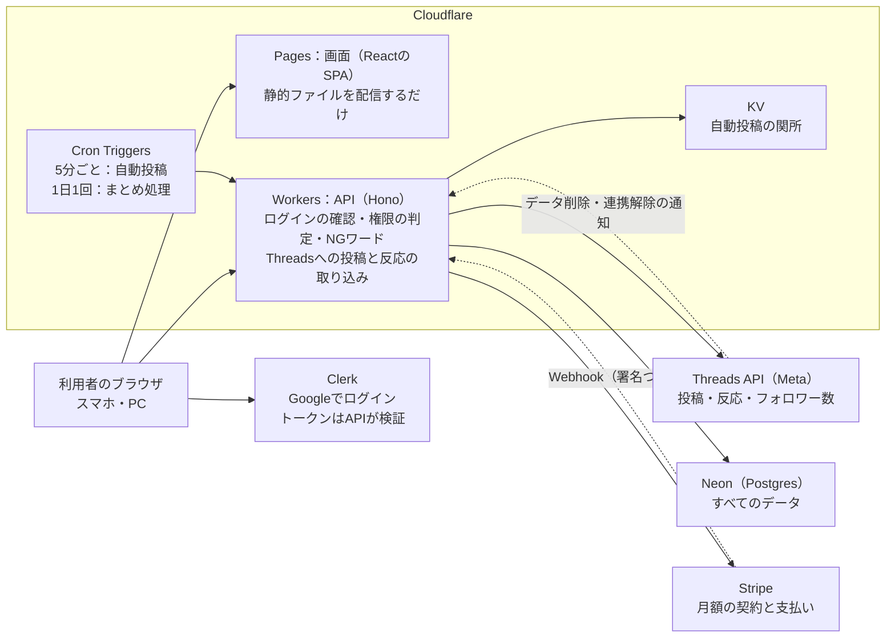
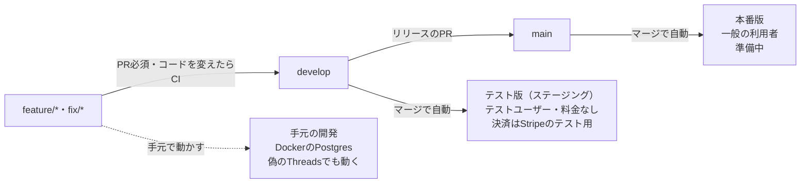
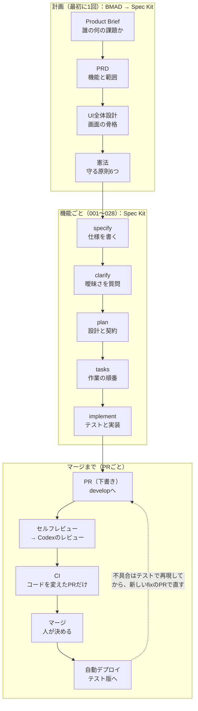

# めぐる Threads 技術ドキュメント

**更新**：2026-11-12（旧名 ThreadsGrower。2026-11-11からスイート「めぐる」の最初のアプリ）

Threadsの運用を「投稿ストック → 承認 → 自動投稿 → 分析 → 改善」のループで回すWebアプリを、個人開発で1か月（2026年10月）かけて作りました。Cloudflare・Neon・Clerkの無料枠で固定費0円から運用できる構成にし、実装の大半は仕様駆動でAI（Claude Code・Codex）が書いています。

## 全体の構成

画面はCloudflare Pagesから配信するだけで、データと外部サービスに触れるのはCloudflare WorkersのAPIだけです。

自動投稿は5分ごとのCronで動きますが、先にKVを見て、投稿の予定がなければDBに触れずに終えます。このためDBは使われていない間止まったままで、費用がかかりません。

## 技術スタック

フロントエンドもバックエンドもTypeScriptで統一し、pnpm workspacesのモノレポにしています。

| 層 | 使っているもの | 選んだ理由 |
| --- | --- | --- |
| 画面 | Vite + React 19、React Router、TanStack Query、shadcn/ui（Radix UI + Tailwind CSS） | 画面はSPAで十分。静的ファイルとして無料で配信できる |
| 配信 | Cloudflare Pages | 静的ファイルの配信が無料。ブランチごとに別のURLを持てる |
| API | Cloudflare Workers + Hono | 無料で1日10万リクエスト。サーバーの管理が要らず、定期処理（Cron Triggers）も同じ場所で動く |
| データベース | Neon（Postgres 17）+ Drizzle ORM | 問い合わせがないと5分で止まり、止まっている間は費用0。履歴から時刻を指定して戻せる |
| 小さな記録 | Cloudflare KV | 自動投稿の「関所」。用のない回はDBを起こさずに終える |
| ログイン | Clerk（Googleだけ） | ログインだけを任せる。チームはClerkではなくアプリのDBで持つ |
| 決済 | Stripe（Billing + Checkout） | 月額の契約・支払いの失敗を任せられる（無料体験は2026-11-08にやめた） |
| 外部API | Threads API | 投稿（作成 → 公開の2段階）と、反応・フォロワー数の取り込み |
| 共通コード | `packages/shared` | 入出力のスキーマ、エラーコードと日本語の文言、料金と上限を、画面とAPIで共有する |
| テスト | Vitest、Testing Library、Playwright | 単体・結合・画面・E2Eを同じ言語で書ける |

## 設計の意図

大きな判断は、開発の最初に「憲法（Constitution）」として文書にし、すべての機能がそれに従います。AIが書くコードでも、前提がぶれないようにするためです。

| 判断 | 理由 |
| --- | --- |
| アプリの中でLLMを呼ばない。作るのは戦略を入れたプロンプトまで | APIの費用が0。利用者が好きなAIを選べる |
| 人が承認した案しか投稿しない。NGワードは承認時と投稿の直前の2回確かめる | 人柄を損なう投稿の無断公開が、運用者にとって最悪の事故だから |
| 契約（お金）とロール（権限）を分ける | 契約は支払う人に1つ、権限はアカウントごと・チームごとに複数で、数の関係が違う |
| 「誰がどのアカウントで何をできるか」の判定を1か所に集め、すべてのAPIが通る | 未払いのときの制限も、機能のまとまりのON/OFFも、この判定に足すだけで済む。画面の出し分けは見た目だけで、守りはAPIに置く |
| 外部媒体（こくちーずプロ・Peatixなど）の登録画面の並び・選択肢・ルールは、媒体ごとの1つのファイルの定数として共有の部分に置き、APIと画面の両方が同じものを使う。文は決まりで組み立て、言い回しは外のAIに頼む | 媒体が画面を変えたときに、1つのファイルを直すだけで済む。アプリの中でAIを呼ばないので、費用がかからない |
| 解析（伸びやすい時間帯・おすすめに乗った目安・伸びた傾向）は、共有の部分の決まった計算で、読むたびに求めて保存しない。中央値で比べ、件数10件・差1.5倍に届いたものだけを傾向にする。傾向は「■伸びた傾向」の節としてプロンプトに入れ、CORE RULES・NGワードと食い違うものは入れない | 画面とプロンプトで同じ傾向になる。保存しないので、反応数が後から確定しても古い結果が残らない。数件の大きく伸びた投稿や偶然の差に振り回されにくい |
| 時間差のメンションの返信は、自動投稿の5分ごとの処理に段階を1つ足して出す。投稿と同じく、公開を送る前に記録して二重に出さない。返信の文も承認と出す直前の2回NGワードを確かめ、承認した文は書き換えずに出す（出せないときは出さない） | 新しいCronや仕組みを足さずに済む。人が承認した文と1文字も変わらない文だけがThreadsに出る |
| 料金のプランを決める前に、機能のまとまり（自動投稿・戦略・チーム）を運営者が人ごと・組織ごとにON/OFFできるようにする（どちらかでOFFなら使えない） | プランを「ONにする組み合わせ」と料金として、あとから決められる。OFFの行だけを持つので、何もしない人は今までどおり |
| チームの運用状況は、新しい記録を取らず、開いたときに今ある記録（操作の記録・投稿・反応数）から数える。見せるのは数と日付だけ | 表もCronも増やさずに済む。ほかのお店の中身は見せずに、手が止まっている人と伸びていないアカウントがわかる |
| チームをClerkのOrganizationsではなく、アプリのDBで持つ | Organizationsはチームごとに課金され、チームが増えると売上を超える |
| 固定費0円から始める。定期処理は用がないときDBを起こさない | DBの費用は「起きている時間」で決まる。5分ごとにDBを読むと、ずっと止まらない |
| 環境の違いをコードの分岐にせず、設定だけに置く | テスト版で確かめたコードが、そのまま本番でも動く |
| マイグレーションは「足してから消す」（expand / contract）で書く | 古いAPIと新しいDBが並んでも壊れず、APIだけを戻せる |
| 既存のツールを使わず、一から作る | n8nは再販に制約のあるライセンス、PostizはAGPL-3.0で、SaaSとして売りにくい |
| APIはモジュラーモノリスにする。土台・窓口・共通・アプリ・組み立ての5つに分け、依存は一方向（組み立て → アプリ → 共通 → 窓口 → 土台）。ほかのモジュールは入口（`index.ts`）からだけ使い、表には持ち主のモジュールが1つある。共通で起きたことは「出来事」でアプリに伝える。ESLintの規則で自動で守る（027・029、[docs/module-map.md](./module-map.md)） | このアプリを起点に、共通のアカウント・契約で複数のアプリを束ねるスイートを育てるため（[docs/product-structure.md](./product-structure.md)）。2作目を同じリポジトリにアプリとして足せ、必要になったアプリだけを後から切り出せる |
| Webは、めぐるの外枠（`shell/`）・アプリ（`apps/<名前>/`。Threadsと人物メモ）・共通の部品（`components/`・`lib/`）・組み立て（`main.tsx`・`router.tsx`・`app-registry.ts`）に分ける。外枠はアプリを読まず、アプリが出す`AppModule`を組み立てが一覧にして渡す。アプリの画面は自分のパスの下（Threadsは`/threads/…`）に置き、前のURL（`/accounts/…`・`/teams/…`）は転送する。入口（`/`）は`/api/me`の`apps.landing`（最後に使ったアプリ）で振り分け、0本の人は「すべてのアプリ」（`/apps`）から始める。ESLintの規則で境界を守る（028、[docs/module-map.md](./module-map.md) 7） | Threadsの改善と2作目のアプリを並行して作れるようにするため（[docs/product-structure.md](./product-structure.md) 6）。行き先・使っているアプリの判断はAPIに置き、将来のモバイルの画面からも同じ判断を使えるようにする |
| すべてのアプリを、モジュラーモノリスのパターン①で作る。ほかのアプリと共通の表は直接さわらず、利用者のIDを値として持つだけにする（外部キーなし）。共通とは入口の関数と出来事（送り出しの表を、書いた直後と5分ごとの定期処理で届ける）でやりとりし、表はアプリ専用のスキーマに置く。Threadsも、2作目より前に029でパターン②（DBを共有し、トランザクションで一貫性を保つ）からパターン①にそろえた（スキーマ`threads`・APIは`/api/threads/…`。[docs/app-separation.md](./app-separation.md)） | 今後マイクロサービスにしていく可能性があるため。アプリを別のWorker・別のDBに切り出すときに、作り直しにならないようにする |

## 安全とデータの守り

守りはすべてAPI側に置き、画面は信用しない前提で作っています。

- **ログイン**：Clerkが発行したセッションのトークンを、APIがリクエストごとに確かめます。
- **権限**：オーナー・担当・見せてもらっている人・関わりなしの判定を1か所に集め、すべてのAPIが通ります。
- **Threadsとの接続**：Threadsのパスワードを受け取る画面・APIはありません。利用者がThreadsの画面でログインして許可するか、自分のMetaアプリのトークンを貼ります。審査の前は、運営者が利用者をMetaアプリのテスターに招待し、申し込みから接続までを「テスター招待」で管理します。運営者がトークンを作ったり付けたりする経路はありません（specs/024）。
- **契約と上限**：契約前の人（無料体験なし）は、契約と支払い・退会のほかのAPIを使えません。アカウントの数と1日の投稿数の上限は1か所（上限のサービス）で決め、アカウントを作る・投稿の時刻を保存する・自動投稿の時刻の処理のすべてで効かせます。運営者には料金も上限もかかりません（specs/024）。
- **Threadsのトークン**：AES-256-GCMで暗号化して保存します。追加の認証データにアカウントのIDを使い、暗号文を別の行へ付け替えても復号できないようにしています。鍵は並べて持ち、入れ替え（ローテーション）できます。
- **データ削除の記録**：ThreadsのユーザーIDを平文で残さず、鍵付きハッシュ（HMAC-SHA256）だけで照合します。
- **外からの通知（Webhook）**：Stripeは署名を、Metaのデータ削除・連携解除はsigned_requestを確かめます。鍵が空や仮の値のときは、署名を形だけ通さずに拒みます。
- **設定の関所**：秘密の値が仮の値のままだと、APIも定期処理も動きません。取り違えた鍵で本物のアカウントに投稿しないためです。
- **秘密の値の置き場所**：リポジトリには置かず、CloudflareのSecretとGitHubのEnvironmentにだけ置きます。
- **画面の入口**：CORSはその環境の画面のオリジンだけを許し、セキュリティヘッダーを付けています。
- **監査**：公開の前に、AIのセキュリティ監査のスキルでコード全体を調べ、見つかった穴を塞ぎました。

## 環境とリリース

ブランチと環境を1対1に対応させ、マージするとGitHub Actionsが自動で出します。テスト版と本番版は、DB・ログイン・決済・秘密の値をすべて分けています。

- デプロイの順は、マイグレーション → API → 画面です。どこかで失敗したら、そこで止まります。
- ふだんのPRは`develop`に向け、テスト版で確かめてから`develop` → `main`のリリースのPRで本番に出します。
- 本番の急ぎの修正は`main`から`fix/*`を分け、マージしたあとに同じ変更を`develop`へ戻します。
- テスト版でも自動投稿は本物のThreadsに出るので、画面には「テスト版」の印を出しています。
- テスト版は招待制です。運営者が組織やコミュニティごとに「テスト用のグループ」（人数の上限つき）を作り、その招待リンクから入った人だけが使えます。仕組みは環境の設定（`TEST_GROUPS_ENABLED`）でON/OFFし、本番はOFFです。入れない人は、すべてのAPIで認証のミドルウェアが止めます。本番でもグループは作れますが、組織ごとに機能をON/OFFするためだけに使います（誰でも登録でき、料金もかかります）。
- 紹介リンクは、誰の紹介で登録したかを記録するだけです（特典なし）。紹介の文字列はブラウザに30日覚え、APIは利用者の行を新しく作るときだけ読みます。そのため、すでにいる人に後から紹介を付ける経路がありません。

## AI駆動開発の流れ

人が決めるのは「何を作るか」と「マージしてよいか」で、その間の仕様書き・設計・実装・テストはAIが進めます。

- **仕様を先に書く**：機能ごとに仕様・計画・タスクを文書にしてから実装します。clarifyでAIが曖昧な点を質問し、人が答えた内容が仕様に残ります。
- **憲法で前提を守る**：どの機能の計画も、憲法の原則（承認なしに投稿しない、契約とロールを分けるなど）と照らし合わせます。
- **決定は文書とメモリに残す**：会話で決めたことは、仕様の「質疑」や決定の日付として文書に書き、作業の好みはAIのメモリに残します。次の会話や別のAIに引き継げます。
- **利用制限への備え**：Claude Codeが制限になったら、同じスキルを読めるCodexで、仕様・タスクと差分を確かめてから続きを進めます（[AIスキルの共用](ai-skills.md)）。

## 使ったスキル・ツール・リポジトリ

開発のスキルはリポジトリの中に置き、Claude CodeとCodexの両方が同じファイルを読むようにしています（片方に実体、もう片方にシンボリックリンク）。

| 名前 | 何に使ったか |
| --- | --- |
| Claude Code | 実装・テスト・レビューの指摘への対応・環境構築の大半。会話をまたいだ決定事項はメモリに残す |
| Codex | PRのレビュー（セルフレビューのあと、Ready for reviewにしたときに動く。[リリースの手順書](release-runbook.md) 2）。Claude Codeが利用制限になったときの引き継ぎ先 |
| [BMAD-METHOD](https://github.com/bmad-code-org/BMAD-METHOD)（30スキル） | 計画の段階だけで使用。Product Brief・PRDと設計の叩き台 |
| [Spec Kit](https://github.com/github/spec-kit)（10スキル） | 実装の段階。憲法 → 仕様 → 計画 → タスク → 実装を、機能ごとに（001〜028） |
| security-audit（スキル） | 公開前のセキュリティ監査 |
| Playwright | E2Eテスト、画面の確認、外部サービスの管理画面の操作 |
| GitHub Actions | CI（マージの前にラベル「run-ci」を付けたときだけ）と、マージでの自動デプロイ |
| Wrangler・neonctl・Stripe CLI・gh | 環境づくりをコマンドで行い、そのまま手順書に残す。秘密の値は画面に出さずパイプで渡す |

BMADとSpec Kitは並行して使わず、「計画はBMAD、実装はSpec Kit」と段階で使い分けています。

## 品質の守り

AIが書いたコードでも、テストとCIを通らなければマージできないようにしています（文書だけの変更はCIを流さずにマージします）。

- **テスト**：単体・結合・画面のテストが278ファイル、E2Eが9ファイル（2026-11-12）。APIの結合テストは本物のPostgres 17で動かします。E2Eは偽のThreadsサーバーを立て、はじめかた・戦略・投稿づくり・チーム・決済・再接続・スマートフォンの幅を通します。
- **CI**：lint・型チェック・テスト・画面のビルド。コミットのたびには流さず、コードを変えたPRで、マージすると決めたときにラベル「run-ci」を付けて流します（Actionsは従量課金のため。2026-11-05、2026-11-12）。`main`と`develop`は、CIの成功とPRをルールセットで必須にしています。文書だけのPRは、管理者がCIを待たずにマージします。文書だけの変更では、デプロイも動きません。
- **不具合の直し方**：先にテストで同じ現象を再現し、直したあとに通ることを確かめてから、新しいPRで直します。
- **デプロイ**：マイグレーション → API → 画面の順に出し、どれかが失敗したらそこで止めます。戻し方は[リリースの手順書](release-runbook.md)にあります。
- **文書**：機能ごとに仕様・計画・タスク・契約（APIと画面の取り決め）を残し、コードのコメントからそこへたどれるようにしています。
