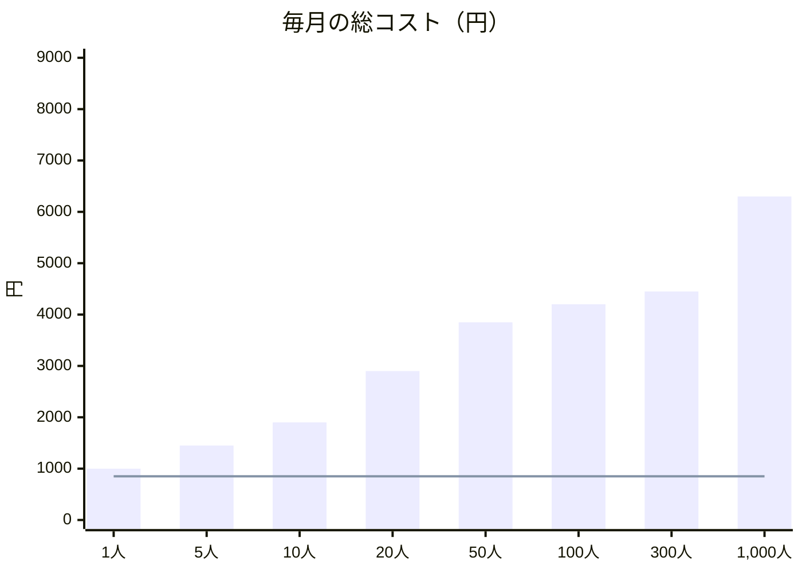
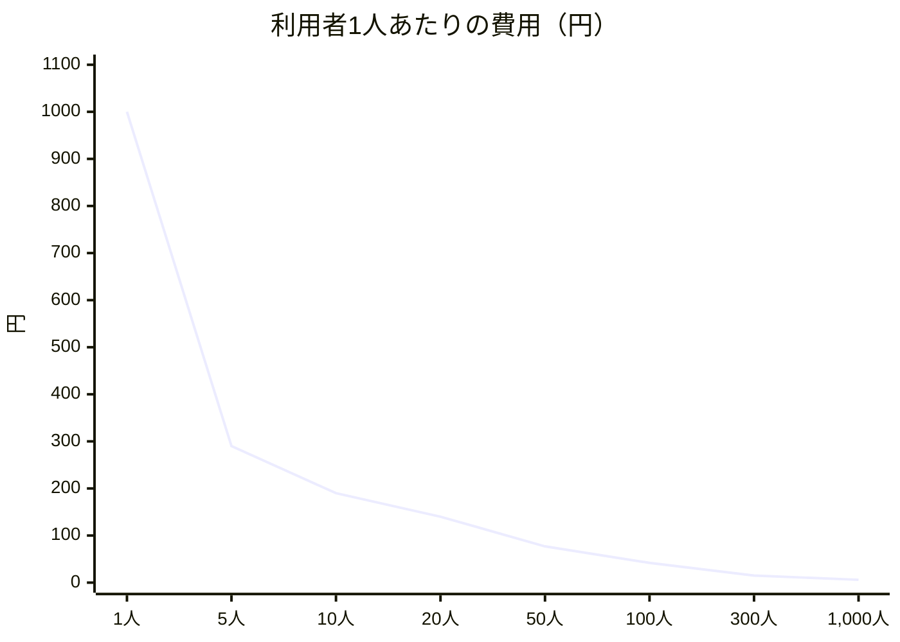

# 運用コストの試算

**作成**：2026-10-05（005 自動投稿の計画のときに作成） ／ **更新**：2026-11-05（総コストの試算を足した） ／ **関係**：[Constitution](../.specify/memory/constitution.md)「運用コスト制約」、[005 research.md](../specs/005-auto-post/research.md) R3・R14

利用者の数ごとに、毎月のインフラの費用がどう変わるかの見込み。料金は2026-10-05時点のもの。利用者が増えたとき、または料金が変わったときに見直す。

## 前提

- **使い方**：1人が1日1回、画面を30分（軽め）〜1時間（多め）使う。自動投稿は1日3件。使う時間帯は日中（7〜24時）が中心。
- **為替**：$1＝¥150。
- **Neonの有料プラン（Launch）**：無料枠の100 CU-hoursは引き継がず、使った分すべてに課金される前提（安全側）。
- **DBの大きさ**：0.25 CU（最小）で足りる前提。300人を超えたあたりからは、実測して見直す。
- 下書き1件の読み込みは約0.8KB（本文150文字前後の日本語と、IDや日時の列。ローカルのDBで測った値から見積もった）。

## 費用を決めるもの

| 項目 | 何で決まるか | 備考 |
|---|---|---|
| **Neonの計算時間** | **DBが起きている時間**。最後の問い合わせから5分たつと止まり、止まっている間は0 | 何人が同時に使っても、起きている時間は1本分。ずっと起きていても、0.25 CUなら月約182 CU-hoursで頭打ち |
| Neonの通信量 | DBから読んだデータの量 | 無料枠は月5GB。Launchは月500GBまで含まれる |
| Workers | リクエストの数・CPU時間。1回の処理のサブリクエスト（50回） | 自動投稿の「1回4件」の制限（005 R3）で、無料プランの限界が先に来る |
| Clerk・Pages・KV | ほぼ使わない量 | 当面$0 |
| Stripe | 売上の約4.3%（カード決済3.6%＋Billing 0.7%） | 売上から引かれる変動費。固定費ではない |

**大事な点**：Neonの無料枠は、計算時間か通信量を使い切ると、**翌月までDBが止まり、アプリ全体が使えなくなる**（データは消えない）。費用より先に、この止まる危険に備える。

## 総コストの試算

アプリを動かすのに、毎月**全部でいくら**かかるかの見込みです（2026-11-05）。利用者が増えたときにどう変わるかを、表とグラフにしました。エンジニアでない人にも読めるように書いています。細かい計算は、この下の節（「サービスごとの料金と無料枠」など）にあります。

### まとめ

- **利用者が1人でも、毎月およそ1,000円かかります。** その多くは、利用者の数に関係なくかかる「固定費」（コードの置き場とドメインで月850円）です。
- **利用者が100人になっても、毎月およそ4,200円です。** 1人あたりにすると約42円で、有料の利用者が5人いれば元が取れます。
- **300人を超えたあたりから、費用はほとんど増えなくなります。** データベースが1日中動いている状態になり、それ以上は料金が上がりにくいためです。

### 何にお金がかかるか

| 使っているサービス | 役割（たとえると） | 料金の決まり方 |
|---|---|---|
| Neon | **データベース**。利用者の戦略・下書き・反応数などを保存する「倉庫」 | 倉庫が開いている時間で決まる。だれも使っていない時間は閉まっていて、お金がかからない |
| Cloudflare | **サーバー**。画面を表示し、自動で投稿する「お店の窓口」 | 利用者が少ないうちは無料。増えたら月5ドル（約750円）の有料の枠に変える |
| GitHub | **コードの置き場**と、直したときの**自動のテスト** | 開発する人1人につき月4ドル（約600円）。自動のテストは、月18ドルぶんまでは料金に含まれる |
| ドメイン | アプリの**住所**（`app.〇〇.com` のような名前） | 年に約3,000円（仮）。月にすると約250円 |
| Clerk | **ログイン**の仕組み | 月5万人までは無料 |
| Stripe | **支払い**の受け取り | 売上の約4.3%が引かれる（売上がなければ0円）。下の表の合計には入れていない |

### 表

利用者の数ごとの、毎月の費用です（円。消費税は含めません）。

| 利用者 | データベース（Neon） | サーバー（Cloudflare） | コードの置き場（GitHub） | ドメイン | **合計（月）** | 1人あたり | 元を取るのに要る有料の利用者 |
|---|---|---|---|---|---|---|---|
| 1人 | 110〜180円 | 0円 | 600円 | 250円 | **約1,000円** | 1,000円 | 2人 |
| 5人 | 480〜730円 | 0円 | 600円 | 250円 | **1,300〜1,600円** | 290円 | 2人 |
| 10人 | 860〜1,240円 | 0円 | 600円 | 250円 | **1,700〜2,100円** | 190円 | 2〜3人 |
| 20人 | 1,410〜1,850円 | 0〜750円 | 600円 | 250円 | **2,300〜3,500円** | 140円 | 3〜4人 |
| 50人 | 2,100〜2,400円 | 750円 | 600円 | 250円 | **3,700〜4,000円** | 77円 | 4〜5人 |
| 100人 | 2,550〜2,700円 | 750円 | 600円 | 250円 | **4,150〜4,300円** | 42円 | 5人（全体の5%） |
| 300人 | 約2,850円 | 750円 | 600円 | 250円 | **約4,450円** | 15円 | 5人（全体の2%以下） |
| 1,000人 | 3,000〜6,000円 | 750〜1,200円 | 600円 | 250円 | **4,600〜8,050円** | 6円 | 5〜9人（全体の1%以下） |

表の見方：
- 「〜」で幅があるのは、利用者がアプリを使う時間（1日30分〜1時間）で変わるためです。
- 「1人あたり」は、合計の真ん中の値を利用者の数で割ったものです。
- 「元を取るのに要る有料の利用者」は、合計を、有料の利用者1人から入るお金（月約957円。月1,000円の基本料金から、支払いの手数料約4.3%を引いた額）で割ったものです。

### グラフ

毎月の総コスト（円）。棒が合計（真ん中の値）、線が固定費（コードの置き場とドメインの月850円）です。棒と線の差が、利用者の数で増える分です。

利用者1人あたりの費用（円）。利用者が増えるほど、1人あたりは安くなります。

### この試算の前提

- 1ドル＝150円で計算しています。
- データベースは、外部の利用者を入れた時点から有料のプランにします（無料の範囲を使い切ると、アプリ全体が止まってしまうため。下の「方針」1）。そのため、利用者が少なくても少しだけお金がかかります。
- サーバーは、利用者が20〜50人になったあたりで、有料の枠（月約750円）に変えます。
- 開発する人は1人として計算しています。
- コードを直したときの自動のテストは、2026-11-05から「公開する直前だけ」流すようにしました。そのため、料金に含まれる月18ドルぶんの中に収まる前提です。
- ドメインの値段は仮です。名前を決めたら直します。

合計に入れていないもの：
- 支払いの手数料（売上の約4.3%）。売上から自動で引かれるので、費用ではなく「入るお金が少し減る」ものとして、上の表の「元を取るのに要る有料の利用者」で扱っています。
- ログインの有料のプラン（月約3,750円）。必要になるまで付けません。
- アプリの外の費用（開発に使うAIやツールの契約など）。

### 費用が増えるとき

- **開発する人が増えたとき**：1人増えるごとに、コードの置き場の料金が月約600円増えます。
- **自動のテストを流しすぎたとき**：月18ドルぶんを超えると、超えた分だけ料金がかかります。11月1〜5日の5日間で7ドルぶん使ったので、「公開する直前だけ流す」を守ります。
- **ログインの有料のプランを付けたとき**：月約3,750円増えます。
- **利用者が1,000人を超えたとき**：データベースの大きさが足りるかを確かめて、試算を見直します。

### 参考文献

料金は2026-11-05時点のものです。変わることがあるので、見直すときは次のページで確かめます。

| 項目 | 根拠 |
|---|---|
| データベース（Neon）の料金 | [Neon pricing](https://neon.com/pricing)、[Neon plans](https://neon.com/docs/introduction/plans) |
| サーバー（Cloudflare Workers）の料金と無料の範囲 | [Workers pricing](https://developers.cloudflare.com/workers/platform/pricing/)、[Workers limits](https://developers.cloudflare.com/workers/platform/limits/) |
| 画面の置き場・設定の保存（Cloudflare Pages・KV） | [Pages limits](https://developers.cloudflare.com/pages/platform/limits/)、[KV pricing](https://developers.cloudflare.com/kv/platform/pricing/) |
| ログイン（Clerk）の料金 | [Clerk pricing](https://clerk.com/pricing) |
| コードの置き場（GitHub Team）の料金 | [GitHub pricing](https://github.com/pricing)。2026-11-05に、請求の画面で「1人あたり月4.00ドル」を確かめた |
| 自動のテスト（GitHub Actions）に含まれる量 | [How use of GitHub Actions is measured](https://docs.github.com/en/billing/concepts/product-billing/github-actions)（Teamは月3,000分）。2026-11-05に、請求の画面で「含まれる分 18.00ドル」「11月1〜5日の使用 6.98ドル」を確かめた |
| 支払い（Stripe）の手数料 | [Stripeの料金](https://stripe.com/jp/pricing)、[Stripe Billingの料金](https://stripe.com/jp/billing/pricing)（国内カード3.6%・定期の請求0.7%）。実際の料率は契約の画面でも確かめる |
| ドメインの値段（年3,000円は仮） | [Cloudflare Registrar](https://www.cloudflare.com/products/registrar/)（原価で売っているので、名前の種類ごとの値段の目安になる） |
| 為替（1ドル＝150円） | この文書の「前提」で決めた値。大きく動いたら直す |

## サービスごとの料金と無料枠

| サービス | 無料の範囲 | 有料 |
|---|---|---|
| Neon | 月100 CU-hours・通信量5GB・保存1GB | Launch：最低料金なし。$0.106/CU-hour、保存$0.35/GB-month、通信量は月500GBまで含む（超えたら$0.10/GB） |
| Cloudflare Workers | 1日10万リクエスト。1回の呼び出しでCPU 10ms・外部へのサブリクエスト50回 | Workers Paid：月$5（月1,000万リクエスト・CPU 3,000万msを含む）。KVの枠も増える |
| Cloudflare Pages・KV | 十分 | — |
| Clerk | 月50,000人まで | Pro：月$25（Clerkのロゴを消す、セッションの長さを変えるなど）。必要になるまで付けない |

出典：[Neon pricing](https://neon.com/pricing)、[Neon plans](https://neon.com/docs/introduction/plans)、[Workers pricing](https://developers.cloudflare.com/workers/platform/pricing/)、[Workers limits](https://developers.cloudflare.com/workers/platform/limits/)、[Clerk pricing](https://clerk.com/pricing)

## 利用者の数ごとの試算

### Neonの計算時間

利用者の使う時間がばらばらに重なるとして見積もった（軽め〜多め）。自動投稿の定期処理は、予定の時刻とやり直しのときだけDBを起こす（005 R3。一定の間隔の見直しはしない）。誰の予定もない時間帯は、DBが止まったままになる。

| 利用者 | 起きている時間/日 | CU-hours/月 | 無料枠（100） | Launchの場合 |
|---|---|---|---|---|
| 1人 | 1〜1.5時間 | 7〜11 | 収まる | — |
| 5人 | 4〜6時間 | 30〜46 | 収まる | — |
| 10人 | 7〜10時間 | 54〜78 | 収まる | — |
| 15人 | 10〜13時間 | 74〜100 | ぎりぎり | — |
| 20人 | 12〜15時間 | 89〜116 | 多めだと超える | $9〜12 |
| 50人 | 18〜20時間 | 136〜155 | 超える | $14〜16 |
| 100人 | 21〜23時間 | 158〜171 | 超える | $17〜18 |
| 300人〜 | ほぼ24時間 | 約180 | 超える | 約$19で頭打ち |

- 2026-10-05に、自動投稿の「1時間に1回の見直し」をやめた（005 R3）。利用者1人で月21 → 7 CU-hours（軽め）と、少人数のうちの計算時間が約3分の1になった。利用者が増えると、日中はもともとDBが起きているので、差は小さくなる。

### Neonの通信量

004の投稿ストックは、承認・却下のたびに一覧（要確認・承認済み・却下の最大500件）を読み直す（005 R14）。

- 却下300・承認済み100・要確認30件のAccountで、1回の読み込みは約350KB。
- 多めに使う人で、月300MB前後になる。
- 無料枠の5GBに届くのは、15〜20人あたり。計算時間の限界（多めで15〜20人、軽めで25人前後）と、ほぼ同じ時期になる。

### 合計（月額）

| 利用者 | Neon | Workers | 合計 | 円 | 費用をまかなう有料の利用者（旧案の¥500のプランで計算） |
|---|---|---|---|---|---|
| 〜10人 | $0 | $0 | $0 | ¥0 | — |
| 20人 | $0〜12 | $0〜5 | $0〜17 | ¥0〜2,600 | 0〜6人 |
| 50人 | $14〜16 | $5 | $19〜21 | ¥2,900〜3,200 | 7人 |
| 100人 | $17〜18 | $5 | 約$23 | 約¥3,500 | 8人（8%） |
| 300人 | 約$19 | $5 | 約$24 | 約¥3,600 | 8人（3%） |
| 1,000人 | $20〜40（DBの大きさしだい） | $5〜8 | $25〜50 | ¥3,800〜7,500 | 8〜16人（2%以下） |

- ¥500のプランは、Stripeの手数料を引いて1人あたり約¥478の収入（2026-10-31にBillingの0.7%を足して直した。前は約¥482）。有料の利用者が数%いれば、インフラの費用はまかなえる。
- 2026-10-08に料金を「基本料金¥1,000（1アカウント目を含む）＋2件目以降¥500／件」に変えた（PRD FR-12）。1人あたりの収入は約¥957以上（Stripeの手数料の約4.3%を引いた額）になるので、まかなうのに必要な有料の利用者は上の表の約半分になる。チーム運用の編集者（パートナーの社員）は無料。チームはClerk Organizationsを使わずアプリのDB（Neon）で管理するので、チームや編集者が増えても費用はほぼ増えない（Clerkのユーザーは月5万人まで無料）。
- Workers Paidは、自動投稿の時刻が同じ利用者が15人ほどを超え、遅れのログ（`auto-post: late publish`）が出始めたときに切り替える想定で、20〜50人の幅にした。
- Clerk Pro（$25）を付けると、それが最大の費用になる。必要になるまで付けない。
- このほかに、独自ドメインの費用（年に数千円）がかかる（下の「2つの環境にしたときの費用」）。

## 2つの環境（本番・ステージング）にしたときの費用

2026-10-18に、`main`＝本番・`develop`＝ステージングの2環境に分けた（[015 research.md](../specs/015-deploy-environments/research.md) R12）。**増える固定費はドメイン代とGitHub Teamの料金**で、ほかは無料の枠に収まる。

| サービス | 本番 | ステージング | 枠 | 増える費用 |
|---|---|---|---|---|
| Cloudflare Workers | 1つ | 1つ | 無料プランは**アカウント単位**（1日10万リクエスト）。ステージングの使用はごくわずか | $0 |
| Cloudflare Pages | 1プロジェクト（`main`＝本番、`develop`＝ブランチの別名） | 同じプロジェクト | 無料 | $0 |
| Cloudflare KV | 環境ごとに別のnamespace | 同左 | 無料の枠内（自動投稿の関所だけ） | $0 |
| Neon | プロジェクト1つ | プロジェクト1つ | 無料プランは1プロジェクト1GB・合計20GB・100 CU-hours/月。ステージングはテストユーザー数人ぶん | $0 |
| Clerk | 本番インスタンス | 開発用インスタンス（**利用者100人まで**） | 無料 | $0 |
| Stripe | 本番 | テスト用環境 | テスト用環境は無料 | $0 |
| **独自ドメイン** | `app.<ドメイン>`・`api.<ドメイン>` | `staging.<ドメイン>` | — | **年に数千円** |
| **GitHub Team** | Organization`takumi-okuya-dev`のリポジトリ1つ（両方の環境で共通） | 同左 | 非公開のリポジトリでは、無料のプランだとEnvironmentの秘密の値・変数とブランチの保護が使えない | **1人あたり月に数ドル**（今は1人。今の値段はGitHubのBillingの画面で確かめる） |

- 有料のプランは2026-10-31に使うと決めた。`deploy.yml`が使うEnvironmentの秘密の値・変数とDeployment branches、`main`・`develop`のルールセットは、非公開のリポジトリでは有料のプラン（個人ならPro、OrganizationならTeam）でないと使えない（[外部サービスの準備手順](./external-services-setup.md) 9-0）。今後も個人開発を続けるので、リポジトリを公開する案や、守りを弱めて無料のまま作り直す案より、有料のプランを選んだ。そのうえで、後から人に手伝ってもらうときに権限を分けやすいOrganization`takumi-okuya-dev`のTeamにし、リポジトリを移した。
- ドメインが要るのは、Clerkの**本番インスタンスに独自ドメインが必須**だから（015 research.md R6）。`*.accounts.dev`のままでは商用公開できない。
- ステージングのNeonは別プロジェクトにして、本番のCU-hoursの枠と分けている（015 research.md R5）。テストの実験で本番の枠を食い潰さない。
- 上の「利用者の数ごとの試算」は**本番の数字**。ステージングは数人のテストユーザーだけなので、無料の枠に対して無視できる。

## 表示する件数を減らすと安くなるか

**結論：ほとんど安くならない。** 減らさない。

- **計算時間（いちばん大きい費用）には効かない**。計算時間は「DBが起きている時間」で決まり、読むデータの量では決まらない。1回の読み込みは数十msで、起きている時間の大半は、利用者が画面を使っている時間と、最後の操作から止まるまでの5分。
- **通信量には効くが、費用は変わらない**。
  - 却下の表示を500件から100件にすると、1回の読み込みは約半分（350KB → 190KB）になる。
  - しかし無料枠のうちは、計算時間の限界（15〜25人）が同じ時期に来るので、有料にする時期はほぼ変わらない。
  - Launchに移った後は、通信量が月500GBまで含まれるので、減らしても費用は変わらない。
- **失うものがある**：
  - 重複検知（004の類似度）は、表示している却下・承認済みの下書きと比べている。件数を減らすと、古い却下と似た下書きに気づけなくなる。
  - 過去の下書きを見返しにくくなる。
- 通信量を減らしたいなら、件数を減らすより「操作のたびに一覧をすべて読み直さない」修正のほうが、効果が大きい（1回の操作の読み込みが、350KBから数KBになる）。ただし、これも有料にする時期はほぼ変わらない。そのため、費用のためではなく、スマートフォンでの表示の速さの改善として、必要になったときに行う（005 R14）。

## 方針

1. **外部の利用者を入れる時点で、NeonをLaunchに切り替える**。最低料金がないので、少人数のうちは月$1〜8程度。無料枠を使い切ってアプリ全体が止まる危険を、数ドルでなくせる。
2. **Workers Paid（月$5）は、自動投稿の遅れのログが出始めてから**切り替える（005 R3）。
3. 表示件数は減らさない（上記）。
4. 投稿の時刻は制限しない。深夜に時刻を置く人がいなければ、深夜はDBが止まったままになるので、制限しても節約はほぼない（深夜に時刻を置く人がいても、1件で月約0.6 CU-hours）。
5. **週に1回、ダッシュボードを見る**（005 quickstart 7）：
   - Neonの計算時間と通信量
   - KVの書き込みの回数
   - WorkersのCPU時間と、`warn`のログ
6. **反応数の取り込み（006）**は、新しいCronを足さず、自動投稿の処理（時刻の処理と、日本時間3:00の補い）の中で行う（[006 research.md](../specs/006-performance-feedback/research.md) R2・R3・R12）。
   - Threadsへの問い合わせは、1投稿あたり最大3回（24時間・3日・7日。遅れて確定は1回）と、Accountごとに1日1回のフォロワー数。
   - 1回の処理で反応数に使える呼び出しは「24回 − その回の公開の数 × 8回」。`metrics: deferred`のwarnが出始めたら、同じ時刻に重なる投稿が多いので、Workers Paidへの切り替えを考える。
   - 3:00の補いで1回に終わらない分は、5分後の回に続ける（DBはすでに起きているので、計算時間はほぼ増えない）。

## 見直すとき

- 利用者が50人・300人を超えたとき（DBの大きさを実測する）
- 料金（Neon・Cloudflare・Clerk）が変わったとき
- 画面の使い方が前提（1日30分〜1時間）から大きく外れたとき
- 商用公開の判断（Constitution TODO(COMMERCIAL_LAUNCH_GATE)）のとき
