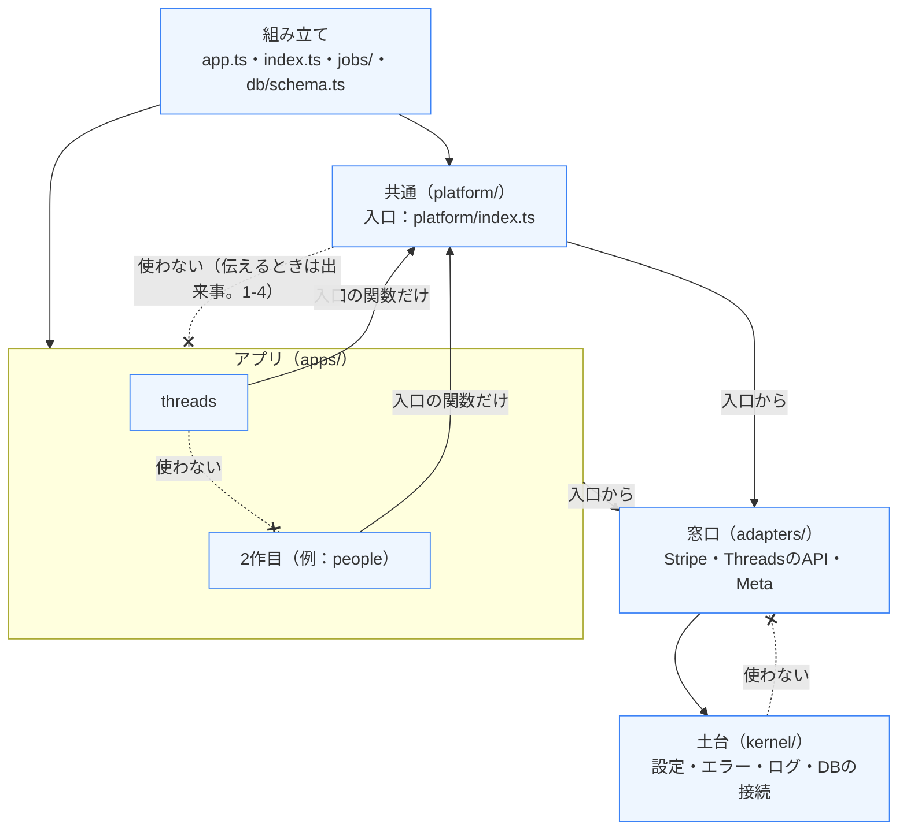

# モジュール地図（API・Web）

**作成**：2026-11-10（specs/027-modular-monolith） | **Webの章**：2026-11-12（specs/028-meguru-shell） | **更新**：2026-11-13（Threadsをパターン①にそろえた。specs/meguru/029-threads-pattern1。集金管理を足した。specs/collect/001-event-day-collection） | **対象**：`apps/api/src`・`apps/web/src`

APIのコード（1〜6章）とWebのコード（7章）を、どのモジュールが持つかを決めた地図。表の持ち主・入口・依存の向き・例外を、ここを正本として管理する。プロダクト全体の形は[docs/product-structure.md](./product-structure.md)、構想の正本は personal-knowledge-base の`Wiki/仕事/システム開発/アイデア/個人開発版Google Workspace構想（スイート型SaaS）.md`。

## 1. 決まり

### 1-1. 5つの種類と依存の向き

| 種類 | 置き場所 | 中身 | 使ってよい相手 |
|---|---|---|---|
| 組み立て（composition） | `src/app.ts`・`src/index.ts`・`src/jobs/`・`src/db/schema.ts` | APIの入口の登録・定期処理の振り分け・モジュールのつなぎこみ | すべて（ほかのモジュールは入口から） |
| アプリ（apps） | `src/apps/<名前>/`（今は`threads`） | アプリ固有の処理・表（アプリ専用のスキーマ）・APIの入口 | 土台・窓口・共通（入口の関数だけ。共通の表の定義は読まない）。**アプリ同士は使わない** |
| 共通（platform） | `src/platform/` | 利用者・契約・利用権・機能のON/OFF・上限・テストのグループ・運営・紹介・退会・出来事・利用の数・アプリの登録 | 土台・窓口。**アプリは使わない**（伝えるときは出来事。1-4） |
| 窓口（adapters） | `src/adapters/<名前>/` | 外部サービスとのやりとり（Stripe・ThreadsのAPI・Metaの署名つきリクエスト）。業務の判断は持たない | 土台 |
| 土台（kernel） | `src/kernel/` | 環境の値と設定・エラー・ログ・入力の確かめ・暗号と識別子のハッシュ・DBの接続とロック | 土台だけ |

```text
組み立て → アプリ → 共通 → 窓口 → 土台   （上から下へだけ。飛ばしてもよい）
```



- 実線の矢印は、使ってよい向き（上から下へ。間を飛ばして、土台を直接使うのもよい）。点線の ✕ は、使ってはいけない向き。ESLint の規則が止める（1-5）。
- アプリ（Threadsを含む）は、これに加えて DB の境界も守る（共通の表を読まない・自分のスキーマにだけ表を置く。[docs/app-separation.md](./app-separation.md) 2-1）。

### 1-2. 入口

- 入口（`index.ts`）は、**共通全体（`platform/index.ts`）・アプリごと（`apps/<名前>/index.ts`）・窓口ごと（`adapters/<名前>/index.ts`）**に1つ。モジュールの直下の`schema.ts`（表の定義）は、ほかのモジュールからは組み立ての`db/schema.ts`だけが読んでよい（共通とThreadsの表を読み直して出すため）。アプリは共通の`schema.ts`を読めず、共通もアプリの`schema.ts`を読めない。
- ほかのモジュールからは入口だけを読む（`../../platform`・`../../adapters/stripe`）。土台は入口なしで、ファイルを直接読んでよい。
- 同じモジュールの中（`platform/`の小分け同士、`apps/threads/`の小分け同士）は自由に読んでよい。共通の中の区切りは、2作目で本当に共通だった部分を取り出すときに見直す。

### 1-3. データの持ち主

- 表には持ち主のモジュールが1つある（2章）。表の定義は持ち主の`schema.ts`に置く。
- 持ち主でないモジュールは、表を読まないし、書き換えない（例外の列は029でなくなった。3章）。ほかのモジュールのデータが要るときは、入口の関数で受け取る。
- アプリの表は共通の表を参照しない（読む・外部キーのどちらも）。利用者のIDを値として持ち、名前や利用権は共通の入口の関数から受け取る。共通の表もアプリの表を参照しない（Threadsと共通の間の外部キーは0本）。
- アプリの表はアプリ専用のスキーマに置く（Threadsは`threads`）。共通の表は`public`。今後マイクロサービスにしていく可能性に備えた決まりで、詳しくは[docs/app-separation.md](./app-separation.md)。

### 1-4. 出来事（共通 → アプリ）

共通で起きたこと（退会など）をアプリに伝えるときは、共通が出来事を出し、アプリがあとから受け取る（`platform/events/events.ts`）。共通は、自分の表の変更と同じトランザクションで送り出しの表（`platform_events`）に書き、書いたあとすぐと、5分ごとの定期処理で、登録された受け取りに届ける。受け取りは、組み立てでアプリの`registerXxx()`を呼んで登録する（中で`registerModule("<名前>", …)`と`registerConsumer`を使い、何度呼んでも1回だけ。Threadsは`apps/threads/register.ts`）。

- 共通とアプリは、1つのトランザクションをまたがない。届くのは少し遅れる（10分以内）。
- 受け取りは、自分のトランザクションの中で出来事のIDを自分の表に記録し、もうあれば何もしない（同じ出来事が2回届いても同じ結果。Threadsは`threads.received_events`）。
- 受け取りが失敗したら、間をあけてやり直す（5分・10分・20分・40分、そのあとは1時間ごと）。10回失敗したら`failed`で止め、`platform_event_deliveries`とログに残す。
- アプリから共通へ伝えるときは、出来事ではなく入口の関数（`reportUsage`など）を呼ぶ。

| 出来事 | 出すところ | Threadsでの受け取り（`apps/threads/events/received-events.ts`） |
|---|---|---|
| `user.withdrawn` | 退会の処理（`platform/withdrawal/withdrawal-service.ts`）。利用者を退会にしたのと同じトランザクション。すべての受け取りが済んだあとで、共通が`users`の行を消す | その人が持ち主のアカウントを消し（テスター招待の片づけ・Metaのデータ削除の要求の完了を含む）、メンバー・チーム・担当から外し、作った人の欄を空にする（`apps/threads/accounts/withdrawal-cleanup.ts`） |
| `limits.changed` | 運営者が上限を保存したとき（`platform/operator/limit-service.ts`）。保存と同じトランザクション | 自動投稿を起こす（`notifyWake`） |

- 027で作った同じトランザクションの「知らせ」（`platform/hooks.ts`）は、029で消した。アカウントを消すとき・開くときの処理は、アカウントがThreadsの持ち物になったので、Threadsの中の処理にした。

### 1-5. 自動のチェック

- ESLintの規則`local/module-boundaries`（`eslint-rules/module-boundaries.js`）が、`apps/api/src`のすべてのファイルで次を止める：①ほかのモジュールの入口でないところ、②共通 → アプリ、③アプリ同士、④窓口・土台から上、⑤アプリ → 共通の表の定義（`platform/schema`。`appToPlatformSchema`）。`import type`・`export … from`・`import("…")`（型の中を含む）・`import x = require("…")`も対象。
- `strictPlacement`を有効にしている：組み立ての場所（`app.ts`・`index.ts`・`jobs/`・`db/schema.ts`）のほかに、どのモジュールにも入っていないファイルがあれば知らせる。
- `pnpm lint`（CIの「lint・型チェック・共通とWeb」）で流れる。規則のテストは`node --test "eslint-rules/*.test.js"`。
- 種類はパスの形で決まる。`src/apps/<名前>/`を作れば、設定を足さなくてもアプリとして当たる。テスト（`apps/api/test`）と`scripts/`にはかけない。

## 2. 表・処理・APIの入口の持ち主

パスは`apps/api/src`から。APIの入口のファイルは`*-routes.ts`。

### 2-1. 共通（platform）

| 小分け | 表 | 処理とAPIの入口 |
|---|---|---|
| `identity/`（利用者） | `users`・`withdrawn_users` | `auth.ts`（認証のミドルウェア・`AppEnv`の型・`allowBeforeSubscribe`・`allowSelfService`）・`me-routes.ts`（`/api/me`・`/api/me/withdrawal-preview`・退会・最後に使ったアプリ。共通の情報だけを返す）・`people.ts`（`currentUser`・`peopleNames`・`peopleProfiles`・`searchPeople`） |
| `entitlement/`（利用権） | — | `entitlement.ts`（`loadAppEntitlement`・`loadAppEntitlements`・`loadAppFeatures`：契約・料金なし・運営者・機能のON/OFF・上限をまとめて返す） |
| `access/`（アプリの利用の許可。specs/meguru/030） | `app_access_grants`・`group_app_access_grants` | `app-access.ts`（使えるかの判定はここだけ：`accessibleApps`・`canUseApp`・道筋の関所`requireAppAccess`）・`app-access-service.ts`（運営者が開く・閉じる）・`operator-app-access-routes.ts`（`PUT /api/operator/app-access/users/:userId`・`/groups/:groupId`） |
| `billing/`（契約と決済） | `subscriptions` | `billing-service.ts`・`billing-routes.ts`・`stripe-webhook-routes.ts` |
| `usage/`（利用の数） | `app_usage` | `usage.ts`（`reportUsage`：アプリが伝える利用の数と使っているか。料金の数と`/api/me`の「使っているアプリ」に使う） |
| `features/`（機能のON/OFF） | `feature_disables`・`group_feature_disables`・`feature_setting_events` | `feature-service.ts`・`feature-sql.ts`・`operator-feature-routes.ts` |
| `test-groups/`（テストのグループ） | `test_groups`・`test_group_members`・`test_group_events` | `test-group-service.ts`・`operator-test-group-routes.ts`・`test-invite-routes.ts` |
| `operator/`（運営と上限） | `operator_events`・`user_app_limits`・`app_limit_defaults` | `limit-service.ts`・`operator-events.ts`・`operator-only.ts`（運営者だけの関所）・`operator-limit-routes.ts` |
| `registry/`（アプリの登録） | — | `registry.ts`（`registerAppFeatures`・`registerAppLimits`）・`modules.ts`（`registerModule`）・`registry-routes.ts`（`GET /api/operator/app-registry`：登録された機能と上限の一覧） |
| `events/`（出来事） | `platform_events`・`platform_event_deliveries` | `events.ts`（`emitEvent`・`registerConsumer`・`deliverPendingEvents`） |
| `referrals/`（紹介） | — | `referral-service.ts`・`referral-routes.ts` |
| `withdrawal/`（退会） | — | `withdrawal-service.ts`（退会の記録と`user.withdrawn`。届いたあとで`users`の行を消す） |
| （直下） | — | `index.ts`（入口。入口の関数と型だけを出し、表の定義とSQLの部品は出さない）・`schema.ts`（17表。スキーマ`public`） |

### 2-2. Threads（apps/threads）

| 小分け | 表 | 処理とAPIの入口 |
|---|---|---|
| `access/`（権限） | — | `access.ts`（`authorizeAccount`：誰がどのアカウントで何をできるか）・`owner.ts`（持ち主の利用権）・`locks.ts`（利用者ごとのロック） |
| `accounts/`（運用するアカウントとメンバー） | `accounts`・`memberships`・`user_states` | `account-service.ts`（作る・名前・消す・数える・上限・最後に開いたアカウント・Metaからのデータ削除でのアカウントの削除`deleteAccountsOfThreadsUser`）・`account-routes.ts`・`usage.ts`（利用の数を数えて`reportUsage`で伝える）・`withdrawal-cleanup.ts`（退会したときの片づけ） |
| `teams/`（チーム・招待） | `teams`・`team_members`・`team_accounts` | `team-service.ts`・`team-status.ts`・`invite-service.ts`・`team-routes.ts`・`account-team-routes.ts`・`invite-routes.ts` |
| `activity/`（活動の記録） | `activity_logs` | `activity-log.ts`・`activity-routes.ts` |
| `connection/`（接続・トークン・Metaの要求） | `threads_connections`・`token_check_failures`・`oauth_states`・`threads_deletion_requests`・`threads_revocations` | `connection-service.ts`（接続の確定・開いたときの確かめ）・`threads-oauth.ts`・`token-connect.ts`・`token-recheck.ts`・`token-refresh.ts`・`username-match.ts`・`threads-credentials.ts`・`revocation.ts`・`threads-check-service.ts`・`data-deletion.ts`（アカウントの削除は`accounts/`の`deleteAccountsOfThreadsUser`）・`threads-connect-routes.ts`・`threads-webhook-routes.ts`・`threads-check-routes.ts`・`data-deletion-routes.ts` |
| `strategy/`（戦略・宣伝・リサーチ） | `strategy_designs`・`promotions`・`reference_posts`・`research_keywords` | `strategy-service.ts`・`profile-status.ts`・`materials.ts`・`item-service.ts`・`strategy-routes.ts`・`promotion-routes.ts`・`research-routes.ts` |
| `drafts/`（投稿の案・確かめる・投稿ルール） | `draft_batches`・`post_drafts`・`ng_words` | `draft-service.ts`・`review-service.ts`・`posting-rules-service.ts`・`account-review-counts.ts`・`post-draft-routes.ts`・`posting-rule-routes.ts`・`needs-review-count-routes.ts`（`GET /api/threads/me/needs-review-counts`） |
| `publish/`（予約と自動投稿） | `posting_schedules`・`publish_attempts` | `posting-schedule-service.ts`・`auto-post-runner.ts`・`auto-post-gate.ts`・`auto-post-status.ts`・`publish-claim.ts`・`publish-executor.ts`・`publish-cleanup.ts`（毎日の片づけ）・`slot-minutes.ts`（投稿に使う時刻）・`posting-schedule-routes.ts`・`auto-post-routes.ts` |
| `metrics/`（数字の取得・分析） | `post_metrics`・`post_metric_snapshots`・`follower_snapshots`・`analysis_settings`・`post_classifications` | `metrics-runner.ts`・`performance-service.ts`・`analysis-service.ts`・`prompt-service.ts`・`performance-routes.ts`・`analysis-routes.ts`・`prompt-routes.ts` |
| `mention/`（時間差のメンション） | `mention_settings`・`mention_people`・`post_mentions` | `mention-runner.ts`・`mention-service.ts`・`mention-view.ts`・`mention-routes.ts` |
| `external-media/`（外部媒体） | `promotion_listings`・`media_defaults` | `external-media-service.ts`・`external-media-routes.ts` |
| `tester-invites/`（テスター招待） | `tester_applications`・`settings`（テスター招待の枠の数） | `tester-application-service.ts`・`tester-application-routes.ts`・`operator-tester-invite-routes.ts` |
| `operator/`（運営のアカウント一覧） | — | `operator-account-service.ts`（Threadsの接続とテスター招待を見せるため）・`operator-account-routes.ts` |
| `me/`（Threadsの「自分」） | — | `threads-me.ts`（`GET /api/threads/me`・`GET /api/threads/me/withdrawal-preview`） |
| `events/`（出来事の受け取り） | `received_events` | `received-events.ts`（`user.withdrawn`・`limits.changed`の受け取り。1-4） |
| （直下） | — | `index.ts`（入口）・`schema.ts`（34表。スキーマ`threads`）・`register.ts`（`registerThreads()`：機能・上限・出来事の受け取りの登録）・`registry.ts`（アプリの番号・機能と上限の名前） |

### 2-2b. 集金管理（apps/collect）

パターン①の最初の2作目（specs/collect/001-event-day-collection）。運営者が開いた人だけが使う（`registerAppAccess("collect", "granted")`。specs/meguru/030-app-access）。道筋はすべて`/api/collect`の下で、ログインと利用の許可の関所（`access.ts`の`collectOwner`）を付ける。今は PR1 の分（イベント・料金の区分・名簿・既定値）。

| 小分け | 表 | 処理とAPIの入口 |
|---|---|---|
| `events/`（イベント・料金の区分） | `events`・`price_tiers` | `event-service.ts`・`event-routes.ts` |
| `roster/`（名簿・前回の参加者） | `roster_people` | `roster-service.ts`（受付番号は`events.next_number`から取る）・`past-attendees.ts`・`roster-routes.ts` |
| `settings/`（主催者の既定値） | `owner_settings` | `settings-service.ts`（PayPayのQRの画像・振込先の案内）・`settings-routes.ts` |
| `me/`（集金管理の「自分」） | — | `collect-me.ts`（`GET /api/collect/me`） |
| `usage/`（利用の値） | — | `usage.ts`（料金の数は0、イベントがあれば「使っている」を`reportUsage`で伝える。毎日の数え直し） |
| `inbox/`（出来事の受け取り） | `received_events` | `received-events.ts`（`user.withdrawn`：その主催者のデータをすべて消す） |
| （直下） | — | `index.ts`（入口）・`schema.ts`（5表。スキーマ`collect`）・`access.ts`（関所とイベントの持ち主の確かめ）・`register.ts`（`registerCollect()`：利用の決まりと出来事の受け取りの登録） |

### 2-2c. 人物メモ（apps/people）

specs/people/001-people-memo。運営者が開いた人だけが使える（`registerAppAccess("people", "granted")`）。道筋は`/api/people`の下で、すべてログインと`requireAppAccess("people")`を通る。

| 小分け | 表 | 処理とAPIの入口 |
|---|---|---|
| `events/`（イベント） | `events` | `event-service.ts`（作る・直す・一覧・数字・来た人・消す。参加者数は毎回数える）・`event-routes.ts` |
| `imports/`（取り込み） | `imports`・`column_mappings`・`choice_mappings`・`responses`・`erased_responses` | `mapping.ts`（列と同意の選択肢の対応・覚える）・`classify.ts`（行の判定・二重の印）・`candidates.ts`（同じ人の候補）・`import-service.ts`（プレビューと書く）・`undo.ts`（取り消し・イベントを消すときの取り消し）・`import-routes.ts` |
| `persons/`（人） | `persons`・`manual_attendances`・`consent_changes`・`erased_attendances` | `person-derive.ts`（今のLINE名と同意を決め直す） |
| `me/`（人物メモの「自分」） | — | `me-routes.ts`（`GET /api/people/me`） |
| `inbox/`（出来事の受け取り） | `received_events` | `withdrawal.ts`（`user.withdrawn`の受け取り） |
| （直下） | — | `index.ts`（入口）・`schema.ts`（11表。スキーマ`people`）・`register.ts`（`registerPeople()`）・`registry.ts`（アプリの番号）・`access.ts`（持ち主の確かめ・作り手のロック）・`usage.ts`（`reportUsage`。数はいつも0）・`routes.ts`（`/api/people`の関所と道筋） |

共通17表（`public`）＋Threads34表（`threads`）＋集金管理5表（`collect`）＋人物メモ11表（`people`）＝67表（`db/schema.ts`がまとめて出す）。共通とアプリの間、アプリ同士の外部キーは0本。

### 2-3. 窓口（adapters）

| 窓口 | ファイル |
|---|---|
| `adapters/stripe/` | `index.ts`・`stripe-client.ts` |
| `adapters/threads-api/` | `index.ts`・`threads-client.ts`・`signed-request.ts` |

### 2-4. 土台（kernel）

`config.ts`・`env.ts`・`errors.ts`・`logger.ts`・`validate.ts`・`crypto.ts`・`identifier-hash.ts`・`invite-token.ts`（招待のトークンの部品。Threadsのチームと共通のテストのグループ・紹介が使う）・`db/client.ts`（DBの接続。表の定義は渡さない）・`db/locks.ts`・`db/columns.ts`（表の定義の共通の部品）

### 2-5. 組み立て（composition）

| ファイル | 役割 |
|---|---|
| `app.ts` | APIの入口の登録。初めに`registerThreads()`・`registerCollect()`・`registerPeople()`を呼ぶ。ThreadsのAPIは`/api/threads`、集金管理は`/api/collect`、人物メモは`/api/people`の下にまとめてつなぐ |
| `index.ts` | Workersの入口（`fetch`・`scheduled`）。定期処理の初めに`registerThreads()`・`registerCollect()`・`registerPeople()`を呼ぶ。5分ごとの回では、出来事の届け（`deliverPendingEvents`）と自動投稿を同時に動かす |
| `jobs/daily-jobs.ts` | 毎日の処理（共通の退会のやり直し・届いた出来事の片づけと、Threadsのトークンの更新・片づけ・利用の数の数え直しなど）。各モジュールの入口の関数を順に呼ぶだけ。初めに`registerThreads()`・`registerCollect()`・`registerPeople()`を呼ぶ |
| `jobs/key-rotation.ts` | 暗号の鍵の入れ替え（`scripts/rotate-token-key.ts`から使う）。共通（テストのグループの招待のトークン）とThreads（接続のトークン・チームの招待のトークン）の両方の表を書き換えるので、組み立てに置く |
| `db/schema.ts` | 共通・Threads・集金管理・人物メモの`schema.ts`を読み直して出すだけ（drizzle-kitとテスト用） |

## 3. 例外：持ち主でないモジュールが書き換えてよい列

今は**ない**。029で、`accounts`をThreadsの持ち物にし、`operator_settings.tester_slot_capacity`をThreadsの`threads.settings`へ移した（`operator_settings`は消し、上限の既定の値は`app_limit_defaults`へ移した）ので、027で書いていた例外の列はなくなった。

- 例外は、組み立ての`jobs/key-rotation.ts`だけ（暗号の鍵の入れ替えのため、共通とThreadsの両方の表を書き換える。2-5）。
- ESLintでは列までは止められない。新しく例外が要るときは、ここに表・書き換えるモジュール・列・理由を書いて、レビューで確かめる。

## 4. 境界の例外

ESLintで止められる違反は0件にする。今すぐ直せないものは、ここに理由とともに書く（5件以下）。

| 場所 | 内容 | 理由 | 解消の予定 |
|---|---|---|---|
| （なし） | — | — | — |

- 027で書いていた例外（`operator_events.application_id`の外部キーのために、`platform/schema.ts`がThreadsの`tester_applications`を読む）は、029で外部キーを外して値だけにしたので、なくなった。

## 5. 027での並べ替えの記録

- 2026-11-10、027のPR2で、このとおりに並べ替えた。動きは変えていない（テストの数・`db:generate`で変更なし・APIの入口の一覧（`apps/api/test/repo/routes.snapshot.txt`）が同じ）。
- 逆向きの依存の解消：接続の処理（`completeConnection`・`verifyConnection`）と確かめ待ちの件数の入口はThreadsへ移し、残りは1-4の知らせにした。
- DBの接続（`kernel/db/client.ts`）には表の定義を渡さないようにした（`db.query`のリレーションの問い合わせは使っていない。土台が表の定義に依存しないため）。
- 境界の規則は`strictPlacement`を有効にした。
- 029（2026-11-13）で、上の知らせは出来事と入口の関数に置き換え、`accounts`・チーム・権限・活動の記録をThreadsへ移した（1-4・2章）。

## 6. アプリのモジュールを足す手順

2作目（例：`people`）を足すときの手順。パターン①（[docs/app-separation.md](./app-separation.md)）で作り、Threadsを実例にしてなぞる。

1. `apps/api/src/apps/<名前>/`を作り、次を置く。
   - `schema.ts`：そのアプリの表。`pgSchema("<名前>")`でアプリ専用のスキーマに置き、共通の表（`platform/schema`）は参照しない。利用者のIDは`user_id`に値として持つ（外部キーなし。[docs/app-separation.md](./app-separation.md) 4）。共通の部品は`../../kernel/db/columns`。受け取った出来事の表（`received_events`）も置く（Threads：`apps/threads/schema.ts`）。
   - 小分けのフォルダー（処理と`*-routes.ts`）。
   - `registry.ts`：アプリの番号と、機能・上限の名前・表示名・範囲（Threads：`apps/threads/registry.ts`）。
   - `register.ts`：`registerXxx()`。`registerModule("<名前>", …)`の中で、`registerAppFeatures`・`registerAppLimits`・`registerConsumer`を呼ぶ（Threads：`apps/threads/register.ts`の`registerThreads()`）。
   - `index.ts`：組み立てが使うもの（APIの入口を作る関数・`registerXxx()`・定期処理の関数）だけを出す。
2. 共通は`../../platform`（入口）の関数からだけ使う（`currentUser`・`loadAppEntitlement(s)`・`loadAppFeatures`・`peopleNames`など。共通の表の定義は読まない。ESLintが止める）。運営者が開いた人だけに使わせるアプリは、組み立てで`registerAppAccess("<名前>", "granted")`を呼び、アプリの道筋に`requireAppAccess("<名前>")`を付ける（使えない人は403 `APP_NOT_AVAILABLE`。`loadAppEntitlement(s)`も`access: "none"`を返す。specs/meguru/030-app-access）。登録しないアプリはだれでも使える。Threadsのモジュールは使わない（ESLintが止める）。
3. 共通の出来事（少なくとも退会の`user.withdrawn`）を受け取る。受け取りは、自分のトランザクションの中で出来事のIDを`received_events`に記録し、もうあれば何もしない。退会なら、その人のデータを消す（Threads：`apps/threads/events/received-events.ts`・`accounts/withdrawal-cleanup.ts`）。
4. 料金の数・使っているかが変わるたびに、自分のトランザクションのあとで`reportUsage`を呼ぶ。ずれに備えて、毎日の処理でも数え直して伝える（Threads：`apps/threads/accounts/usage.ts`と、`jobs/daily-jobs.ts`の`recountThreadsUsage`）。
5. `apps/api/src/db/schema.ts`に`export * from "../apps/<名前>/schema";`を足し、`pnpm --filter api db:generate`でマイグレーションを作る。できたSQLを読み、スキーマを作る文があることを確かめる。
6. `apps/api/src/app.ts`で、入口のAPIの関数を`/api/<名前>`の下につなぐ（Threads：`threadsApi`を`.route("/threads", …)`）。アプリの「自分」の情報は`/api/<名前>/me`から返し、共通の`/api/me`には足さない（Threads：`apps/threads/me/threads-me.ts`）。`registerThreads()`と同じ場所（`app.ts`・`index.ts`・`jobs/daily-jobs.ts`）で`registerXxx()`を呼ぶ。
7. 入口を足したら`pnpm --filter api routes:snapshot`で一覧を書き直す。
8. この地図の2章に、表と処理を足す。

- ESLintの規則は、`apps/<名前>/`の形から自動でアプリとして当たる（設定は要らない）。
- 出来事の種類を足すときは、`platform/events/events.ts`の型に足し、名前を`platform_events.type`の`CHECK`の形（`user.withdrawn`のような「まとまり.こと」）に合わせる。中身に入れるのは番号だけ。
- `workspaces`・アプリごとの契約（まとめ買い）などスイート向けの表は、2作目で本当に共通だった部分を取り出すときに考える（[docs/product-structure.md](./product-structure.md) 7）。

## 7. Webの境界（specs/028）

Webのコード（`apps/web/src`）を、外枠（めぐるの共通の画面の枠）とアプリに分けた。APIの1〜6章と同じ考え方で、種類・入口・依存の向きをESLintで守る。

### 7-1. 4つの種類と依存の向き

| 種類 | 置き場所 | 中身 | 使ってよい相手 |
|---|---|---|---|
| 組み立て | `main.tsx`・`router.tsx`・`app-registry.ts` | 出せるアプリの一覧（`registeredApps`）を作り、外枠の`buildRoutes`に渡してルーターを組む | すべて（外枠とアプリは入口から） |
| アプリ | `apps/<名前>/`（今は`threads`） | アプリの画面・ルート・サイドバーの中身・アプリでだけ使う部品 | 外枠の入口（`shell/index.ts`）・共通の部品。**アプリ同士は使わない** |
| 外枠 | `shell/` | 画面の骨格（サイドバーの枠・アプリの切り替え・ユーザーメニュー・上部バー）・入口の振り分け（`/`）・すべてのアプリ（`/apps`）・共通の設定（`/settings`）・ログインのいらない共通のページ・関所（ログイン・契約・退会・テスト版） | 共通の部品。**アプリは使わない**（アプリの一覧は組み立てから受け取る） |
| 共通の部品 | `components/`・`lib/` | 見た目の部品（`components/ui`）・共通のAPIの呼び出し（`lib/api-client.ts`）・書式・保存のエラー・確認のダイアログ・契約の帯など | 共通の部品だけ |

```text
組み立て → アプリ → 外枠の入口 → 共通の部品
組み立て → 外枠 ─────────────→ 共通の部品
```

- 外枠からアプリへは読まない。アプリが外枠に渡すものは`AppModule`（`shell/app-module.ts`）にまとめ、組み立てが一覧にして`buildRoutes(apps)`に渡す。外枠はルートのいちばん外の`AppRegistryProvider`で一覧を配る。
- アプリのサイドバーの中身（頭・中身・下の項目＝`AppSidebar`）は、アプリの画面の枠が`AppShell`の`sidebar`に渡す（Threadsは`ThreadsShell`）。
- 同じ種類の中（外枠の中、同じアプリの中、共通の部品の中）は自由に読んでよい。

### 7-2. 自動のチェック

- ESLintの規則`local/web-module-boundaries`（`eslint-rules/web-module-boundaries.js`）が、`apps/web/src`のすべてのファイルで次を止める：①アプリ同士、②外枠 → アプリ（入口も）、③アプリ → 外枠の入口でないところ、④共通の部品 → 外枠・アプリ・組み立て、⑤外枠・アプリ → 組み立て、⑥組み立て → 入口でないところ、⑦どの種類にも入らない場所のファイル（`strictPlacement`）。
- 読みこみ先は、別名（`@/…`）と相対パスの両方を`src`からのパスに直して判定する。型の宣言（`.d.ts`）は置き場所を問わない。
- 種類はパスの形で決まる。`apps/<名前>/`を作れば、設定を足さなくてもアプリとして当たる。テスト（`apps/web/test`）にはかけない。

### 7-3. 主な置き場所

| モジュール | 主な中身 |
|---|---|
| `shell/` | `app-module.ts`（`AppModule`・`AppRegistryProvider`・`useCurrentApp`・`useEntryAppHome`・`defineWithdrawalPreview`）・`routes.tsx`（`buildRoutes`）・`layout/`（`AppShell`・サイドバーの枠・`AppSwitcher`・`UserMenu`・`PageHeader`・`EnvBanner`）・`pages/`（入口の振り分け・すべてのアプリ・前のURLの転送・ログイン・利用規約・特定商取引法の表記・テスト用のグループの招待・紹介・見つかりません）・`settings/`（共通の設定。退会のダイアログ`WithdrawDialog.tsx`は、アプリの`withdrawalPreview`を並べて出す。運営の機能・上限・グループの画面は、名前と範囲を`GET /api/operator/app-registry`の一覧から出す）・`guards/`（関所）・`lib/`（`seller-info`・`use-last-app`） |
| `apps/threads/` | `index.ts`（`threadsApp`）・`routes.tsx`・`sidebar/`（アカウントの切り替え・機能の一覧・チーム・`ThreadsShell`）・`pages/`（アカウント・チーム・接続から戻る画面・チームの招待・トークンの作り方・データ削除の確認・運営の「テスター招待」「アカウント一覧」）・`components/`・`lib/`（`api.ts`の`threadsApi`・`query-keys.ts`の`threadsQueryKeys`・`use-threads-me.ts`の`useThreadsMe`（`/api/threads/me`）・`paths.ts`・`use-account-access` など） |
| `apps/people/` | `index.ts`（`peopleApp`）・`routes.tsx`・`shell/`（`PeopleShell`：サイドバーの中身と、767px以下の下のバー）・`pages/`（ホーム・取り込み・イベント）・`components/`（取り込みの段・同じ人の候補のカード）・`lib/`（`api.ts`・`query-keys.ts`・`paths.ts`・`read-csv-file.ts`） |
| `components/`・`lib/` | `components/ui`・`ApiErrorScreen`・`LoadingSkeleton`・`FeatureUnavailableNotice`・`ConfirmDialog`・`billing/`・`lib/api-client.ts`・`query.ts`（どちらも共通のAPIだけ）・`feature-defs.ts`・`limit-defs.ts`（運営の画面が使う登録の一覧）・`home-link.ts`・`invite-return.ts`・`referral-store.ts`・`use-logout.ts` など |

### 7-4. URLの決まり

- アプリの画面は、自分のパスの下に置く（Threadsは`/threads/…`）。パスは`@meguru/shared`のアプリの一覧（`APP_CATALOG`）の`basePath`とそろえる。
- 前のURL（`/accounts/…`・`/teams/…`）は、アプリの`legacyRedirects`で`/threads/…`へ転送する（ログインの関所の外。少なくとも次の外枠のfeatureまで残す）。
- ログインのいらないページも、2作目からはアプリのパスの下に置く。

### 7-5. 境界の例外とこれから

- ESLintで止める違反の例外は0件。
- **Threadsの例外（URL）**：Metaに登録した・外部に配ったURL（`/invite/:token`・`/guide/threads-token`・`/data-deletion/:code`）は、Threadsのパスの外に今のまま置く。
- **APIの呼び出しの置き場所**：Threadsの呼び出しとキーは、029で`apps/threads/lib/`（`api.ts`・`query-keys.ts`）へ移した。共通の`lib/api-client.ts`・`lib/query.ts`にはThreadsの道筋とキーを置かない（`apps/web/test/api-client-common.test.ts`が確かめる）。2作目の呼び出しも`apps/<名前>/lib/api.ts`に置く。
- **使っているアプリの判定**：`/api/me`の`apps.using`は、アプリが`reportUsage`で伝えた「使っているか」（`app_usage`）から決める（029）。Threadsは、開けるアカウントがあるか、チームに入っていれば「使っている」と伝える。
- **退会の確かめ**：外枠の退会のダイアログは、アプリを読まない。アプリは消えるデータの見せ方を`AppModule`の`withdrawalPreview`（`defineWithdrawalPreview`で作る）で渡す（Threads：`apps/threads/index.ts`。`/api/threads/me/withdrawal-preview`を読む）。
- **共通のパッケージ**：`@meguru/shared`の中身は分けていない。2作目のものは`packages/shared/src/apps/<名前>/`に置き、`@meguru/shared/<名前>`で読む（`package.json`の`exports`に足す）。Threads固有のものは`packages/shared/src/apps/threads/`へ移し始めた（029で`FEATURES`・`FEATURE_LABELS`・`threadsMeResponseSchema`・`threadsWithdrawalPreviewSchema`）。残りのThreads固有のもの（投稿・戦略・分析など）は移す候補。

### 7-6. Webにアプリを足す手順

1. `packages/shared/src/apps.ts`の`APP_CATALOG`に1行足す（ID・名前・パス・説明・料金・`released: false`）。
2. `apps/web/src/apps/<名前>/`を作り、`index.ts`で`AppModule`を出す（`id`・`basePath`・`icon`・`startPath`・`routes`。ルートは`/<名前>/…`の下）。画面の枠は`AppShell`に自分のサイドバーの中身（`AppSidebar`）を渡す。
3. `apps/web/src/app-registry.ts`の一覧に1行足す（**外枠のほかの場所は直さない**）。
4. APIは6章の手順で`apps/api/src/apps/<名前>/`に足す（`reportUsage`で「使っているか」を伝えれば、`/api/me`の`apps.using`に入る）。画面からのAPIの呼び出しとキーは`apps/<名前>/lib/`に置き、退会の確かめに出す中身があれば`withdrawalPreview`を渡す。
5. 業務の判断とデータのやりとりは、APIと`@meguru/shared`に置く。Webの画面やブラウザだけで動く仕組みに閉じこめない（モバイル化を見込んだ決まり。Constitutionの技術スタック制約）。
6. 出してよくなったら`released: true`にする。

## 8. この文書の更新

- モジュール・表・処理を足す・移すときは、同じPRでこの地図を直す。
- 種類・依存の向き・共通とアプリの分担を変えたら、[docs/product-structure.md](./product-structure.md)も直す。
