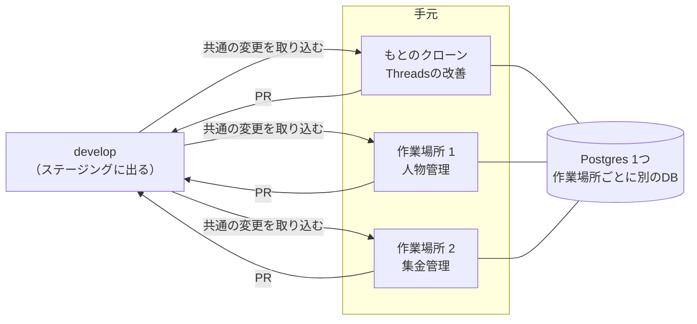

# 並行開発の手順

**作成**：2026-11-12 | **対象**：Threadsの改善・人物管理・集金管理などを、Claude Codeのセッションを分けて同時に進めるとき

手元で作業場所（`git worktree`）を分け、作業場所ごとにClaude Codeを1つずつ動かす。決まり（なぜそうするか）は[docs/product-structure.md](./product-structure.md) 6、2作目からの作り方は[docs/app-separation.md](./app-separation.md)、1つの機能の中でスキルを使う順番は[docs/ai-skills.md](./ai-skills.md)。

## 1. 全体の形

| セッション | 作業場所 | ブランチ・仕様 | ローカルのDB・ポート |
|---|---|---|---|
| Threadsの改善 | もとのクローン（`meguru-app`） | `feature/threads-NNN-…`・`specs/threads/NNN-…`（029から） | `threads_grower`・Web 5173・API 8787 |
| 人物管理 | `../meguru-app-<名前>`（`pnpm worktree:new`で作る） | `feature/<アプリ>-NNN-…`・`specs/<アプリ>/NNN-…`（001から） | `threads_grower_<名前>`・Web 5273・API 8887 |
| 集金管理 | `../meguru-app-<名前>` | 同上 | `threads_grower_<名前>`・Web 5373・API 8987 |

- `<アプリ>`はアプリのID（`@meguru/shared`の`APP_CATALOG`の`id`）。新しいアプリのIDとスキーマ名は、そのアプリの最初の仕様で決める。共通の料金の機能（`platform/billing`）と紛らわしい名前は避ける。
- 外枠や共通（どのアプリにも属さないもの）の仕様は`specs/meguru/NNN-…`（029から）。
- ポートは、作った順に100ずつずれる。`pnpm worktree:list`で確かめられる。



## 2. はじめに一度だけ

1. もとのクローンで、ふだんの開発ができる状態にしておく（README「開発環境の用意」。`apps/api/.dev.vars`・`apps/web/.env.local`・`e2e/.env.local`）。作業場所は、これらを写して作る。
2. OrbStack（Docker）を起動し、`docker compose up -d`でDBを動かしておく。

## 3. 作業場所を作る

もとのクローンで動かす。

```bash
pnpm worktree:new people                # 作業場所 ../meguru-app-people（ブランチは feature/people。develop の最新から）
pnpm worktree:new people feature/people-001-contacts   # ブランチの名前を決めて作るとき
cd ../meguru-app-people && claude       # その作業場所で Claude Code を開く
```

- 作るときに、その作業場所のDBを作ってマイグレーションを当て、手元の設定ファイルを写してDBとポートを書き換え、`pnpm install`まで済ませる（README「手元で同時に進める」）。
- Claude Codeを開いたら、最初に**どのアプリの担当か**を伝える（例：「このセッションは人物管理を進めます」）。

## 4. 1つの機能を進める

どの作業場所でも同じ流れ。

1. **ブランチを作る**。`develop`の最新から切る。

   ```bash
   git fetch origin
   git switch -c feature/people-001-contacts origin/develop
   ```

   `git switch develop`は使わない。`develop`はほかの作業場所が使っていることがあり、同じブランチは2つの作業場所で同時に開けないため。
2. **仕様を書く**。`/speckit-specify`で`specs/<アプリ>/NNN-…`に置く。番号は、`develop`と作業中のブランチの`specs/<アプリ>/`の最大の番号の次（[product-structure.md](./product-structure.md) 6）。そのあとは[ai-skills.md](./ai-skills.md)の順に、計画・タスク・実装まで進める。
3. **自分のフォルダの中で作る**。人物管理なら`apps/api/src/apps/<アプリ>/`・`apps/web/src/apps/<アプリ>/`・`specs/<アプリ>/`。ほかのアプリのフォルダには触らない。
4. **PRを出す**（[release-runbook.md](./release-runbook.md) 2）。下書きで出す → セルフレビュー → コードを変えたPRだけ`run-ci`でCI → Ready for review → Codexのレビュー → ユーザーがマージを決める。
5. **ステージングで確かめる**。マージすると`develop`がステージングに出る（文書だけのPRでは出ない）。

## 5. 共通を直すとき・develop を取り込むとき

- 共通（`platform/`・Webの外枠・`@meguru/shared`の共通の部分）を直す必要が出たら、**アプリの機能のPRに混ぜず、小さなPRに分けて先に`develop`へ入れる**。仕様が要るなら`specs/meguru/NNN-…`。
- ほかのセッションの変更が`develop`に入ったら、作業中のブランチに取り込む。

  ```bash
  git fetch origin
  git merge origin/develop
  pnpm install                     # 依存が変わっていることがある
  pnpm --filter api db:migrate     # マイグレーションが増えていることがある
  ```

- ぶつかったら、ほかのアプリのフォルダの変更は相手の側を取る。共通の変更がぶつかったら、そのセッションで直さず、ユーザーに相談する。

## 6. マイグレーションがぶつかったとき

2つのセッションで同時にマイグレーションを作ると、同じ番号になる。**先に`develop`へ入った方がその番号を使い、後の方が作り直す**（番号を手で直さない）。

1. `develop`を取り込む（5章）。
2. 自分のブランチで作ったマイグレーションを消す。`apps/api/drizzle/`の自分のSQL、`meta/`の自分のスナップショット、`meta/_journal.json`の自分の行を、`develop`の状態に戻す。
3. 作り直す：`pnpm --filter api db:generate`。できたSQLを読んでからコミットする。
4. その作業場所のDBには前のマイグレーションが当たっているので、作り直す：`pnpm worktree:reset-db --yes`（その作業場所のDBの中身はすべて消える）。

## 7. テストを流すとき

- 共通とWebのテスト（`pnpm --filter web test`など）は、いつでも流せる。
- **結合テスト（`pnpm --filter api test`）とE2E（`pnpm e2e`）は、作業場所をまたいで1つずつ流れる**。ほかの作業場所で流れているときは「終わるまで待ちます…」と出て、終わってから始まる。止まっているのではない。
- 作業場所ごとにDBが分かれているので、テストがほかの作業場所のデータを消すことはない。

## 8. 終わったとき

1. その作業場所のPRがすべてマージされたら、もとのクローンで片付ける。

   ```bash
   pnpm worktree:remove people      # 作業場所とそのDBを消す（コミットしていない変更があると止まる）
   ```

2. マージ済みのブランチは消す（手元は`git branch -d <ブランチ>`、GitHubは`git push origin --delete <ブランチ>`）。

続けて同じアプリを進めるなら、作業場所は消さずに、4章の1から次の機能のブランチを切る。

## 9. 気をつけること

- **本物のThreads（Meta）の接続は、もとのクローンで試す**。Metaに登録した戻り先（Cloudflare Tunnel → `localhost:8787`）がもとのクローンを向いているため。作業場所では偽のThreads（`pnpm dev:fake`）を使う。
- もとのクローンの手元の設定ファイルを変えても、作業場所には写らない。作り直すか、作業場所の側も手で直す。
- セッションをまたいで守る決まりは、Claude Codeのメモリーではなくリポジトリの文書に書く（どのセッションからも同じものが読めるように）。
- 作業場所を消すと、その中のコミットしていない変更も消える。
