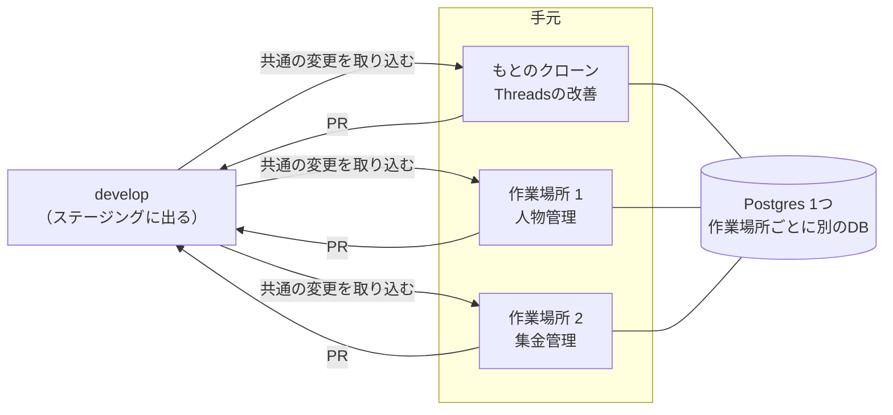

# 並行開発の手順

**作成**：2026-11-12 | **対象**：Threadsの改善・人物管理・集金管理などを、Claude Codeのセッションを分けて同時に進めるとき

手元で作業場所（`git worktree`）を分け、作業場所ごとにClaude Codeを1つずつ動かす。決まり（なぜそうするか）は[docs/product-structure.md](./product-structure.md) 6、2作目からの作り方は[docs/app-separation.md](./app-separation.md)、1つの機能の中でスキルを使う順番は[docs/ai-skills.md](./ai-skills.md)。

## 1. 全体の形

| セッション | 作業場所 | ブランチ・仕様 | ローカルのDB・ポート |
|---|---|---|---|
| Threadsの改善 | もとのクローン（`meguru-app`） | `feature/threads-NNN-…`・`specs/threads/NNN-…`（029から） | `threads_grower`・Web 5173・API 8787 |
| 人物管理 | `../meguru-app-<名前>`（`pnpm worktree:new`で作る） | `feature/<アプリ>-NNN-…`・`specs/<アプリ>/NNN-…`（001から） | `threads_grower_<名前>`・Web 5273・API 8887 |
| 集金管理 | `../meguru-app-<名前>` | 同上 | `threads_grower_<名前>`・Web 5373・API 8987 |

- `<アプリ>`はアプリのID（`@meguru/shared`の`APP_CATALOG`の`id`）。新しいアプリのIDとスキーマ名は、そのアプリの最初の仕様で決める。共通の料金の機能（`platform/billing`）と紛らわしい名前は避ける。
- 外枠や共通（どのアプリにも属さないもの）の仕様は`specs/meguru/NNN-…`（029から）。
- ポートは、作った順に100ずつずれる。`pnpm worktree:list`で確かめられる。
- **029のあとの進め方**（2026-11-13）：029（Threadsをパターン①にそろえる。`specs/meguru/029-threads-pattern1`）の間は、Threadsの改善を止め、人物管理・集金管理は仕様と計画（文書）までにしていた。029を終えたので、Threadsの改善を再開してよく、人物管理・集金管理も実装を始めてよい。新しいアプリは、Threadsを実例にしてパターン①で作る（[app-separation.md](./app-separation.md) 5章・[module-map.md](./module-map.md) 6章）。



## 2. はじめに一度だけ

1. もとのクローンで、ふだんの開発ができる状態にしておく（README「開発環境の用意」。`apps/api/.dev.vars`・`apps/web/.env.local`・`e2e/.env.local`）。作業場所は、これらを写して作る。
2. OrbStack（Docker）を起動し、`docker compose up -d`でDBを動かしておく。

## 3. 作業場所を作る

もとのクローンで動かす。

```bash
pnpm worktree:new people                # 作業場所 ../meguru-app-people（ブランチは feature/people。develop の最新から）
pnpm worktree:new people feature/people-001-contacts   # ブランチの名前を決めて作るとき
cd ../meguru-app-people && claude       # その作業場所で Claude Code を開く
```

- 作るときに、その作業場所のDBを作ってマイグレーションを当て、手元の設定ファイルを写してDBとポートを書き換え、`pnpm install`まで済ませる（README「手元で同時に進める」）。
- Claude Codeを開いたら、最初に**どのアプリの担当か**を伝える（例：「このセッションは人物管理を進めます」）。

## 4. 1つの機能を進める

どの作業場所でも同じ流れ。

1. **ブランチを作る**。`develop`の最新から切る。

   ```bash
   git fetch origin
   git switch -c feature/people-001-contacts origin/develop
   ```

   `git switch develop`は使わない。`develop`はほかの作業場所が使っていることがあり、同じブランチは2つの作業場所で同時に開けないため。
2. **仕様を書く**。`/speckit-specify`で`specs/<アプリ>/NNN-…`に置く。番号は、`develop`と作業中のブランチの`specs/<アプリ>/`の最大の番号の次（[product-structure.md](./product-structure.md) 6）。そのあとは[ai-skills.md](./ai-skills.md)の順に、計画・タスク・実装まで進める。
3. **自分のフォルダの中で作る**。人物管理なら`apps/api/src/apps/<アプリ>/`・`apps/web/src/apps/<アプリ>/`・`specs/<アプリ>/`・`docs/apps/<アプリ>.md`。ほかのアプリのフォルダには触らない。共通の場所は11章の一覧だけを触る。
4. **PRを出す**（[release-runbook.md](./release-runbook.md) 2）。下書きで出す → セルフレビュー → コードを変えたPRだけ`run-ci`でCI → Ready for review → Codexのレビュー → ユーザーがマージを決める。
5. **ステージングで確かめる**。マージすると`develop`がステージングに出る（文書だけのPRでは出ない）。

## 5. 共通を直すとき・develop を取り込むとき

- 共通（`platform/`・Webの外枠・`@meguru/shared`の共通の部分）を直す必要が出たら、**アプリの機能のPRに混ぜず、小さなPRに分けて先に`develop`へ入れる**。仕様が要るなら`specs/meguru/NNN-…`。
- ほかのセッションの変更が`develop`に入ったら、作業中のブランチに取り込む。

  ```bash
  git fetch origin
  git merge origin/develop
  pnpm install                     # 依存が変わっていることがある
  pnpm --filter api db:migrate     # マイグレーションが増えていることがある
  ```

- ぶつかったら、ほかのアプリのフォルダの変更は相手の側を取る。共通の変更がぶつかったら、そのセッションで直さず、ユーザーに相談する（11章）。

## 6. マイグレーションがぶつかったとき

2つのセッションで同時にマイグレーションを作ると、同じ番号になる。**先に`develop`へ入った方がその番号を使い、後の方が作り直す**（番号を手で直さない）。

1. `develop`を取り込む（5章）。
2. 自分のブランチで作ったマイグレーションを消す。`apps/api/drizzle/`の自分のSQL、`meta/`の自分のスナップショット、`meta/_journal.json`の自分の行を、`develop`の状態に戻す。
3. 作り直す：`pnpm --filter api db:generate`。できたSQLを読んでからコミットする。
4. その作業場所のDBには前のマイグレーションが当たっているので、作り直す：`pnpm worktree:reset-db --yes`（その作業場所のDBの中身はすべて消える）。

## 7. テストを流すとき

- 共通とWebのテスト（`pnpm --filter web test`など）は、いつでも流せる。
- **結合テスト（`pnpm --filter api test`）とE2E（`pnpm e2e`）は、作業場所をまたいで1つずつ流れる**。ほかの作業場所で流れているときは「終わるまで待ちます…」と出て、終わってから始まる。止まっているのではない。
- 作業場所ごとにDBが分かれているので、テストがほかの作業場所のデータを消すことはない。

## 8. 終わったとき

1. その作業場所のPRがすべてマージされたら、もとのクローンで片付ける。

   ```bash
   pnpm worktree:remove people      # 作業場所とそのDBを消す（コミットしていない変更があると止まる）
   ```

2. マージ済みのブランチは消す（手元は`git branch -d <ブランチ>`、GitHubは`git push origin --delete <ブランチ>`）。

続けて同じアプリを進めるなら、作業場所は消さずに、4章の1から次の機能のブランチを切る。

## 9. 気をつけること

- **本物のThreads（Meta）の接続は、もとのクローンで試す**。Metaに登録した戻り先（Cloudflare Tunnel → `localhost:8787`）がもとのクローンを向いているため。作業場所では偽のThreads（`pnpm dev:fake`）を使う。
- もとのクローンの手元の設定ファイルを変えても、作業場所には写らない。作り直すか、作業場所の側も手で直す。
- セッションをまたいで守る決まりは、Claude Codeのメモリーではなくリポジトリの文書に書く（どのセッションからも同じものが読めるように）。
- 作業場所を消すと、その中のコミットしていない変更も消える。

## 10. 作業場所の仕組み

- 作業場所は、もとのクローンの隣（`../meguru-app-<名前>`）にできる。
- **DB**：同じPostgres（`docker compose`のコンテナは1つ。`docker-compose.yml`の`name`で決めてある）の中に、`threads_grower_<名前>`を作ってマイグレーションを当てる。結合テストとE2Eは、その作業場所のDBだけを空にする。
- **ポート**：決まったポートに100ずつ足す（1つ目の作業場所はWeb `5273`・API `8887`・偽のThreads `8890`・デバッガー `9329`）。`pnpm dev`・`pnpm dev:fake`・`pnpm e2e`・`pnpm team:open`が合わせて動く。Webの開発サーバーは、ポートが使われていたら別のポートに逃げずに止まる。
- **値の置き場所**：作業場所のルートの`.env.worktree`（コミットしない）に、`MEGURU_DB_NAME`と`MEGURU_PORT_OFFSET`の2つだけを置く。API・Web・E2Eがこれを読む（`apps/api/scripts/worktree-env.ts`・`apps/web/vite.config.ts`・`e2e/env.ts`）。もとのクローンにはこのファイルがないので、今までどおり`threads_grower`と決まったポートで動く。
- **手元の設定ファイル**（`apps/api/.dev.vars`・`apps/web/.env.local`・`e2e/.env.local`）は、もとのクローンから写し、DBとポートの行（`DATABASE_URL`・`WEB_ORIGIN`・`VITE_API_BASE_URL`）だけを書き換える。
- **結合テストとE2Eの順番待ち**：Workersからつなぐ`local-neon-http-proxy`は1つで、2つの作業場所で同時に流すと認証の問い合わせが追いつかずに落ちる。そこで、Postgresの`postgres`のDBのアドバイザリーロックで順番を待つ（`apps/api/test/global-setup.ts`・`e2e/global-setup.ts`）。テストを止めれば、接続が切れてロックは外れる。

## 11. ぶつからないための決まり（必ず守る）

2026-11-13に、人物メモ（PR #111）と集金管理（PR #113・#114）を続けて取り込んだとき、19か所がぶつかった。どれも「アプリを足すたびに、共通の場所へ1行足す所」で、各アプリのフォルダの中身は1つもぶつからなかった。git が自動でまとめた結果が間違っていたテストも1件あった。そこで共通の作りを変え（specs/meguru/031-conflict-free-composition）、次の決まりを置く。**どのセッションも、この決まりを守る。**

### 11-1. アプリを足す・広げるときに触ってよい共通の場所

アプリの番号を`<名前>`とする。共通のファイルで触ってよいのは、次の「1行に1つ」の一覧だけ。どれも`.gitattributes`で`merge=union`にしてあり、2つのブランチが同時に1行ずつ足しても両方の行が残る。

| 一覧 | 足すもの |
|---|---|
| `apps/api/src/app-modules.ts` | `<名前>Module`の import と、`API_APPS`の1行 |
| `apps/api/src/db/schema.ts` | `export * from "../apps/<名前>/schema";` |
| `apps/web/src/app-list.ts` | `<名前>App`の import と、`ALL_APPS`の1行 |
| `packages/shared/src/apps/app-list.ts` | アプリの一覧の1行（中身は`apps/<名前>/catalog-entry.ts`） |
| `packages/shared/src/apps/app-errors.ts` | エラーコードと文言（中身は`apps/<名前>/errors.ts`） |
| `packages/shared/src/apps/index.ts` | `export * from "./<名前>";`（`@meguru/shared/<名前>`で読ませるアプリは足さない） |
| `apps/api/test/repo/routes.snapshot.txt` | `pnpm --filter api routes:snapshot`で書き直す |

- これらのファイルは**1行に1つだけ**書く。1行に2つ並べたり、一覧のほかの中身（関数・説明の文）を足したりしない。union は、同じ行を両方が書き換えると両方の行を残すので、壊れた形が残る。取り込んだあとは、型チェックとテストで確かめる。
- 次のファイルは、アプリを足す・広げるために**直さない**：`app.ts`・`index.ts`・`jobs/daily-jobs.ts`・`packages/shared/src/errors.ts`・`packages/shared/src/apps/catalog.ts`・`apps/web/src/app-registry.ts`・`apps/api/test/helpers/app.ts`（テストのDBの片づけは、アプリのスキーマの表を自動で読む）・`e2e/tests/helpers.ts`。
- アプリの地図は`docs/apps/<名前>.md`に書く。`docs/module-map.md`にはアプリの節を足さず、表の数の合計も書かない。
- 境界のルールの例は`eslint-rules/module-boundaries.<名前>.test.js`・`eslint-rules/web-module-boundaries.<名前>.test.js`に置く（共通のテストのファイルには足さない）。

### 11-2. テストにアプリの数を書かない

「アプリは2つ」「届け先は2つ」「`["threads", "collect"]`と同じ」のように、**アプリの数や並びをそのまま書いたテストを書かない**。アプリが増えるたびに、ほかのセッションのテストが落ちる。

- 数は、登録された数（DBの行の数・`releasedApps()`・`APP_CATALOG`）と比べる（例：`apps/api/test/integration/withdrawal-events.test.ts`）。
- 自分のアプリがあることは`toContain`・`toMatchObject`・`expect.arrayContaining`で確かめる。

### 11-3. 共通を直すとき

- 11-1の一覧のほかの共通のファイル（`platform/`・Webの外枠・`@meguru/shared`の共通の部分・`kernel/`・`eslint-rules/`のルールそのもの）を直すときは、**アプリのPRに混ぜず、小さなPRに分けて先に`develop`へ入れる**（5章）。
- 作る前に、ユーザーに「共通のPRを出す」と伝える。ほかのセッションには、そのPRが入るまで同じ共通のファイルを触らないよう、ユーザーから伝えてもらう。

### 11-4. マイグレーション

- マイグレーションの番号の取り合いは避けられない。**マイグレーションのあるPRは小さく切り、先に`develop`へ入れる**（表を作るPRと、画面・処理を足すPRを分ける）。
- ぶつかったら6章の手順で作り直す（番号を手で直さない）。できたSQLが前と同じかを`diff`で確かめる。

### 11-5. develop を早めに取り込む

- 作業中のブランチには、**少なくとも1日1回、またPRを出す前とマージの前に必ず**`develop`を取り込む（5章）。ずれが小さいうちに直す。
- 取り込みは、手元の`git merge origin/develop`で行い、push する。`merge=union`は手元の git では効くが、GitHub の画面の「ぶつかり」の判定とマージのボタンで効くとは限らない。PR が「This branch has conflicts」になったら、GitHub の画面で直さずに、手元で取り込む。
- ぶつかったら、ほかのアプリのフォルダの変更は相手の側を取る。11-1の一覧は、両方の行を残す（union で自動で残るはず）。それ以外の共通のファイルがぶつかったら、そのセッションで直さず、ユーザーに相談する。
