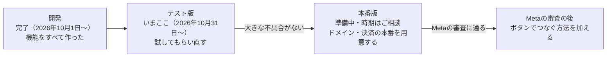

# ThreadsGrower 開発のご報告

**更新**：2026-10-31

予定した機能はすべて作り終え、2026年10月31日にテスト版を公開しました。いまはテストユーザーに使ってもらいながら不具合を直しており、そのあと本番版を公開します。

## ねらい

Threadsを伸ばしたい個人・お店・その運用を手伝うチームが、人柄と口調を保ったまま投稿を続けられるようにするアプリです。

- **解く困りごと**：投稿のネタが尽きる。AIに書かせると自分らしくない。毎日投稿する手間がある。何が効いたかわからない。
- **解き方**：「戦略 → 投稿の案 → 人の承認 → 自動投稿 → 振り返り」を1つのアプリで回し、振り返りの結果を次の案づくりに戻します。
- **守っていること**：人が承認した案しか投稿しません。NGワードを含む案は、誰の操作でも投稿されません。
- **AIの費用はかかりません**：文章を書くAIはアプリの中になく、利用者がお好きなAI（ChatGPT・Claudeなど）を使います。アプリは、戦略を入れたAIへのお願いの文（プロンプト）を作ります。

## できたこと

予定した機能をすべて作り終え（開発は15回に分けて進めました）、テスト版で確かめています。

| 機能 | 内容 | 状態 |
| --- | --- | --- |
| ログインとアカウント | Googleでログイン。Threadsアカウントをつなぐ（今はトークンの貼り付け）。つなぐ前にアカウントを作れる | テスト版で確認中 |
| 戦略 | 課題・宣伝内容・リサーチ。入力に迷ったらAIに手伝ってもらえる | テスト版で確認中 |
| 投稿づくり | 戦略を入れたプロンプトを作り、AIの答えをまとめて登録 | テスト版で確認中 |
| 確認と承認 | 似た案の検出、承認・却下と理由、NGワード | テスト版で確認中 |
| 自動投稿 | 承認済みの案を、決めた時間帯・1日の件数で投稿。失敗したらやり直して知らせる | テスト版で確認中 |
| パフォーマンス | 反応を7日後まで取り込み、好調・低調を判定。低調の投稿を次のプロンプトへ。CSVで書き出し | テスト版で確認中 |
| 複数アカウント | 切り替えと、アカウントごとの要確認の件数 | テスト版で確認中 |
| チーム | 招待リンク、管理者・メンバー・編集者、担当、「チームに見せる」、操作の記録 | テスト版で確認中 |
| 決済と退会 | 無料体験1か月、月額の契約（Stripe）、未払いのときは読むだけ、退会 | テスト版で確認中（テスト用の決済） |
| 公開のしくみ | テスト版と本番版を分け、変更を自動で出す | テスト版は稼働中。本番版は準備中 |

## 公開の状況

いまはテスト版の段階です。本番版は、テスト版で大きな不具合がなくなってから公開します。

本番版の前に、独自ドメインの取得、本番用のデータベース・ログイン・決済の用意、事業者としての表記が要ります。テスト版のしくみは本番版と同じなので、これらをそろえれば同じ手順で公開できます。

## 費用

利用者が10人ほどまでは、サーバーの費用は0円です。300人でも月に約3,600円で、有料の利用者が数人いればまかなえます。

| 利用者 | サーバーの費用（月） |
| --- | --- |
| 〜10人 | 0円 |
| 20人 | 0〜2,600円 |
| 50人 | 2,900〜3,200円 |
| 100人 | 約3,500円 |
| 300人 | 約3,600円 |
| 1,000人 | 3,800〜7,500円 |

- 上の表のほかに、決まってかかる費用があります。独自ドメインが年に数千円、開発の場所（GitHubの有料プラン）が月に数百円です。
- 決済の手数料は売上の約4.3%です。月1,000円の契約1件で、手元に残るのは約957円です。
- 社外の利用者を迎える時点で、データベースを有料プランに切り替えます。最低料金はなく、少人数のうちは月に数百円〜千円ほどです。無料の枠を使い切ってアプリが止まる危険をなくすためです。
- 金額は1ドル150円、2026年10月時点の料金で計算しています（詳しくは[運用コストの試算](cost-estimate.md)）。

## ご相談したいこと

本番版の公開までに、次の点を決めていただきたいです。

- [ ] **サービス名とドメイン**：「Threads」はMetaの商標なので、公開する名前やドメインには入れない方針です。候補は「PostGrower」で、postgrower.comは2026年10月31日の時点で空いていました。
- [ ] **本番版を公開する時期**：テスト版で大きな不具合がなくなってからを想定しています。
- [ ] **テストユーザー**：誰に、何人に試してもらうか。テストユーザーには料金を求めません。
- [ ] **事業者としての情報**：特定商取引法の表記、問い合わせ先、請求書（インボイス）の扱い。決済（Stripe）の本番も、この情報を入れてから使えます。
- [ ] **Metaの審査（App Review）を申し込むか**：通ると、利用者がボタンを押すだけでThreadsをつなげます。通るまでは、今のトークンの貼り付けで使えます。

あわせて、気をつけている点もお伝えします。

- テスト版でも、自動投稿は本物のThreadsに出ます。テストユーザーにはそのことを伝え、画面にも「テスト版」と出しています。
- Threadsとつなぐためのトークンは、暗号化して保存しています。
- テスト版と本番版は、データも設定も分けています。テスト版での失敗が、本番版の利用者に影響しません。
