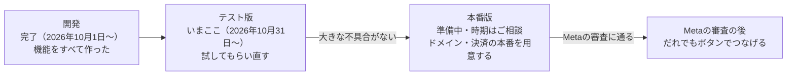

# めぐる Threads 開発のご報告

**更新**：2026-11-12

予定した機能はすべて作り終え、2026年10月31日にテスト版を公開しました。いまはテストユーザーに使ってもらいながら、不具合を直し、機能を足しています。本番版はまだ公開していません。

2026年11月11日に、このアプリを最初のアプリとするスイートの名前を「**めぐる**」に決め、アプリの名前を「めぐる Threads」（旧名 ThreadsGrower）にしました。同じログイン・契約で、人物管理・集金管理などのアプリを足していきます（[プロダクトの構造](product-structure.md)）。

## ねらい

Threadsを伸ばしたい個人・お店・その運用を手伝うチームが、人柄と口調を保ったまま投稿を続けられるようにするアプリです。

- **解く困りごと**：投稿のネタが尽きる。AIに書かせると自分らしくない。毎日投稿する手間がある。何が効いたかわからない。
- **解き方**：「戦略 → 投稿の案 → 人の承認 → 自動投稿 → 振り返り」を1つのアプリで回し、振り返りの結果を次の案づくりに戻します。
- **守っていること**：人が承認した案しか投稿しません。NGワードを含む案は、誰の操作でも投稿されません。
- **AIの費用はかかりません**：文章を書くAIはアプリの中になく、利用者がお好きなAI（ChatGPT・Claudeなど）を使います。アプリは、戦略を入れたAIへのお願いの文（プロンプト）を作ります。

## できたこと

予定した機能をすべて作り終え、テスト版で確かめています。開発は機能ごとに分けて進め、2026年11月12日までに28回になりました。

| 機能 | 内容 | 状態 |
| --- | --- | --- |
| ログインとアカウント | Googleでログイン。Threadsアカウントをつなぐ（「Threadsで許可する」のボタンか、トークンの貼り付け。Metaの審査の前は、テスターとして招待した人だけがボタンでつなげる）。つなぐ前にアカウントを作れる | テスト版で確認中 |
| 戦略 | 課題・宣伝内容・リサーチ。入力に迷ったらAIに手伝ってもらえる。AIと壁打ちして、課題をまとめて埋められる | テスト版で確認中 |
| 投稿づくり | 戦略を入れたプロンプトを作り、AIの答えをまとめて登録 | テスト版で確認中 |
| 確認と承認 | 似た案の検出、承認・却下と理由、NGワード | テスト版で確認中 |
| 自動投稿 | 承認済みの案を、決めた時間帯・1日の件数で投稿。失敗したらやり直して知らせる | テスト版で確認中 |
| パフォーマンス | 反応を7日後まで取り込み、好調・低調を判定。低調の投稿を次のプロンプトへ。CSVで書き出し。伸びた投稿の傾向と、おすすめに乗った目安の解析 | テスト版で確認中 |
| 時間差のメンション | 投稿してから時間をおいて、自分の投稿への返信でほかのユーザーをメンションし、拡散をお願いする | テスト版で確認中 |
| 外部媒体への展開 | 宣伝内容（イベント）を、外部のイベント募集サイト（こくちーずプロ・Peatixなど）の登録画面と同じ順に並べ、欄ごとにコピーして貼れるようにする | テスト版で確認中 |
| 複数アカウント | 切り替えと、アカウントごとの要確認の件数 | テスト版で確認中 |
| チーム | 招待リンク、管理者・メンバー・編集者、担当、「チームに見せる」、操作の記録、運用状況（止まっている人・伸びていないアカウント） | テスト版で確認中 |
| 紹介 | 紹介リンクで、誰の紹介で登録したかを記録する | テスト版で確認中 |
| 運営 | テスト版はグループの招待制。運営者は、機能のまとまり（自動投稿・戦略・チーム）を人ごと・グループごとにオン・オフでき、アカウントの数と1日の投稿数の上限を決められる。すべてのアカウントを接続方法ごとに確かめられる | テスト版で確認中 |
| 決済と退会 | 月額の契約（Stripe。アカウント1件につき月1,000円）、未払いのときは読むだけ、退会。無料体験は2026年11月8日にやめた | テスト版で確認中（テスト用の決済） |
| 公開のしくみ | テスト版と本番版を分け、変更を自動で出す | テスト版は稼働中。本番版は準備中 |
| 作りの整理（2026年11月） | このアプリを土台に、同じログイン・契約で別のアプリも足せるよう、中身を「共通の部分」と「Threadsの部分」に分けた。画面のURLは`/threads/…`に移した（前のURLは転送する）。「すべてのアプリ」の画面を足した（[プロダクトの構造](product-structure.md)）。使い方・料金は変わらない | 完了 |

## 公開の状況

いまはテスト版の段階です。本番版は、テスト版で大きな不具合がなくなってから公開します。

本番版の前に、独自ドメインの取得、本番用のデータベース・ログイン・決済の用意、事業者としての表記が要ります。テスト版のしくみは本番版と同じなので、これらをそろえれば同じ手順で公開できます。

## 費用

利用者が1人でも、毎月およそ1,000円かかります。その多くは、利用者の数に関係なくかかる固定費（コードの置き場とドメインで月850円）です。100人で月およそ4,200円になり、有料の利用者が5人いればまかなえます。

| 利用者 | 毎月の合計 |
| --- | --- |
| 1人 | 約1,000円 |
| 10人 | 1,700〜2,100円 |
| 100人 | 4,150〜4,300円 |
| 300人 | 約4,450円 |
| 1,000人 | 4,600〜8,050円 |

- 決済の手数料は売上の約4.3%です。月1,000円の契約1件で、手元に残るのは約957円です。この表の合計には入れていません。
- 社外の利用者を迎える時点で、データベースを有料プランに切り替える前提で計算しています。無料の枠を使い切ってアプリが止まる危険をなくすためです。
- 金額は1ドル150円、2026年11月5日時点の料金で計算しています（詳しくは[運用コストの試算](cost-estimate.md)の「総コストの試算」）。

## ご相談したいこと

本番版の公開までに、次の点を決めていただきたいです。

- [ ] **ドメイン**：サービス名は「めぐる」に決めました（2026年11月11日）。「Threads」はMetaの商標なので、ドメインには入れない方針です。ドメインはまだ決めていません。
- [ ] **本番版を公開する時期**：テスト版で大きな不具合がなくなってからを想定しています。
- [ ] **テストユーザー**：誰に、何人に試してもらうか。テストユーザーには料金を求めません。
- [ ] **事業者としての情報**：特定商取引法の表記、問い合わせ先、請求書（インボイス）の扱い。決済（Stripe）の本番も、この情報を入れてから使えます。
- [ ] **Metaの審査（App Review）を申し込むか**：通ると、だれでもボタンを押すだけでThreadsをつなげます。通るまでは、テスターとして招待した人のボタンでの接続と、トークンの貼り付けで使えます。

あわせて、気をつけている点もお伝えします。

- テスト版でも、自動投稿は本物のThreadsに出ます。テストユーザーにはそのことを伝え、画面にも「テスト版」と出しています。
- Threadsとつなぐためのトークンは、暗号化して保存しています。
- テスト版と本番版は、データも設定も分けています。テスト版での失敗が、本番版の利用者に影響しません。
