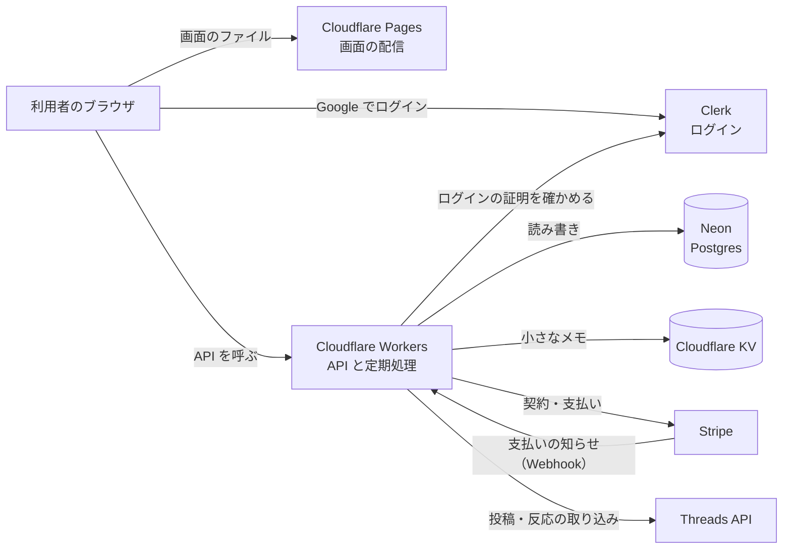
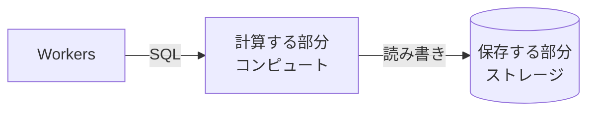
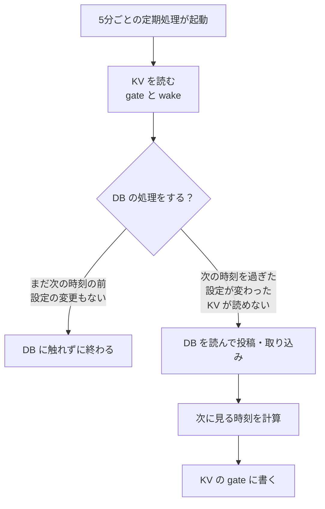
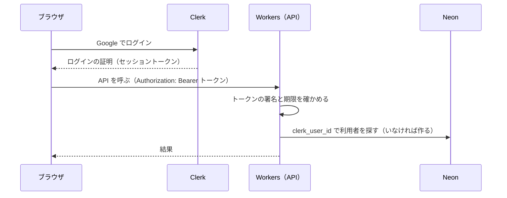
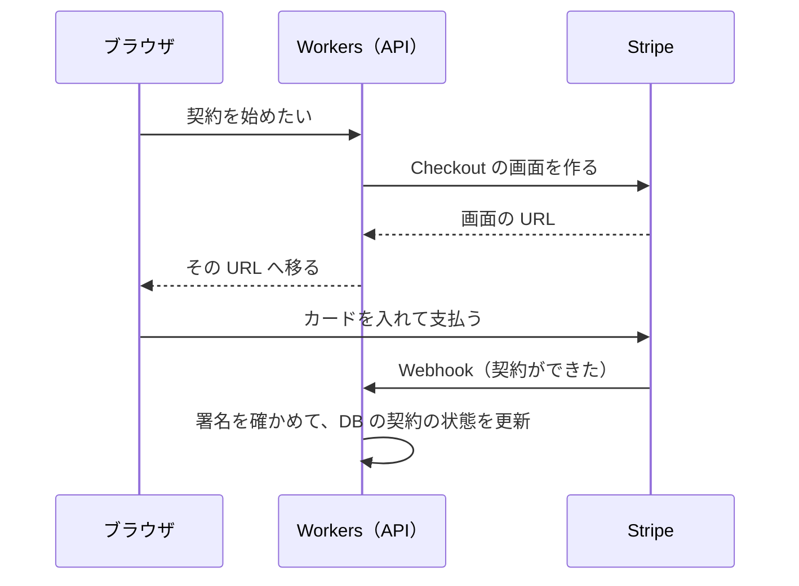

# 技術の入門：このアプリを支えるサービスと仕組み

このアプリ（めぐる Threads。旧名 ThreadsGrower）で使っている外部のサービスについて、それぞれが何をしていて、どう組み合わさっているかをまとめた勉強用の文書です。設計の判断と理由は [architecture.md](../architecture.md)、料金の見積もりは [cost-estimate.md](../cost-estimate.md) にあります。

無料枠や料金の数字は、2026年11月1日に各サービスの公式のページで確かめたものです（出典は最後の章）。変わることがあるので、使う前にもう一度確かめてください。

---

## 1. 全体の地図



一言でいうと、次の役割分担です。

| サービス | 役割 | このアプリでの使い方 |
| --- | --- | --- |
| Cloudflare Pages | 画面のファイルを配る | React で作った画面（HTML・JS・CSS）を置く |
| Cloudflare Workers | プログラムを動かす | API（Hono で書いたもの）と、5分ごと・1日1回の定期処理 |
| Cloudflare KV | 小さな値を置いておく | 定期処理の「関所」。DB を起こすかどうかを決めるメモ |
| Neon | データベース（Postgres） | 利用者・アカウント・下書き・予定・契約など、すべてのデータ |
| Clerk | ログイン | Google でのログインと、ログインの証明（トークン）の発行 |
| Stripe | 決済 | 月額の契約、支払いの失敗、カードの変更画面 |

---

## 2. Cloudflare：Pages と Workers

### 2-1. Cloudflare とは

Cloudflare は、世界中に置いたサーバー（データセンター。300か所を超える）の上で、ウェブサイトの配信やプログラムの実行を引き受けるサービスです。利用者のいちばん近くの拠点で応答するので速く、サーバーそのものの管理（OS の更新、台数の調整など）を自分でする必要がありません。

### 2-2. Pages：画面のファイルを配る

**仕組み**

- 画面は React で書いて、`vite build` で「HTML・JavaScript・CSS のファイルの束」（`apps/web/dist`）にします。
- Pages は、そのファイルを世界中の拠点に置き、ブラウザから求められたら返すだけの役です。サーバーで計算はしません（静的配信）。
- ブラウザに届いた JavaScript が画面を組み立て、必要なデータは Workers の API に取りに行きます（SPA：シングルページアプリケーション）。

**ブランチごとの URL**

- Pages は、ブランチごとに別の URL で配れます。
  - このアプリでは、`main` を本番の URL に出します。
  - `develop` は「ブランチの別名」の URL に出し、テスト版として使っています。
- 配るのは GitHub Actions です（`.github/workflows/deploy.yml`）。`wrangler pages deploy` でファイルを送ります。

**無料の範囲**

- 公式の上限の一覧には、静的なファイルを配る回数や量の上限は書かれていません。
  - Pages Functions（Pages の上でプログラムを動かす機能）を使うと、その呼び出しは Workers の回数に数えます。このアプリは Functions を使っていません。
- 作り直して配れる回数（ビルド）は、1か月に500回までです。同時に動かせるビルドは1つです。
- 1つのサイトに置けるファイルは20,000個まで、1つのファイルは25MiBまでです。

### 2-3. Workers：プログラムを動かす

**仕組み**

- Workers は、書いたプログラム（このアプリでは `apps/api/src/index.ts`）を Cloudflare の拠点で動かすサービスです。
- 「サーバーを1台借りて、ずっと動かしておく」のではありません。**リクエストが来たときだけ、その場で小さく起動して処理し、終わる**作りです（サーバーレス）。
- 起動には、V8 という JavaScript の実行エンジンの「アイソレート」という軽い仕切りを使います。
  - コンテナや仮想マシンより、ずっと速く起動します（数ミリ秒）。
  - そのため、「しばらく使われていないと、最初の1回が遅い」ということがほとんどありません。

**このアプリでの入口は2つです。**

```ts
export default {
  fetch: app.fetch,            // ① ブラウザからの API の呼び出し（Hono が道案内する）
  async scheduled(controller, env, ctx) { ... }, // ② 決まった時刻に動く定期処理（Cron Triggers）
};
```

1. **`fetch`（API）**
   - ブラウザが `/api/...` を呼ぶたびに動きます。
   - Hono というフレームワークが、パスごとに処理を振り分けます。
   - 認証のミドルウェアがログインの証明を確かめてから、それぞれの処理に進みます。
2. **`scheduled`（定期処理）**
   - `wrangler.toml` の `crons` に書いた時刻に、Cloudflare が自動で呼びます。
   - `*/5 * * * *` は5分ごとです。自動投稿と反応の取り込みをします。
   - `0 18 * * *` は、毎日 18:00 UTC（日本時間の午前3時）です。日に一度の片付けなどをします。

**Workers ならではの決まり**

- **リクエストをまたいで記憶を持てません。**
  - 同じプログラムが別の拠点や別のアイソレートで同時に動くので、変数に入れた値は次のリクエストでは消えているものと考えます。
  - データは DB（Neon）か KV に置きます。
  - DB への接続も、リクエストごとに作って捨てます（`apps/api/src/kernel/db/client.ts`）。
- **環境ごとの設定は `wrangler.toml` と Secret に分けます。**
  - 公開してよい値（環境の名前、ON/OFF の切り替えなど）は `wrangler.toml` の `[vars]` に書きます。
  - 秘密の値（DB の接続文字列、Clerk や Stripe の秘密鍵など）は、`wrangler secret put` で Cloudflare に預けます。リポジトリには書きません。
  - 環境（開発・テスト版・本番）は `[env.staging]`・`[env.production]` で分けます。コードは同じで、設定だけが違います。
- **無料の範囲**
  - リクエストは1日100,000回までです（日本時間の午前9時、UTC の0時に戻ります）。超えると、エラーの画面（Error 1027）になります。
  - 1回の処理で CPU を使える時間は、10ミリ秒までです。定期処理（Cron）も1回10ミリ秒までで、かかってよい時間の全体は15分までです。
  - 待ち時間（DB や外部 API の応答待ち）は、CPU の時間に数えません。DB や Threads API を待っている間は、10ミリ秒を使いません。
  - 1回の処理から外へ出す呼び出し（サブリクエスト）は、50回までです。
  - Cron の予定は、アカウント全体で5つまでです。このアプリは環境ごとに2つ（5分ごと・1日1回）を使っています。

### 2-4. Pages と Workers の分担

| | Pages | Workers |
| --- | --- | --- |
| 何を返すか | 決まったファイル（誰に対しても同じ） | その場で計算した結果（人やデータで変わる） |
| サーバーでの計算 | しない | する |
| このアプリでは | 画面 | API・定期処理 |

画面と API を別のドメインに分けているので、API は「どの画面からの呼び出しを許すか」（CORS）を、`WEB_ORIGIN` の設定で決めています。

---

## 3. Neon：データベース

### 3-1. Neon とは

Neon は、Postgres（PostgreSQL）というデータベースを、クラウドで「使った分だけ」払う形で貸すサービスです。このアプリでは Postgres 17 を使っています。

### 3-2. 「計算」と「保存」を分けた作り

ふつうの Postgres は、1台のサーバーの中で「問い合わせを計算する部分」と「データを保存する部分」が一体です。Neon はこの2つを分けています。



- **計算する部分（コンピュート）**
  - 問い合わせが来ているときだけ動きます。
  - 何も来ないまま5分たつと止まります（scale to zero）。
  - 次の問い合わせが来ると、自動で起き直します。このとき、最初の1回だけ少し遅くなります（1秒未満〜数百ミリ秒ほど）。
- **保存する部分（ストレージ）**
  - データはいつも残っています。
  - 変更の履歴も持っているので、「何時何分の状態に戻す」ことができます。
  - 「ブランチ」という、データの写しを一瞬で作る機能も、この作りのおかげです。

### 3-3. 費用は「起きている時間」で決まる

- 料金と無料枠は、主に**計算する部分が起きていた時間 × 大きさ**（CU 時間）で決まります。CU は計算の大きさの単位で、1 CU はメモリ4GB ほどです。
- 無料のプラン
  - 1つのプロジェクトにつき、1か月に 100 CU 時間までです。大きさは、自動で 2 CU まで増えます。
  - 保存できるのは、1つのプロジェクトにつき 1GB までです。
  - 5分で止まる設定は、無料のプランでは外せません。
  - CU 時間を使い切ると、次の月まで DB が止まったままになります。保存が 1GB を超えると、書き込めなくなります。どちらもデータは消えず、勝手に請求もされません。
- 有料のプラン（Launch）は、月の最低料金がなく、1 CU 時間あたり 0.106 ドルです。
- つまり、**5分おきに1回でも問い合わせが来ると、DB はずっと止まれません。** 5分ごとの定期処理が毎回 DB を読むと、それだけで24時間起きっぱなしになります。
- これを防ぐのが、次の章の KV の「関所」です。

### 3-4. Workers からのつなぎ方

Workers はリクエストをまたいで接続を持てないので、Neon が用意している Workers 向けのつなぎ方を使っています（`@neondatabase/serverless`）。

| つなぎ方 | 使う場面 |
| --- | --- |
| HTTP（`neon-http`） | ふつうの問い合わせ。1回の SQL を HTTP で送って結果を受け取る。接続の準備がいらず速い |
| WebSocket（`neon-serverless` の Pool） | 複数の SQL を1つのまとまり（トランザクション）として行うとき。グループへの参加のように「数えてから入れる」処理で使う |

---

## 4. Cloudflare KV と「関所」：DB を起こさない工夫

### 4-1. KV とは

KV（Key-Value）は、「名前（キー）」と「値」の組を置いておくだけの、とても単純な保管場所です。

```text
キー: "autopost:gate"   値: {"nextCheckAt":"2026-11-01T03:00:00Z","runStartedAt":"..."}
```

KV の性質は次のとおりです。

- **読むのが速くて安い。**
  - よく読まれる値は、読んだ拠点に写し（キャッシュ）を置くので、速く読めます。
  - 無料の範囲は、1日100,000回まで読めます。
- **書く回数は少なめに使う前提。**
  - 無料の範囲は、1日1,000回まで書けます。同じキーに書けるのは、1秒に1回までです。
  - 保存できるのは 1GB まで、1つの値は 25MiB までです。
- **書いた値が、すべての拠点に届くまで少し時間がかかる。**
  - 書いた値は、まず中央の保管場所に入ります。ほかの拠点は、手元の写しの期限（既定で60秒）が切れるまで、古い値を返すことがあります。
  - なので、ほかの拠点で見えるようになるまで、60秒かそれ以上かかります（結果整合性）。
  - なので、「1秒を争う」「値を足し引きする」ような使い方には向きません。
  - 「次に見るのは何時か」のような、少し古くても困らないメモに向いています。
- **Postgres のような「起きる・止まる」がない。**
  - いつ読んでも同じように速く、読んだ回数のほかに費用もかかりません。

### 4-2. なぜ「関所」が要るのか

5分ごとの定期処理は、1日に288回動きます。用事（投稿の時刻、反応の取り込みなど）があるのは、そのうちのわずかです。

- **関所がない場合：** 288回すべてで DB に「今やることはある？」と聞きます。DB は5分おきに起こされ、一度も止まれません（無料枠をすぐ使い切ります）。
- **関所がある場合：** まず KV のメモを見て、「次の用事はまだ先」とわかれば、DB に触れずに終わります。DB は、用事のある回だけ起きます。

### 4-3. 関所の流れ

コードは `apps/api/src/apps/threads/publish/auto-post-gate.ts` と、同じフォルダの `auto-post-runner.ts` です。



KV に置いているメモは3つです。

| キー | 書く人 | 中身 | 意味 |
| --- | --- | --- | --- |
| `autopost:gate` | 定期処理だけ | `nextCheckAt`（次に見る時刻）と `runStartedAt`（この回を始めた時刻） | 「次はこの時刻まで DB を見なくてよい」 |
| `autopost:wake` | API だけ | `at`（設定が変わった時刻） | 「利用者が予定を変えたので、次の回は見に来て」 |
| `metrics:catchup` | 定期処理だけ | 日付 | 「今日の反応数の補いは終わった」 |

DB の処理をするのは、次のどれかに当てはまるときです（`shouldRun`）。

1. KV が読めない、または値が壊れている（**安全側**に倒して、DB を見に行く）
2. 関所のメモがない（初めて動いたとき）
3. 今が「次に見る時刻」を過ぎている
4. 利用者が予定を変えた時刻（`wake`）が、前の回を始めた時刻より後

「次に見る時刻」は、DB の処理をしたついでに計算します（`computeNextCheckAt`）。

- 候補は、次の投稿の予定の時刻と、失敗した投稿をやり直す時刻です。そのうち、いちばん早いものを選びます。
- この回で終わりきらなかった仕事があるときは、「今」にします。次の5分後の回で続きをするためです。
- 長くても24時間後にします。予定がなくても1日に1回は DB を見て、全員の設定を読み直します。

### 4-4. 細かい工夫

- **書く人を1つに決める。**
  - `gate` は定期処理だけが、`wake` は API だけが書きます。
  - 2人が同じキーに同時に書くと、片方の値が消えることがあります。キーを分けて、どちらの知らせも失わないようにしています。
- **予定を変えたら、すぐ気づく。**
  - 予定の保存や Threads のつなぎ直しのとき、API が `wake` に「今」を書きます（`notifyWake`）。
  - そうしないと、関所が「次は明日」と覚えている間、新しい予定に気づけません。
- **失敗しても、悪い方に転ばない。**
  - KV に書けなかったときは、前の値（過ぎた時刻）が残ります。なので、次の回も DB の処理が動きます。DB を余分に起こすだけで、投稿を取りこぼすことはありません。
  - 読めないときも、DB を見に行く側に倒します。
- **結果整合性との付き合い方。**
  - 書いた値が届くのが少し遅れても、困るのは「1回分、余分に DB を見る」か「5分遅れて気づく」くらいです。
  - 自動投稿は、予定の時刻から60分の幅の中で出せばよい作りなので、問題になりません。

**効果**

用事のない時間帯は、5分ごとの起動が KV を読むだけで終わります。DB は、投稿の前後や反応の取り込みのときにだけ起きて、5分たてばまた止まります。

**KV の無料の範囲に収まるか**

- 読む回数：5分ごとに3つのキーを読むので、1日に 288回 × 3 = 864回です。上限の100,000回に比べて、ずっと少ないです。
- 書く回数：`gate` を書くのは、DB の処理をした回だけです。毎回動いたとしても、1日288回です。これに、利用者が予定を変えたときの `wake` が足されます。上限の1,000回に収まります。

---

## 5. Clerk：ログイン

### 5-1. Clerk とは

Clerk は、ログインの仕組み（Google でのログイン、ログイン画面、ログイン中であることの管理）をまるごと引き受けるサービスです。パスワードを自分で預からずに済み、安全な作りを自分で一から作らなくてよくなります。このアプリでは、Google でのログインだけを有効にしています。

**無料の範囲**

- 1つのアプリにつき、1か月に 50,000人（MRU）までです。
- MRU（Monthly Retained User）は、「登録した日の翌日以降に、その月にもう一度来た人」です。登録しただけで戻ってこなかった人は数えません。
- 有料の Pro は月25ドルで、50,000人を超えた分は1人あたり月0.02ドルです。

### 5-2. ログインの流れ



- **トークン**
  - ブラウザは、Clerk から受け取った「ログインの証明」（JWT という形の、署名付きの短い文字列）を、API を呼ぶたびに付けます。
  - トークンの期限は短く、Clerk の部品が自動で取り直します。
- **API での確かめ**
  - API は、トークンの署名が Clerk のものか、期限が切れていないかを確かめます（`apps/api/src/platform/identity/auth.ts`）。
  - 確かめられなければ、401（ログインが要る）を返します。
- **利用者の行**
  - 確かめられたら、Clerk の利用者 ID（`clerk_user_id`）で、アプリの DB の利用者を探します。
  - 初めての人なら、その場で行を作ります（JIT 作成）。
- **Clerk に任せるのは「この人は誰か」まで**
  - チーム・ロール・契約など「この人が何をしてよいか」は、アプリの DB で持ちます。
  - Clerk の Organizations 機能は、チームごとに費用がかかるので使っていません。

---

## 6. Stripe：決済

### 6-1. Stripe とは

Stripe は、カードでの支払いと月額の契約（サブスクリプション）を引き受けるサービスです。カードの番号はこのアプリには一切届かず、Stripe の画面で入力されます。

**手数料**（日本の標準の料金）

- 国内のカードでの決済は、1回ごとに 3.6% です。
- 通貨の換算が要るとき（海外のカードなど）は、2% が足されます。
- 月額の契約（Billing）を使う分には、さらに取引額の 0.7% がかかります。
- 月額の固定費はなく、売れたときにだけかかります。

### 6-2. このアプリで使っている部品

| 部品 | 何をするか |
| --- | --- |
| Customer | Stripe の側の「お客さん」。アプリの利用者1人に1つ作る |
| Checkout | Stripe が用意した支払いの画面。契約を始めるときに、ここへ移ってカードを入れてもらう |
| Subscription | 月額の契約。毎月の請求、支払いの失敗、解約を Stripe が管理する（このアプリは無料体験を2026-11-08にやめた） |
| Customer Portal（billing_portal） | 利用者が自分でカードの変更や解約をする画面。これも Stripe が用意する |
| Webhook | Stripe からアプリへの知らせ。「支払いが済んだ」「失敗した」「解約された」などを、`/stripe/webhook` に送ってくる |

### 6-3. 流れ



大事なのは、**「契約できたか」をブラウザの言うことでは決めず、Stripe からの Webhook で決める**ことです。

- ブラウザの戻り先の URL は、誰でも開けます。
- Webhook には Stripe の署名が付いていて、アプリはそれを確かめてから受け取ります（`STRIPE_WEBHOOK_SECRET`）。
- 同じ知らせが2回届いても、結果が同じになるように作っています（冪等性）。

**環境ごとの ON/OFF**

- 決済を使うかどうかは `BILLING_ENABLED` で切り替えます。
- テスト版では、Stripe の「テストモード」（本物のお金が動かない、試し用のカード番号が使える）につないでいます。

---

## 7. 用語の早見表

| 用語 | 意味 |
| --- | --- |
| サーバーレス | サーバーを借りっぱなしにせず、呼ばれたときだけプログラムを動かす形。動いた分だけ払う |
| 静的配信 | 決まったファイルを、そのまま返すだけの配信 |
| SPA | 最初に画面のプログラムをまとめて読み込み、あとはブラウザの中で画面を切り替えるウェブアプリ |
| Cron | 「毎日3時」「5分ごと」のように、決まった時刻に処理を動かす仕組み。書き方は `分 時 日 月 曜日` |
| scale to zero | 使われていないときは計算の部分を0台まで止め、費用を0にすること |
| 結果整合性 | 書いた値が、少し時間をおいて、いずれすべての場所で同じになる性質 |
| トランザクション | 複数の読み書きを「全部やる か 全部やらない」の1つのまとまりにすること |
| JWT | 署名付きの、短い証明書のような文字列。中身が書き換えられていないことを、署名で確かめられる |
| Webhook | 外のサービスから、出来事を知らせるために呼ばれる URL |
| 冪等性 | 同じ操作を何回くり返しても、結果が1回と同じになること |
| Secret | 環境に預ける秘密の値。リポジトリには書かない |

---

## 8. 出典（2026年11月1日に確かめたもの）

- Cloudflare Workers の上限：[Limits · Cloudflare Workers docs](https://developers.cloudflare.com/workers/platform/limits/)
- Cloudflare Pages の上限：[Limits · Cloudflare Pages docs](https://developers.cloudflare.com/pages/platform/limits/)
- Cloudflare KV の上限：[Limits · Cloudflare Workers KV docs](https://developers.cloudflare.com/kv/platform/limits/)
- Cloudflare KV の仕組み：[How KV works · Cloudflare Workers KV docs](https://developers.cloudflare.com/kv/concepts/how-kv-works/)
- Neon の料金と無料のプラン：[Neon Pricing](https://neon.com/pricing)
- Clerk の料金：[Clerk Pricing](https://clerk.com/pricing)
- Stripe の手数料（日本）：[Stripe 料金体系](https://stripe.com/jp/pricing)
