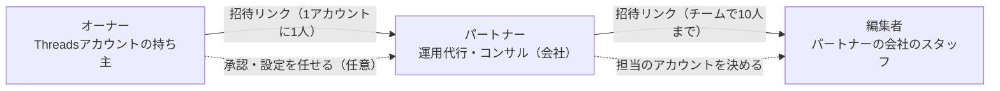
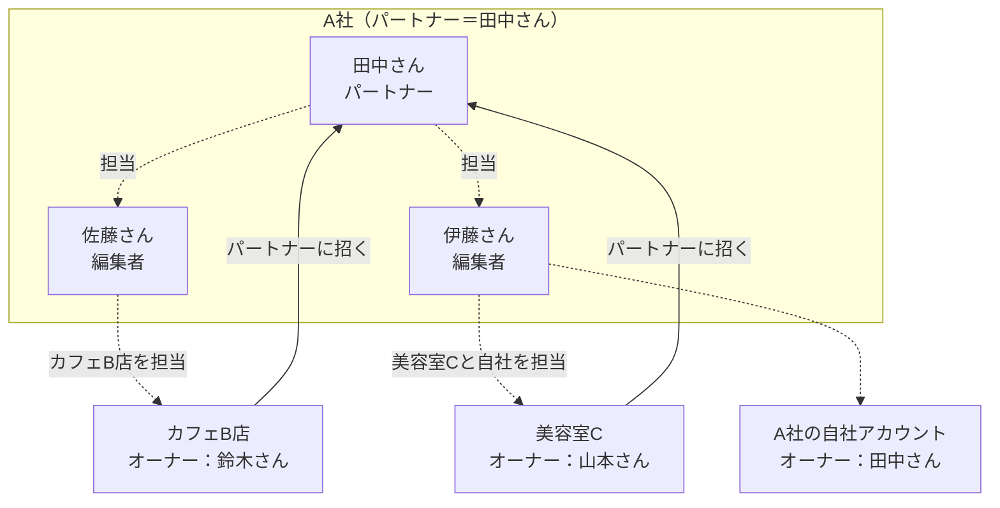

# チーム運用の役割

ThreadsGrowerの「チーム運用」（[specs/008-team-operations](../specs/008-team-operations/spec.md)）には、3つの役割がある。他のアプリにあまりない仕組みなので、誰が誰を招き、何ができるかをここにまとめる。アプリの画面にも同じ図を出している（「このアカウントの設定 > 運用を手伝ってもらう」と、招待の確認の画面）。

## 全体の図

- オーナーが、自分のThreadsアカウントごとにパートナーを1人招く。
- パートナーは、自分の会社（チーム）のスタッフを編集者として招き、どのアカウントを担当するかを決める。
- 編集者は、オーナーと直接やりとりしない。オーナーの設定には「このアカウントのチーム」（オーナー → パートナー → 担当の編集者）として名前だけが出る。

## できること

| | オーナー | パートナー | 編集者 |
|---|---|---|---|
| 投稿の案・戦略を作る・直す | ○ | ○ | ○（担当のアカウントだけ） |
| 要確認の投稿の案を消す | ○ | ○ | ○（担当のアカウントだけ） |
| パフォーマンスを見る | ○ | ○ | ○（担当のアカウントだけ） |
| 投稿の承認・却下 | ○ | 任されたときだけ | × |
| 自動投稿・NGワード・投稿のルールの設定 | ○ | 任されたときだけ | ×（読むだけ） |
| 操作の記録を見る | ○ | ○ | × |
| 編集者を招く・担当を決める・外す | × | ○ | × |
| パートナーを招く・外す・任せる範囲を決める | ○ | × | × |
| Threadsとの接続・再接続・支払い | ○ | × | × |

- 承認・設定を任せるかどうかは、オーナーが「パートナーに任せること」のスイッチで決める。既定はどちらもオフ。
- 誰が何をしたかは「操作の記録」に90日残る（チームがあるアカウントだけ）。
- 判定はAPIの1か所（`apps/api/src/services/access.ts`）で行う。画面の出し分けは見た目のためだけ（詳しくは[contracts/permissions.md](../specs/008-team-operations/contracts/permissions.md)）。

## よくある組み合わせ

- パートナーは、複数のオーナーのアカウントを手伝える。切り替えメニューの「手伝っているアカウントをまとめて見る」で一覧できる。
- パートナー自身のThreadsアカウント（自社）も、編集者の担当にできる。自社のアカウントでは、パートナーはオーナーとして承認・設定も行う。
- 1人の人が、あるアカウントではオーナー、別のアカウントではパートナー、ということもある。役割はアカウントごとに決まる。

## 動作確認

- 自動：`pnpm e2e -- team`（3人のブラウザでの招待・参加・担当・任せる範囲・記録・外す。README「E2E」）
- 手で触る：`pnpm team:demo`（サーバーの起動からチームの用意まで1回で行い、3人がログインしたブラウザを並べて開く）。データを残したまま開くときは、`pnpm dev:fake`の後に`pnpm team:open`
- 手順の全体：[quickstart.md](../specs/008-team-operations/quickstart.md)
