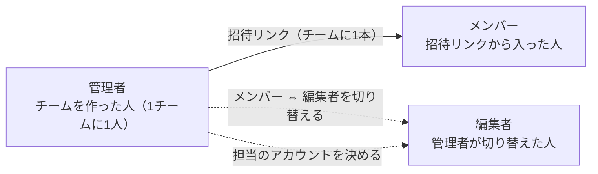
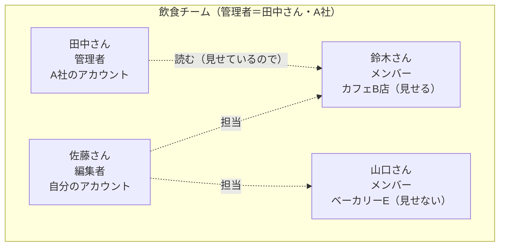

# チームのロール

ThreadsGrowerの「チーム」（[specs/011-team-revision](../specs/011-team-revision/spec.md)。008のチーム運用を作り直した）は、LINEグループに近い仕組みです。管理者がチームを作って招待リンクを送り、受け取った人が自分のThreadsアカウントを入れて参加します。他のアプリにあまりない仕組みなので、誰が何をできるかをここにまとめます。アプリの画面にも同じ図を出しています（「このアカウントの設定 > チーム」の「ロールと、できることを見る」と、招待の確認の画面）。

## 2つの考え方

- **オーナー**：Threadsアカウントの持ち主です。チームの全員が、自分のThreadsアカウントを1つ以上持っています。自分のアカウントでは、誰でもオーナーです。承認・設定・Threadsとの接続・支払いは、いつもオーナーだけが行います。
- **チームのロール**：管理者・メンバー・編集者の3つです。ロールは「ほかの人のアカウントに何ができるか」を決めます。ロールを変えても、アカウントの持ち主は変わりません。

## 全体の図

- 招待リンクから入った人は、まずメンバーになります。入るときに、自分のアカウントを1つ以上チームに入れます。
- オーナーは、チームに入れた自分のアカウントごとに「チームに見せる」を決めます（初めはオフ）。オンにすると、同じチームの人がそのアカウントの投稿ストックと戦略を読めます。
- 管理者は、メンバーを編集者に切り替え、編集者（と自分）に担当のアカウントを決めます。担当にしたアカウントは、見せていなくても、その人が開けます（チームに入れたときに、手伝ってもらうことに同意した扱い）。

## できること

| | オーナー（自分のアカウント） | 担当の人（編集者・自分を担当にした管理者） | 見せてもらっている人（同じチームの人） |
|---|---|---|---|
| 投稿ストック・戦略を読む | ○ | ○ | ○（オーナーが見せているときだけ） |
| 投稿の案・戦略を作る・直す | ○ | ○ | × |
| パフォーマンス・設定を見る | ○ | ○ | × |
| 投稿の承認・却下 | ○ | × | × |
| 自動投稿・NGワード・投稿のルールの設定 | ○ | ×（読むだけ） | × |
| 操作の記録を見る | ○ | 管理者だけ○ | × |
| Threadsとの接続・再接続・支払い | ○ | × | × |
| チームに見せる | ○ | × | × |

| | 管理者 | メンバー・編集者 |
|---|---|---|
| チームを作る | ○（自分のアカウントがあれば誰でも作れる） | ○ |
| 招待リンクを送る・作り直す | ○ | × |
| メンバー ⇔ 編集者を切り替える・担当を決める | ○ | × |
| 人をチームから外す・管理者を引き継ぐ | ○ | × |
| 運用状況を見る（数と日付だけ） | ○（チームのすべて） | 編集者は担当のアカウントとそのオーナーだけ。メンバーは× |
| チーム名を直す・チームを削除する | ○ | × |
| 自分のアカウントを足す・外す・チームを抜ける | ○（抜ける前に引き継ぐ） | ○ |

- 承認と設定を、ほかの人に任せる仕組みはありません（008の「任せる範囲」はなくしました）。
- 管理者は1チームに1人です。抜ける前に、ほかの人に管理者を引き継ぎます。ほかに誰もいなければ、チームを削除します。
- 1つのアカウントは、1つのチームにだけ入れられます。1人が、複数のチームに入れます。
- 別のチームの人には、見せる設定にかかわらず、アカウントは見えません。
- 誰が何をしたかは「操作の記録」に90日残ります（チームに入っているアカウントだけ）。
- 「運用状況」では、管理者と担当の編集者が、手が止まっている人・アカウントと、伸びていないアカウントを見られます。見えるのは投稿の数・伸び・最後に動いた日などの数と日付だけで、投稿の本文や戦略は見えません。「チームに見せる」に関わらず見えるので、招待の確認の画面でもそう伝えます（[specs/020](../specs/020-team-monitoring/spec.md)）。
- 判定はAPIの1か所（`apps/api/src/platform/access/access.ts`）で行います。画面の出し分けは見た目のためだけです（詳しくは[contracts/permissions.md](../specs/011-team-revision/contracts/permissions.md)）。

## よくある組み合わせ

- 田中さん（運用代行のA社）がチームを作り、お店のオーナーとA社のスタッフに招待リンクを送ります。
- 佐藤さんは編集者なので、担当のカフェB店とベーカリーEで投稿の案を作れます。ベーカリーEは見せていませんが、担当なので開けます。承認は、それぞれのオーナー（鈴木さん・山口さん）が行います。
- 田中さんは、自分を担当にしていないので、カフェB店は読むだけ（鈴木さんが見せているので）、ベーカリーEは名前だけが見えます。

## 動作確認

- 自動：`pnpm e2e -- team`（3人のブラウザで、チームを作る・参加・編集者と担当・見せる・読む・案の登録・引き継いで抜ける。README「E2E」）
- 手で触る：`pnpm team:demo`（サーバーの起動からチームの用意まで1回で行い、3人がログインしたブラウザを並べて開く）。データを残したまま開くときは、`pnpm dev:fake`の後に`pnpm team:open`
- 手順の全体：[quickstart.md](../specs/011-team-revision/quickstart.md)
