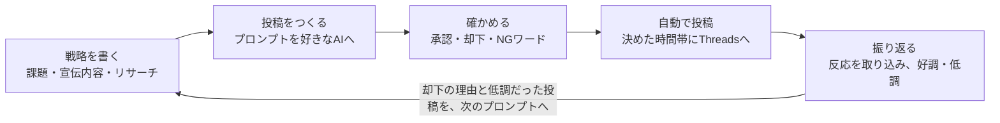

# ThreadsGrower ご利用ガイド

**更新**：2026-10-31

## できること

ThreadsGrowerは、Threadsの投稿づくりから自動投稿・振り返りまでを、ひとつの流れで手伝うアプリです。あなたの人柄や口調を保ったまま、続けて投稿できるようにします。

あなたが承認した案しか投稿されません。振り返りの結果は次の投稿づくりに生かされるので、使うほど案の質が上がります。

## はじめかた

Googleアカウントでログインし、運用したいThreadsアカウントをつなげば使い始められます。

1. ログインの画面で「Googleでログイン」を押します。
2. 「アカウントを作る」で、運用するアカウントを作ります。Threadsとつなぐ前でも、戦略づくりは始められます。
3. Threadsアカウントをつなぎます。今は「アクセストークンを貼り付ける」方法です。ご自身か、チームのオーナーがMetaの開発者サイトで作ったアプリから、トークンを取り出して貼り付けます。手順は、アプリの中の「トークンの取り方」のページにあります。
4. つながると、サイドバーの上にアカウントの名前とアイコンが出ます。

Metaの審査が通ったら、ボタンを押すだけでつなげる方法も加わる予定です。トークンを貼り付ける方法も、そのまま使えます。

## ふだんの使い方

「戦略を書く → 投稿をつくる → 確かめる → 自動で投稿 → 振り返る」をくり返すほど、投稿があなたらしく、伸びやすくなります。

1. **戦略を書く**（課題・宣伝内容・リサーチ）
    - 課題：誰に、何を届け、最後に何をしてもらいたいか。迷ったら、AIに質問してもらいながら埋められます。
    - 宣伝内容：知ってほしい商品やサービス。
    - リサーチ：参考にしたい伸びた投稿と、検索するキーワード。
2. **投稿をつくる**
    - アプリが、戦略を入れた「AIへのお願いの文（プロンプト）」を作ります。
    - それをChatGPTやClaudeなど、お好きなAIに貼り付けて送り、返ってきた投稿の案をまとめて貼り付けます。
    - アプリの中でAIは動かないので、AIの費用はかかりません。
3. **確かめる**（投稿ストック）
    - 「要確認」の案を、承認または却下します。まとめて承認もできます。
    - 却下した理由は次のプロンプトに入り、同じ傾向の案が出にくくなります。
    - 前の案と似ている案には、似ている割合が出ます。
    - NGワードを含む案は承認できず、投稿もされません。
4. **自動で投稿**
    - 承認した案だけが、「このアカウントの設定」で決めた時間帯・1日の件数にそって、順にThreadsへ投稿されます。
    - 承認していない案が投稿されることはありません。
5. **振り返る**（パフォーマンス）
    - 投稿の24時間後から7日後まで、閲覧・いいね・返信などの反応を取り込みます。
    - いつもの閲覧数と比べて「好調・普通・低調」がわかります。
    - 低調だった投稿は、メモを付けて次のプロンプトに入れられます。

複数のThreadsアカウントを運用している場合は、サイドバーの上のアカウント名から切り替えます。アカウントごとの「要確認」の件数も、そこで見られます。

## チームで使う

役割は「ほかの人のアカウントに何ができるか」だけを決めます。自分のアカウントでは、誰もがオーナーです。

- チームは管理者が作り、招待リンクを送ります。入る人は、自分のThreadsアカウントを1つ以上チームに入れます。
- 承認と設定は、いつもそのアカウントのオーナーだけが行います。
- 「チームに見せる」は、初めはオフです。オンにしても、見せるのは投稿ストックと戦略だけで、読むだけです。
- 手伝う人は、手伝う先のアカウントの料金を払いません。

| 役割 | ほかの人のアカウントでできること |
| --- | --- |
| メンバー | 見せてもらった投稿ストックと戦略を読む |
| 編集者 | 加えて、担当のアカウントで投稿の案と戦略を作る・直す |
| 管理者 | 招待・役割の切り替え・担当の割り当て・人を外す。自分を担当にしたアカウントでは、作る・直す |

「操作の記録」では、誰がいつ何をしたかを、オーナーと担当の管理者が確かめられます。

## テスト版について

テスト版は料金なしで、すべての機能を使えます。ただし、投稿は本物のThreadsに出ます。

- テスト版は、招待された方だけが使えます。届いた招待のリンクを開き、Googleでログインして「参加する」を押してください。グループごとに人数の上限があり、定員になると入れません。
- サイドバーの左下、お名前の横に「テスト版」と出ていれば、テスト版です。
- 自動投稿も、つないだThreadsアカウントに実際に投稿されます。試すときは、出ても困らない案で試してください。
- テスト版のデータは、本番版とは別の場所に保存されます。本番版へは自動では引き継がれません。
- 不具合や使いにくいところを見つけたら、画面の写真を添えて教えてください。

本番版の料金は、次の予定です。

| 区分 | 内容 |
| --- | --- |
| 無料体験 | 登録から1か月、アカウント1件まで、すべての機能 |
| 基本料金 | 月1,000円（アカウント1件目を含む） |
| 2件目から | 1件につき月500円 |

契約がないときや支払いが失敗しているときは、読むだけになり、自動投稿が止まります。データは消えず、契約すれば続きから使えます。

## 困ったとき

| こんなとき | こうしてください |
| --- | --- |
| 画面が古いまま、直ったはずのところが直っていない | ブラウザを再読み込みしてください |
| アカウントに「要再接続」と出た | Threadsとのつながりが切れています。「このアカウントの設定」からつなぎ直してください。つながるまで自動投稿は止まります |
| 承認したのに投稿されない | 投稿の時間帯・1日の件数、つながり、契約の状態を確かめてください。投稿の直前にNGワードに当たった案は、「要確認」に戻ります |
| チームの人のアカウントが見えない | そのアカウントのオーナーが「チームに見せる」をオンにしているか、確かめてください |

問い合わせ先：（未定。メールアドレスなどをここに書く）
