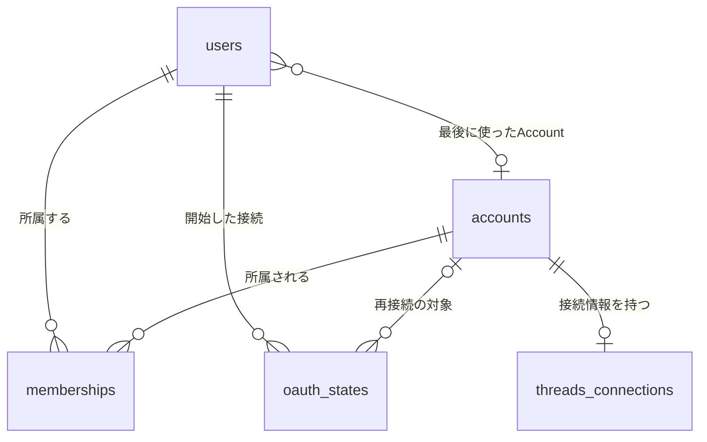
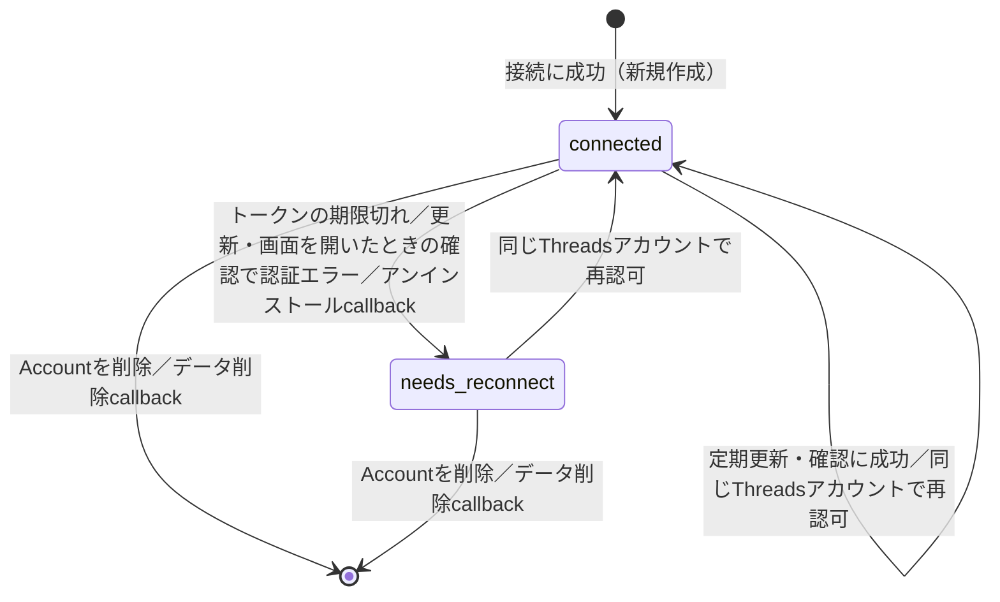
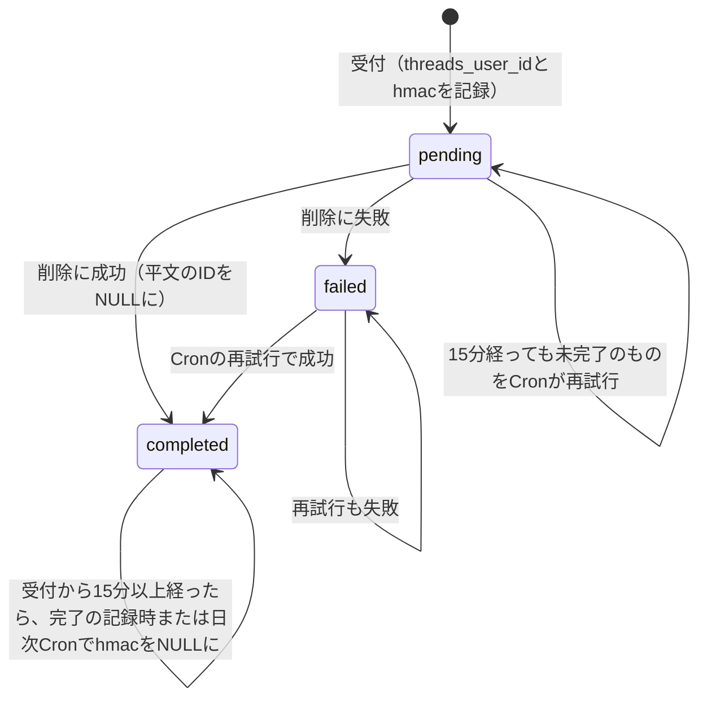

# データモデル（Phase 1 Data Model）：ログインとThreadsアカウント登録

**対象feature**：[spec.md](./spec.md) ／ **根拠**：[research.md](./research.md)

DBはNeon（Postgres）。テーブル名・列名はsnake_caseとする。IDはすべてUUID（v4）。日時はすべて`timestamptz`（UTC）。

## 関係の全体像

## 列挙型

| 型名 | 値 | 用途 |
|---|---|---|
| `account_plan` | `auto-only`, `auto-grower`, `multi-account`, `team` | Accountの契約プラン（PRD Glossary）。順位はこの並び順 |
| `membership_role` | `owner`, `member` | Membershipのロール。`member`はプラン4限定で、本featureでは作らない |
| `connection_status` | `connected`, `needs_reconnect` | Threads接続の状態（FR-018） |
| `oauth_mode` | `new`, `reconnect` | 接続フローの種類 |
| `deletion_status` | `pending`, `completed`, `failed` | Metaのデータ削除要求の進み具合（research.md R7） |

## users

アプリを使う個人。Clerkのユーザーと1対1で対応する。

| 列 | 型 | 制約 | 説明 |
|---|---|---|---|
| `id` | uuid | PK | |
| `clerk_user_id` | text | NOT NULL, UNIQUE | ClerkのユーザーID。同一性の判定に使う（FR-002） |
| `email` | text | NOT NULL | 表示用。ログインのたびにClerkの値で更新する |
| `display_name` | text | NULL可 | 表示用 |
| `last_account_id` | uuid | NULL可、FK → `accounts.id` ON DELETE SET NULL | 最後に使ったAccount（FR-004、FR-007） |
| `last_account_deleted_at` | timestamptz | NULL可 | このユーザーが最後にAccountを削除した日時。これより前に始めた`mode = new`の認可フローは拒否する（research.md R13） |
| `last_account_client_id` | text | NULL可 | `last_account_id`を記録した`open`の`clientId`（ブラウザのタブごとの乱数ID） |
| `last_account_open_seq` | bigint | NULL可 | 同じく`openSeq`。同じ`clientId`からの、これ以下の`openSeq`の記録は反映しない（research.md R10） |
| `created_at` / `updated_at` | timestamptz | NOT NULL | |

- **作成**：認証済みのAPIリクエストで、`clerk_user_id`に一致する行がなければ作る（research.md R2）。

## accounts

Threadsアカウント1件に対応する運用単位。

| 列 | 型 | 制約 | 説明 |
|---|---|---|---|
| `id` | uuid | PK | |
| `threads_user_id` | text | NOT NULL, UNIQUE | ThreadsのユーザーID。1つのThreadsアカウントにつきAccountは1件まで（FR-012） |
| `username` | text | NOT NULL | Threadsのユーザー名。削除の確認入力に使う（FR-022） |
| `display_name` | text | NULL可 | Threadsの表示名 |
| `profile_picture_url` | text | NULL可 | Meta CDNのURL。期限付きのため、定期更新と画面を開いたときに取り直す（research.md R6・R14） |
| `plan` | account_plan | NOT NULL | 初期値はサーバー側で決める（FR-014） |
| `connection_status` | connection_status | NOT NULL, 既定値`connected` | |
| `last_used_at` | timestamptz | NULL可 | 最後に画面が開かれた日時 |
| `connection_generation` | bigint | NOT NULL, 既定値0 | 接続の世代番号。トークンを書き込む・消すたびに1増やす。Accountが存在する限り単調に増え、初期値に戻らない（research.md R6） |
| `created_at` / `updated_at` | timestamptz | NOT NULL | |

- **競合制御**：Cron・画面を開いたときの確認・後続featureのヘルパーは、読んだ時点の`connection_generation`を条件にして書き込む。条件に合わなければ（その間に再接続・アンインストールなどで接続が変わっていれば）結果を捨てる。再接続のcallbackは条件なしで上書きし、世代番号を1増やす。世代番号をこの表に置くのは、接続行を削除して作り直しても番号が戻らないようにするため（ABA問題の防止、research.md R6）。
- **プランと上限**：`plan`はAccountが持ち、ロールは持たない（Constitution原則IV）。上限の判定方法はresearch.md R9を参照。
- **削除**：物理削除する。Accountに紐づくテーブルはすべて`ON DELETE CASCADE`とする（research.md R13。後続featureも守る規約）。

### 接続状態の遷移

## memberships

UserとAccountの関係。本featureでは、Account作成時に作成者を`owner`とする行を1件だけ作る（FR-011）。

| 列 | 型 | 制約 | 説明 |
|---|---|---|---|
| `id` | uuid | PK | |
| `user_id` | uuid | NOT NULL, FK → `users.id` ON DELETE CASCADE | |
| `account_id` | uuid | NOT NULL, FK → `accounts.id` ON DELETE CASCADE | |
| `role` | membership_role | NOT NULL | |
| `created_at` | timestamptz | NOT NULL | |

- **一意制約**：`(user_id, account_id)`。
- **部分一意インデックス**：`account_id WHERE role = 'owner'`。1つのAccountにownerは1人だけ。
- **アクセス制御**：APIでAccountを扱うときは、必ず「リクエストしたユーザーのMembershipがあるか」で絞り込む。Membershipがなければ、Accountが存在しても`ACCOUNT_NOT_FOUND`を返す（存在の有無を漏らさない）。

## threads_connections

AccountがThreadsにアクセスするための認証情報。Accountと1対1で対応する。

| 列 | 型 | 制約 | 説明 |
|---|---|---|---|
| `account_id` | uuid | PK, FK → `accounts.id` ON DELETE CASCADE | |
| `access_token_ciphertext` | bytea | NOT NULL | AES-256-GCMの暗号文。AADは`account_id`（research.md R5） |
| `access_token_iv` | bytea | NOT NULL | 12バイト。暗号化のたびに暗号学的乱数で新しく生成し、使い回さない（research.md R5） |
| `key_version` | smallint | NOT NULL | 暗号化に使った鍵のバージョン。復号時は、鍵リングからこのバージョンの鍵を選ぶ（research.md R5） |
| `scopes` | text[] | NOT NULL | 認可されたスコープ |
| `expires_at` | timestamptz | NOT NULL | 長期トークンの有効期限（発行から60日） |
| `issued_at` | timestamptz | NOT NULL | 発行または更新した日時。更新できるのは24時間経過後 |
| `created_at` / `updated_at` | timestamptz | NOT NULL | |

- **競合制御**：この表の行への書き込み・削除は、必ず`accounts.connection_generation`を1増やすのと同じ文（またはトランザクション）で行う。
- **行がない状態**：アンインストールのcallbackを受けると行を削除する。このときAccountは`needs_reconnect`になり、`connection_generation`が1増える。データ削除のcallbackでは、Accountごと削除する（research.md R7）。
- **平文を出さない**：この表の値はAPIのレスポンス・ログ・エラーのどこにも出さない（FR-010）。

## oauth_states

Threads接続フローの使い捨ての`state`（research.md R4）。

| 列 | 型 | 制約 | 説明 |
|---|---|---|---|
| `state_hash` | text | PK | `state`のSHA-256（hex）。平文は保存しない |
| `user_id` | uuid | NOT NULL, FK → `users.id` ON DELETE CASCADE | 接続を始めたユーザー |
| `mode` | oauth_mode | NOT NULL | |
| `target_account_id` | uuid | NULL可、FK → `accounts.id` ON DELETE CASCADE | `mode = reconnect`のときだけ必須（CHECK制約） |
| `expires_at` | timestamptz | NOT NULL | 作成から10分 |
| `created_at` | timestamptz | NOT NULL | |

- **消費**：callbackで`DELETE … RETURNING`して取得する。2回目以降は見つからない。
- **掃除**：日次のCronで期限切れの行を削除する。

## threads_deletion_requests

Metaのデータ削除callbackの受付記録、削除の進み具合、進行中の接続フローに対するtombstone（research.md R7）。Accountを削除しても、この行は残す（Accountへの外部キーは持たない）。

| 列 | 型 | 制約 | 説明 |
|---|---|---|---|
| `confirmation_code` | text | PK | Metaに返す確認コード（推測できない乱数） |
| `request_fingerprint` | text | NOT NULL, UNIQUE | 検証済み`signed_request`の文字列全体のSHA-256（hex）。Metaが同じcallbackを再送したときに、同じ要求だと判定する。署名部分を含むので、App Secretなしには元の値を推測できない（research.md R7） |
| `threads_user_id` | text | NULL可 | 対象のThreadsユーザーID（平文）。再試行に使う。`completed`にするのと同じトランザクションでNULLにする |
| `threads_user_hmac` | text | NULL可 | `HMAC-SHA256(IDENTIFIER_HASH_KEY, threads_user_id)`（hex）。受付時に記録する。tombstoneの確認に使う。`completed`で受付から15分以上経ったら、完了の記録時または日次CronでNULLにする（最長で完了から約25時間。research.md R7） |
| `status` | deletion_status | NOT NULL | 下の状態遷移を参照 |
| `received_at` | timestamptz | NOT NULL | |
| `last_attempted_at` | timestamptz | NOT NULL | 最後に削除を試みた日時。再試行のリースの起点であり、claimの条件（楽観的な排他）にも使う |
| `completed_at` | timestamptz | NULL可 | Accountと関連データを削除し終えた日時 |
| `attempts` | smallint | NOT NULL, 既定値0 | 削除を試みた回数 |

- **CHECK制約**：`status <> 'completed'`なら`threads_user_id IS NOT NULL`（完了するまでは再試行のために平文を保持する）。`status = 'completed'`なら`threads_user_id IS NULL`。
- **インデックス**：`threads_user_hmac`（tombstoneの確認用）、`(status, last_attempted_at)`（Cronの再試行の抽出用）。
- **再試行の対象**：`status IN ('pending', 'failed') AND last_attempted_at < now() - interval '15 minutes'`。`pending`（受付直後の中断からの回収）と`failed`を、同じリースで扱う。
- **claim**：試行のたびに、アドバイザリーロック → `SELECT … FOR UPDATE`での読み直し → `last_attempted_at`を条件にした`UPDATE … RETURNING`の順で、担当を確定する。claim・削除・完了の記録は1つのトランザクションで行い、claimできなかったWorkerは削除しない（research.md R7）。
- **tombstoneの確認**：callbackは、`threads_user_hmac`が一致し、次のどちらかに当たる行があれば登録を拒否する。(1) `status`が`pending` / `failed`（未完了。受付時刻は問わない）、(2) `received_at`が自分の`oauth_states.created_at`以降（状態は問わない）。平文ではなく鍵付きハッシュで照合するので、完了後に平文を消しても確認できる。未完了の行の`threads_user_hmac`は、完了するまで消さない（research.md R7）。
- **最終的に残る情報**：確認コード・状態・日時・試行回数だけ。どちらの識別子もNULLになる。
- **状況確認**：`GET /api/data-deletion/:confirmationCode`が`status`・`received_at`・`completed_at`だけを返す。識別子は外に出さない。

## 業務ルールとの対応

| ルール | 実現方法 |
|---|---|
| 1つのThreadsアカウントは1ユーザーだけが登録できる（FR-012） | `accounts.threads_user_id`の一意制約、callbackで所有者を確認 |
| 自分の既存Accountを再接続しても重複しない（FR-013） | callbackで`threads_user_id`を検索し、あれば更新 |
| 登録数の上限（FR-015〜FR-017） | `memberships`（owner）とその`accounts.plan`から計算。callbackでは`users`行をロックして再判定（research.md R8） |
| 再接続は同じThreadsアカウントだけ（FR-020） | `oauth_states.target_account_id`の`threads_user_id`と、認可されたユーザーIDを照合 |
| 最後に使ったAccount（FR-004、FR-007） | `users.last_account_id`と`accounts.last_used_at`。Accountの画面を開くたびに冪等に更新（research.md R10） |
| 再接続とCronの競合で新しい接続を壊さない（FR-018、FR-020） | `accounts.connection_generation`を条件にした書き込み（research.md R6） |
| データ削除要求の履行（research.md R7） | Accountのカスケード削除、`threads_deletion_requests.status`、`pending`のリース付き回収 |
| 削除要求の後に、進行中の接続フローでAccountを作り直さない（research.md R7） | Threadsユーザー単位のアドバイザリーロックと、`threads_user_hmac`によるtombstoneの確認 |
| 削除後に識別子を残さない（research.md R7） | 完了時に平文をNULL。hmacは受付から15分以上経ったら、完了の記録時または日次Cronで消す（最長で完了から約25時間） |
| Account削除で関連データも消える（FR-022） | 全テーブルの`ON DELETE CASCADE` |
| プランとロールの分離（原則IV） | `plan`は`accounts`だけ、`role`は`memberships`だけに持つ |
