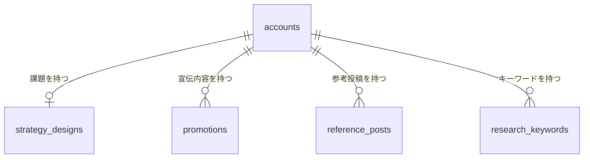
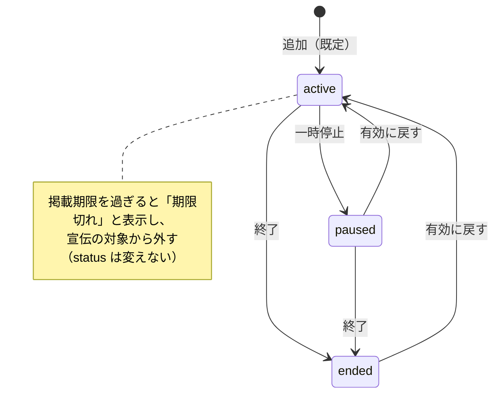

# データモデル（Phase 1 Data Model）：戦略プロファイル

**対象feature**：[spec.md](./spec.md) ／ **根拠**：[research.md](./research.md) ／ **001のデータモデル**：[001 data-model.md](../001-login-account-setup/data-model.md)

DBはNeon（Postgres）。001の規約をそのまま使う：テーブル名・列名はsnake_case、IDはUUID（v4）、日時は`timestamptz`（UTC）。Accountに紐づくテーブルはすべて`ON DELETE CASCADE`とする（001 research.md R13）。

## 関係の全体像

「戦略プロファイル」（spec Key Entities）は、上の4つと`accounts.promotion_ratio_percent`の総称で、それ自体のテーブルは持たない。

## 列挙型

| 型名 | 値 | 用途 |
|---|---|---|
| `tone_preset` | `energetic_casual`, `polite_warm`, `formal`, `casual_frank`, `introspective_calm`, `passionate`, `humorous` | 課題の「近い人間性」（FR-002）。順に「元気・カジュアル」「丁寧・温かい」「敬語ベース」「ため口・フランク」「内省的・静かめ」「情熱的・熱量高め」「ユーモア・自虐混じり」。未選択は`NULL` |
| `promotion_status` | `active`, `paused`, `ended` | 宣伝内容の状態（FR-007）。「有効」「一時停止」「終了」。「期限切れ」は列挙型に含めず、掲載期限から求める（research.md R6） |

## accounts（001のテーブルに列を追加）

| 列 | 型 | 制約 | 説明 |
|---|---|---|---|
| `promotion_ratio_percent` | smallint | NOT NULL、既定値20、`0 <= 値 <= 100` | 宣伝投稿の割合（FR-010、research.md R7） |

## strategy_designs（課題）

Accountと1対1。最初の保存で作る。行がないAccountは、全項目が空・`version = 0`として扱う（research.md R1）。

| 列 | 型 | 制約 | 説明 |
|---|---|---|---|
| `account_id` | uuid | PK、FK → `accounts.id` ON DELETE CASCADE | |
| `final_action` | text | NULL可 | 課題①：最終的に読者に取ってほしい行動 |
| `target_persona` | text | NULL可 | 課題①：どんな人に投稿を届けたいか（ターゲット） |
| `real_worries` | text | NULL可 | 課題①：ターゲットの本音の悩み |
| `desired_self_image` | text | NULL可 | 課題①：ターゲットの「なりたい姿」（理想像） |
| `perceived_image` | text | NULL可 | 課題①：このアカウントがどう見られたいか |
| `content_theme_mix` | text | NULL可 | 課題②：発信テーマの掛け合わせ |
| `anti_persona` | text | NULL可 | 課題②：来てほしくない人 |
| `benchmark_accounts` | text | NULL可 | 課題②：ベンチマークにしたい他アカウント |
| `funnel_design` | text | NULL可 | 課題③：集客導線の設計 |
| `post_genres` | text | NULL可 | 課題③：投稿ジャンル（3種類程度） |
| `dm_reply_template` | text | NULL可 | 課題③：DM返信の型 |
| `inquiry_quality_tips` | text | NULL可 | 課題③：問い合わせの質を上げるコツ |
| `tone_preset` | tone_preset | NULL可 | 人柄：近い人間性（NULLは未選択） |
| `tone_notes` | text | NULL可 | 人柄：その他の文体の条件 |
| `differentiation` | text | NULL可 | その他：競合・他アカウントとの違い |
| `success_metrics` | text | NULL可 | その他：成功の指標（KPI） |
| `profile_bio_draft` | text | NULL可 | プロフィール文（下書き） |
| `pinned_post_draft_1` / `_2` / `_3` | text | NULL可 | 固定投稿①〜③（下書き） |
| `version` | integer | NOT NULL、既定値1 | 保存のたびに1増やす（research.md R3） |
| `created_at` / `updated_at` | timestamptz | NOT NULL | `updated_at`が画面の「最終更新日時」（FR-006） |

- **テキスト列の共通の制約**：`char_length(列) <= 2000`（FR-021）。前後の空白を除いて空になる値は保存しない（`NULL`にする。research.md R2）。
- **入力済み項目数**（FR-005）：課題①〜③・人柄・その他の**16項目**（`final_action`〜`success_metrics`。`tone_preset`は`NULL`でなければ入力済み）のうち、`NULL`でないものの数。プロフィール文と固定投稿の下書き4項目は数えない。
- **項目の定義**：列名、画面のラベル・説明・記入例、区分、入力済み項目数に数えるかどうかは、`packages/shared`の1つの定数（`STRATEGY_FIELDS`）にまとめる。画面の描画、APIの検証、後続のプロンプト生成が同じ定義を使う。

## promotions（宣伝内容）

| 列 | 型 | 制約 | 説明 |
|---|---|---|---|
| `id` | uuid | PK | |
| `account_id` | uuid | NOT NULL、FK → `accounts.id` ON DELETE CASCADE | |
| `title` | text | NOT NULL、`1 <= char_length <= 100` | 管理用タイトル（投稿本文には使わない） |
| `content` | text | NOT NULL、`1 <= char_length <= 2000` | 宣伝したい内容 |
| `target_location` | text | NULL可、`char_length <= 100` | 届けたい属性：場所 |
| `target_persona` | text | NULL可、`char_length <= 100` | 届けたい属性：どんな人 |
| `target_age_range` | text | NULL可、`char_length <= 100` | 届けたい属性：年齢 |
| `cta` | text | NULL可、`char_length <= 100` | 読者に取ってほしい行動 |
| `linked_url` | text | NULL可、`char_length <= 2000` | 専用URL（`http:`・`https:`のみ。research.md R8） |
| `priority` | smallint | NOT NULL、既定値0、`0 <= 値 <= 100` | 優先度（高いほど優先） |
| `status` | promotion_status | NOT NULL、既定値`active` | |
| `valid_until` | date | NULL可 | 掲載期限。その日の終わり（日本時間）まで有効 |
| `version` | integer | NOT NULL、既定値1 | research.md R3 |
| `created_at` / `updated_at` | timestamptz | NOT NULL | |

- **インデックス**：`(account_id)`。
- **件数の上限**：1つのAccountにつき50件（FR-022、research.md R4）。
- **宣伝の対象**：`status = 'active'`かつ（`valid_until IS NULL`または`valid_until >= 日本時間の今日`）（FR-008、research.md R6）。
- **並び順**（FR-009）：宣伝の対象 → それ以外の順。それぞれの中は`priority`の降順、同じなら`created_at`の降順。

### 状態の移り変わり

どの状態からでも、編集で別の状態に変えられる。削除はどの状態からでもできる（FR-011）。

## reference_posts（参考投稿）

| 列 | 型 | 制約 | 説明 |
|---|---|---|---|
| `id` | uuid | PK | |
| `account_id` | uuid | NOT NULL、FK → `accounts.id` ON DELETE CASCADE | |
| `body` | text | NOT NULL、`1 <= char_length <= 2000` | 投稿の本文 |
| `keyword` | text | NULL可、`char_length <= 100` | 検索したキーワード（`research_keywords`とは結び付けない。キーワードを削除しても残る） |
| `post_url` | text | NULL可、`char_length <= 2000` | 投稿のURL（`http:`・`https:`のみ） |
| `why_good` | text | NULL可、`char_length <= 2000` | なぜ良いか（分析メモ） |
| `version` | integer | NOT NULL、既定値1 | research.md R3 |
| `created_at` / `updated_at` | timestamptz | NOT NULL | `created_at`が「保存日時」 |

- **インデックス**：`(account_id, created_at DESC)`。
- **件数の上限**：1つのAccountにつき200件（FR-022）。
- **並び順**（FR-013）：`created_at`の降順。

## research_keywords（リサーチキーワード）

| 列 | 型 | 制約 | 説明 |
|---|---|---|---|
| `id` | uuid | PK | |
| `account_id` | uuid | NOT NULL、FK → `accounts.id` ON DELETE CASCADE | |
| `keyword` | text | NOT NULL、`1 <= char_length <= 100` | 入力されたままのキーワード |
| `keyword_normalized` | text | NOT NULL | 重複判定用（NFKC → 前後の空白を除く → 小文字。research.md R5） |
| `purpose` | text | NULL可、`char_length <= 100` | 狙いのメモ |
| `version` | integer | NOT NULL、既定値1 | research.md R3 |
| `created_at` / `updated_at` | timestamptz | NOT NULL | |

- **一意制約**：`(account_id, keyword_normalized)`（FR-014）。
- **件数の上限**：1つのAccountにつき100件（FR-022）。
- **並び順**：`created_at`の降順。

## 共通の規則

- **アクセス制御**：どのテーブルも、001の`findOwnedAccount`（リクエストしたユーザーが`owner`のMembershipを持つAccountだけを返す）でAccountを確かめてから読み書きする。子の行（宣伝内容など）は、必ず`account_id`も条件に含めて取得・更新する。他人のAccountのものは`404 ACCOUNT_NOT_FOUND`、自分のAccountにない行は`404 ITEM_NOT_FOUND`にする（FR-023）。
- **Accountの削除**：`ON DELETE CASCADE`で、上の4つのテーブルの行がすべて消える（FR-026）。001のAccount削除・Metaのデータ削除要求の処理は変えなくてよい。
- **「要再接続」のAccount**：接続状態は読み書きの条件にしない（FR-025）。
- **grower機能の判定**（FR-024、research.md R14）：書き込みは、Accountのプランがプラン2以上か、ユーザーが無料体験中（`users.created_at`から1か月）の場合だけ許可する。読み取りは判定しない。判定のための列は足さない。
- **マイグレーション**：`apps/api/drizzle/`に1本追加する（列挙型2つ、テーブル4つ、`accounts`への列1つ）。既存のAccountには`promotion_ratio_percent = 20`が入る。
