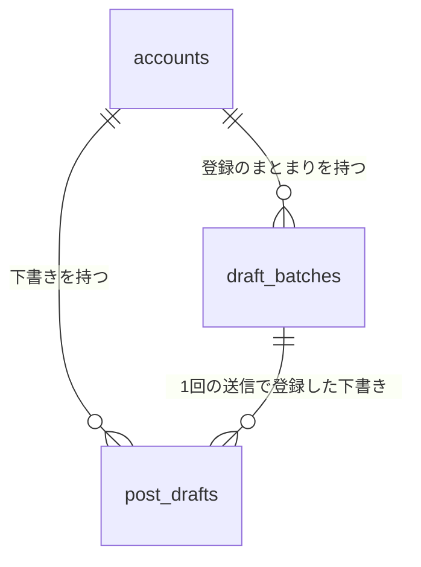
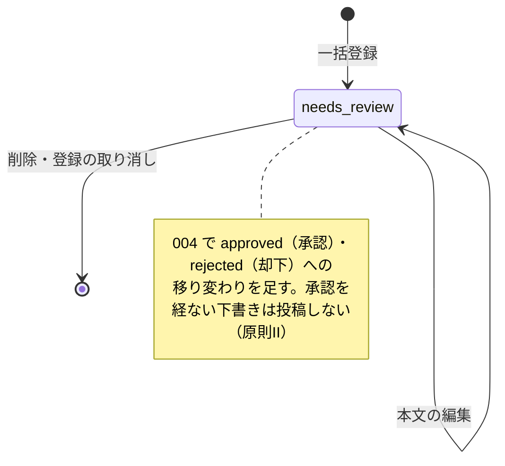

# データモデル（Phase 1 Data Model）：AIプロンプトの生成と投稿案の一括登録

**対象feature**：[spec.md](./spec.md) ／ **根拠**：[research.md](./research.md) ／ **これまでのデータモデル**：[001](../001-login-account-setup/data-model.md)、[002](../002-strategy-profile/data-model.md)

001・002の規約をそのまま使う：テーブル名・列名はsnake_case、IDはUUID（v4）、日時は`timestamptz`（UTC）、Accountに紐づくテーブルはすべて`ON DELETE CASCADE`。

## 関係の全体像

プロンプトはテーブルに保存しない。表示のたびに、002の課題・宣伝内容・参考投稿と下書きから組み立てる（research.md R1）。

## 列挙型

| 型名 | 値 | 用途 |
|---|---|---|
| `post_draft_status` | `needs_review` | 下書きの状態。003では「要確認」だけ。004で`approved`（承認済み）・`rejected`（却下）を足す |

## accounts（001のテーブルに列を追加）

| 列 | 型 | 制約 | 説明 |
|---|---|---|---|
| `prompt_post_count` | smallint | NOT NULL、既定値30、`1 <= 値 <= 50` | プロンプトで作る件数（FR-004、research.md R11） |

## draft_batches（登録のまとまり）

貼り付けの1回の送信。二重送信の判定（R5）と、直前の登録の取り消し（R8）、並び順（R7）に使う。

| 列 | 型 | 制約 | 説明 |
|---|---|---|---|
| `id` | uuid | PK | |
| `account_id` | uuid | NOT NULL、FK → `accounts.id` ON DELETE CASCADE | |
| `client_request_id` | uuid | NOT NULL | Webが送信ごとに作るID。再試行では同じ値（R5） |
| `draft_count` | smallint | NOT NULL、`1 <= 値 <= 50` | 登録した件数 |
| `delimiter_found` | boolean | NOT NULL | 区切り（@@@）が見つかったか（FR-011） |
| `created_at` | timestamptz | NOT NULL | 一覧の並び順に使う |

- **一意制約**：`(account_id, client_request_id)`。
- 取り消し（R8）では、この行は残し、下書きだけを削除する。

## post_drafts（下書き）

| 列 | 型 | 制約 | 説明 |
|---|---|---|---|
| `id` | uuid | PK | |
| `account_id` | uuid | NOT NULL、FK → `accounts.id` ON DELETE CASCADE | |
| `batch_id` | uuid | NOT NULL、FK → `draft_batches.id` ON DELETE CASCADE | 登録のまとまり |
| `position` | smallint | NOT NULL、`0 <= 値 < 50` | 登録のまとまりの中での順番（貼り付けたテキストの順） |
| `body` | text | NOT NULL、`1 <= char_length <= 2000` | 本文。前後の空白は登録時に取り除く |
| `status` | post_draft_status | NOT NULL、既定値`needs_review` | |
| `version` | integer | NOT NULL、既定値1 | 編集のたびに1増やす（002 research.md R3） |
| `created_at` / `updated_at` | timestamptz | NOT NULL | |

- **一意制約**：`(batch_id, position)`。
- **インデックス**：`(account_id, status)`。
- **並び順**（FR-018、spec Clarifications Q2）：`draft_batches.created_at`の降順 → `position`の昇順。
- **件数の上限**：1つのAccountの`needs_review`の下書きは500件まで（FR-014、R6）。
- **Threadsの長さ**：保存はしない。表示のたびに`threadsLength`・`countLinks`で求める（R4）。

### 状態の移り変わり

## 共通の規則

- **アクセス制御**：001の`findOwnedAccount`でAccountを確かめてから読み書きする。下書き・登録のまとまりは、必ず`account_id`も条件に含める。他人のAccountは`404 ACCOUNT_NOT_FOUND`、自分のAccountにない下書き・登録のまとまりは`404 ITEM_NOT_FOUND`（002と同じ）。
- **grower機能**：プロンプトの取得と作る件数の保存だけを判定する。下書きの操作は全プラン（R10）。
- **Accountの削除**：`ON DELETE CASCADE`で、登録のまとまりと下書きがすべて消える（FR-026）。
- **マイグレーション**：`apps/api/drizzle/`に1本追加する（列挙型1つ、テーブル2つ、`accounts`への列1つ）。既存のAccountには`prompt_post_count = 30`が入る。
