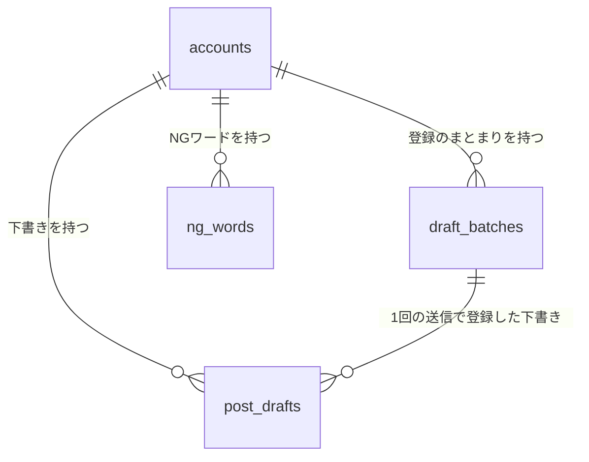
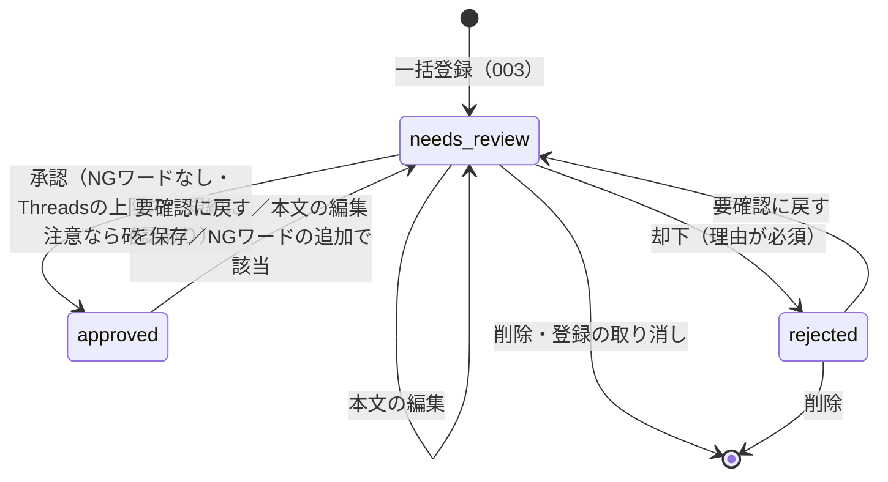

# データモデル（Phase 1 Data Model）：重複検知・承認/却下・NGワード（CORE RULES）

**対象feature**：[spec.md](./spec.md) ／ **根拠**：[research.md](./research.md) ／ **これまでのデータモデル**：[001](../001-login-account-setup/data-model.md)、[002](../002-strategy-profile/data-model.md)、[003](../003-prompt-bulk-register/data-model.md)

001〜003の規約をそのまま使う。
- テーブル名・列名はsnake_case、IDはUUID（v4）、日時は`timestamptz`（UTC）
- Accountに紐づくテーブルは、すべて`ON DELETE CASCADE`

## 関係の全体像

次のものはテーブルに保存しない。
- **類似度**：表示のたびにWebで求める（research.md R8）
- **規約の注意の一覧・規約上のルール**：`packages/shared`の定数（R7、[contracts/policy-cautions.md](./contracts/policy-cautions.md)）
- **却下ログ**：「状態が却下の下書き＋却下理由」で表す（R1）

## 列挙型

| 型名 | 値 | 変更 |
|---|---|---|
| `post_draft_status` | `needs_review`、`approved`、`rejected` | `approved`（承認済み）・`rejected`（却下）を足す（`ALTER TYPE … ADD VALUE`） |

却下理由の候補のコード（`similar`・`tone`・`thin`・`inaccurate`・`too_promotional`・`policy`。R10）は、列挙型にせず`text[]`に保存する。候補の追加でマイグレーションが要らないようにするため。検証はAPIのzodのスキーマで行う。

## accounts（001のテーブルに列を追加）

| 列 | 型 | 制約 | 説明 |
|---|---|---|---|
| `core_rules` | text | NOT NULL、既定値`''`、`char_length <= 2000` | 投稿ルール（CORE RULES）。1行に1つのルール（FR-019、R11） |
| `core_rules_version` | integer | NOT NULL、既定値1 | 投稿ルールの保存のたびに1増やす（002 R3） |

## post_drafts（003のテーブルに列を追加）

| 列 | 型 | 制約 | 説明 |
|---|---|---|---|
| `reviewed_at` | timestamptz | NULL可 | 承認・却下した日時。承認済み・却下のタブの並び順（FR-012） |
| `reject_reasons` | text[] | NULL可 | 選んだ却下理由の候補のコード（R10） |
| `reject_note` | text | NULL可、`char_length <= 200` | 却下理由の自由記述 |

- **状態と記録の組み合わせ**（CHECK制約`post_drafts_review_state`。R1）：
  - `status::text = 'needs_review'`：`reviewed_at`・`reject_reasons`・`reject_note`がすべてNULL
  - `status::text = 'approved'`：`reviewed_at`がNOT NULL、`reject_reasons`・`reject_note`がNULL
  - `status::text = 'rejected'`：`reviewed_at`がNOT NULL、かつ`coalesce(cardinality(reject_reasons), 0) >= 1 OR coalesce(btrim(reject_note), '') <> ''`
  - NULLとの比較はCHECK制約を通ってしまう（式がNULLなら合格になる）ため、`coalesce`で必ず真か偽にする。
  - 状態は列挙型の値ではなく、`status::text`の文字列で比べる（下の「マイグレーション」）。
- **インデックス**：`(account_id, status, reviewed_at DESC)`を足す。003の`(account_id, status)`は、このインデックスで代えられるので消す。
- **件数の上限**：
  - 要確認：500件（003）
  - 承認済み：500件（R9）
  - 却下：上限なし。一覧のAPIは新しい順に500件まで返す
  - 上限の確認は、「Account × 下書き」のアドバイザリーロックの中で行う（R3）
- **`version`**：本文の編集に加え、状態の変更（承認・却下・要確認に戻す）のたびに1増やす（R1）。

### 状態の移り変わり

- 承認済みの下書きは直接削除しない（FR-009）。要確認に戻してから削除する。
- 却下の下書きは編集できない（R5）。
- 005で、`approved`から投稿済みへの移り変わりを足す。

## ng_words（NGワード。新規）

| 列 | 型 | 制約 | 説明 |
|---|---|---|---|
| `id` | uuid | PK | |
| `account_id` | uuid | NOT NULL、FK → `accounts.id` ON DELETE CASCADE | |
| `word` | text | NOT NULL、`1 <= char_length <= 50` | 入力のままの言葉（前後の空白を除く）。画面とプロンプトに出す |
| `normalized` | text | NOT NULL | 照合と重複の判定に使う値（1文字ずつNFKC → 小文字。R4） |
| `created_at` | timestamptz | NOT NULL | 一覧とプロンプトでの並び順（古い順） |

- **一意制約**：`(account_id, normalized)`。
- **件数の上限**：1つのAccountにつき200語（FR-014）。追加は「Account × 下書き」のアドバイザリーロックの中で数えてから行う（R3・R6）。
- 全プランで追加・削除できる（FR-017）。

## 共通の規則

- **アクセス制御**：001の`findOwnedAccount`でAccountを確かめてから読み書きする。下書き・NGワードは、必ず`account_id`も条件に含める。
  - 他人のAccount：`404 ACCOUNT_NOT_FOUND`
  - 自分のAccountにない下書き・NGワード：`404 ITEM_NOT_FOUND`、またはまとめての操作では`skipped: NOT_FOUND`
- **grower機能**：投稿ルールの保存だけを判定する（FR-020）。承認・却下・NGワードは全プラン（FR-034）。
- **Accountの削除**：`ON DELETE CASCADE`で、NGワード・下書き（承認・却下の記録を含む）が消える。投稿ルールは`accounts`の列なので一緒に消える（FR-036）。
- **マイグレーション**：`apps/api/drizzle/`に1本追加する（`0003_review_approval.sql`）。中身は次のとおり。
  - 列挙型への値の追加
  - `post_drafts`への列3つと、CHECK制約・インデックスの付け替え
  - `accounts`への列2つ
  - `ng_words`テーブル

  既存の下書きはすべて`needs_review`で、新しい列はNULLなので、CHECK制約をそのまま満たす。`ADD VALUE`で足した値は、同じトランザクションの中では列挙型として使えない（PostgreSQLの制約）。drizzleは未適用のマイグレーションを1つのトランザクションで当てるため、ファイルを分けても避けられない。そこで、CHECK制約では状態を`status::text`の文字列で比べ、新しい値を列挙型として使わない。
