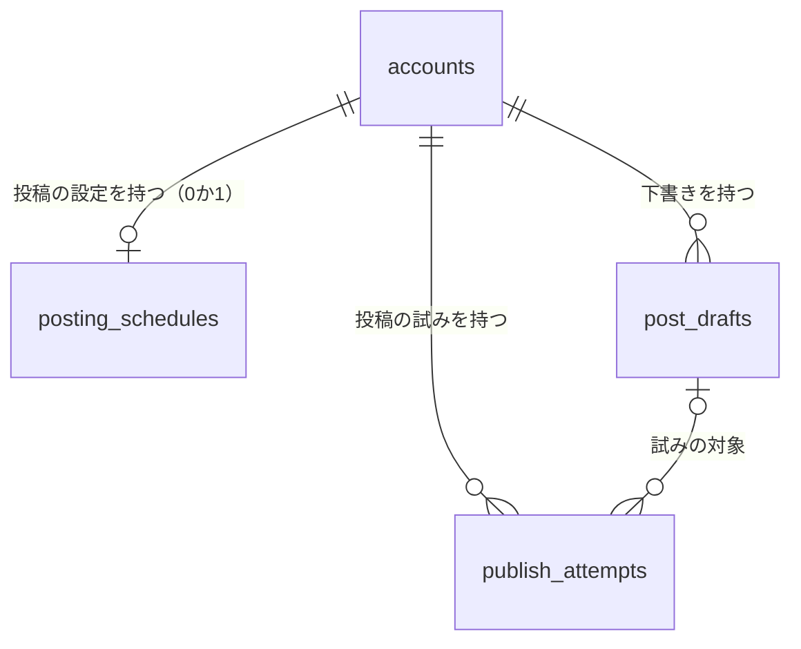
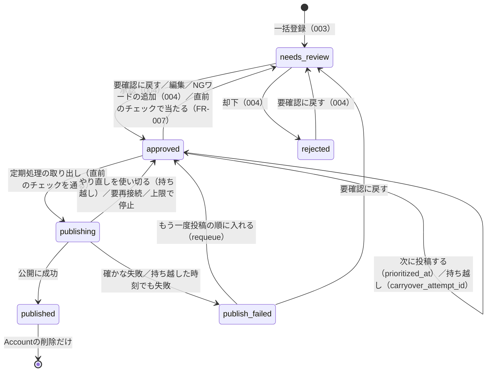
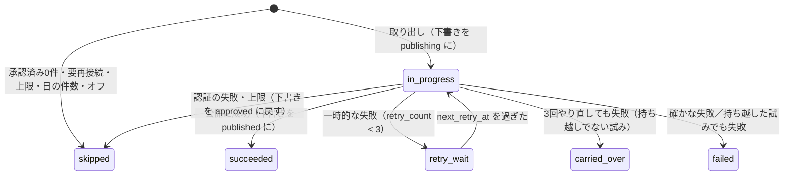

# データモデル（Phase 1 Data Model）：スケジュール投稿・自動投稿

**対象feature**：[spec.md](./spec.md) ／ **根拠**：[research.md](./research.md) ／ **これまでのデータモデル**：[001](../001-login-account-setup/data-model.md)、[002](../002-strategy-profile/data-model.md)、[003](../003-prompt-bulk-register/data-model.md)、[004](../004-review-approval/data-model.md)

001〜004の規約をそのまま使う。
- テーブル名・列名はsnake_case、IDはUUID（v4）、日時は`timestamptz`（UTC）
- Accountに紐づくテーブルは、すべて`ON DELETE CASCADE`

## 関係の全体像

次のものはテーブルに保存しない。
- **その日の予定（ずらした時刻）**：`plannedSlotTime`で毎回同じ値を求める（research.md R2）
- **知らせ**：状態から読むたびに求める（R8）
- **KVの関所**：Workers KVの`autopost:gate`・`autopost:wake`（R3）。DBには持たない

## 列挙型

| 型名 | 値 | 変更 |
|---|---|---|
| `post_draft_status` | `needs_review`、`approved`、`rejected`、`publishing`、`published`、`publish_failed` | `publishing`（処理中）・`published`（投稿済み）・`publish_failed`（投稿に失敗）を足す（`ALTER TYPE … ADD VALUE`） |
| `publish_attempt_state` | `in_progress`、`retry_wait`、`succeeded`、`carried_over`、`failed`、`skipped` | 新規 |

失敗の理由（`publish_error`・`last_error`）と、飛ばした理由（`skip_reason`）・直前のチェックの理由（`blocked_reason`）は、列挙型にせず`text`にし、CHECK制約で値を絞る。理由の追加で、列挙型の変更が要らないようにするため（004の却下理由と同じ考え方）。

| 列 | 値 |
|---|---|
| `publish_error`・`last_error` | `network`（Threadsとの通信の失敗）、`threads_server`（Threads側のエラー）、`invalid_request`（Threadsが受け付けない内容）、`container_error`（Threadsでの処理の失敗）、`unknown` |
| `skip_reason` | `no_drafts`、`needs_reconnect`、`rate_limited`、`daily_limit`、`auto_post_off` |
| `blocked_reason` | `ng_word`、`over_threads_limit` |

## posting_schedules（投稿の設定。新規）

Accountと1対1。最初の保存で作る。行がなければ既定値として扱う（R1）。

| 列 | 型 | 制約 | 説明 |
|---|---|---|---|
| `account_id` | uuid | PK、FK → `accounts.id`（CASCADE） | |
| `enabled` | boolean | NOT NULL、既定値false | 自動投稿のオン・オフ（FR-002） |
| `slot_minutes` | smallint[] | NOT NULL、既定値`{}` | 1日に投稿する時刻（日本時間、0時からの分）。昇順・重複なし・最大10件 |
| `jitter` | boolean | NOT NULL、既定値true | 時刻を少しずらす（FR-001a） |
| `effective_from` | timestamptz(6) | NOT NULL、既定値now() | この時刻より後の予定だけを投稿する（FR-012・FR-016。R1・R7） |
| `paused_until` | timestamptz | NULL可 | Threadsの投稿数の上限で止めたとき、翌日の0時（日本時間）（FR-017） |
| `blocked_notice_seen_at` | timestamptz(6) | NULL可 | 「投稿の直前に要確認へ戻した」の知らせを閉じた日時（R8） |
| `version` | integer | NOT NULL、既定値1 | 競合の検知（002 R3） |
| `created_at`・`updated_at` | timestamptz | NOT NULL | |

- **CHECK制約**：
  - `cardinality(slot_minutes) <= 10`
  - 要素は0〜1439（`slot_minutes <@ 0〜1439の配列`の代わりに、`0 <= ALL(slot_minutes) AND 1439 >= ALL(slot_minutes)`）
  - `NOT enabled OR cardinality(slot_minutes) >= 1`（FR-002）
  - 昇順・重複なし・30分の間は、APIの`validatePostingSchedule`で確かめる。配列の並びをCHECK制約で書くと読みにくいため。
- **インデックス**：`(enabled) WHERE enabled`。定期処理がオンのAccountだけを読むため。
- `effective_from`は、オフからオンにした・時刻を変えた・ずらすかを切り替えたときに今にする。再接続（001の`writeConnection`）でも、行があれば今にする。
- `version`は、ユーザーの保存でだけ1増やす。定期処理が書く`paused_until`、知らせを閉じたときの`blocked_notice_seen_at`、再接続での`effective_from`では増やさない。設定の画面で競合を出さないため。

## post_drafts（003・004のテーブルに列を追加）

| 列 | 型 | 制約 | 説明 |
|---|---|---|---|
| `prioritized_at` | timestamptz(6) | NULL可 | 「次に投稿する」「もう一度投稿の順に入れる」の日時（R4） |
| `carryover_attempt_id` | uuid | NULL可、FK → `publish_attempts.id`（SET NULL） | 前の時刻で公開できず、次の時刻に持ち越した試み（R6） |
| `published_at` | timestamptz(6) | NULL可 | 投稿した日時（FR-009） |
| `threads_media_id` | text | NULL可 | Threadsの投稿のID |
| `threads_permalink` | text | NULL可、`char_length <= 2000` | Threadsの投稿のURL。公開の後に取るので、一時的に空のことがある（R6） |
| `permalink_checked_at` | timestamptz | NULL可 | URLの取り直しに最後に失敗した日時。失敗した投稿を`AUTOPOST_PERMALINK_RETRY_MINUTES`の間は選ばない（contracts/auto-post-job.md 手順5） |
| `publish_failed_at` | timestamptz(6) | NULL可 | 投稿に失敗にした日時 |
| `publish_error` | text | NULL可、値は上の表 | 投稿に失敗の理由 |
| `blocked_at` | timestamptz(6) | NULL可 | 投稿の直前のチェックで要確認に戻した日時（FR-007） |
| `blocked_reason` | text | NULL可、値は上の表 | 戻した理由 |
| `blocked_words` | text[] | NULL可 | 当たったNGワード（入力のまま。`ng_word`のときだけ） |

- **状態と記録の組み合わせ**（CHECK制約`post_drafts_review_state`を置き換える。004と同じく`status::text`で比べ、NULLとの比較は`coalesce`で真か偽にする）：

  | 状態 | `reviewed_at` | 却下理由 | 投稿の記録（`published_at`） | 失敗の記録（`publish_failed_at`・`publish_error`） | `prioritized_at`・`carryover_attempt_id` |
  |---|---|---|---|---|---|
  | `needs_review` | NULL | NULL | NULL | NULL | NULL |
  | `approved` | NOT NULL | NULL | NULL | NULL | 任意 |
  | `rejected` | NOT NULL | 1件以上か自由記述（004） | NULL | NULL | NULL |
  | `publishing` | NOT NULL | NULL | NULL | NULL | 任意 |
  | `published` | NOT NULL | NULL | NOT NULL | NULL | NULL |
  | `publish_failed` | NOT NULL | NULL | NULL | ともにNOT NULL | NULL |

  - `blocked_*`は、`needs_review`のときだけ入れてよい（CHECK制約`post_drafts_blocked_state`）。`blocked_at`と`blocked_reason`は、両方あるか両方ないか。
  - `threads_media_id`・`threads_permalink`は、`published`のときだけ入れてよい（`published`でも空のことがある。R6）。
- **インデックス**：
  - 投稿の順を読むため：`(account_id, status, prioritized_at DESC NULLS LAST, reviewed_at, id)`。004の`(account_id, status, reviewed_at DESC)`は残す（却下のタブで使う）。
  - 投稿済みの一覧と件数のため：`(account_id, status, published_at DESC, id)`。新しい列挙型の値を条件にした部分インデックスにはしない（下の「マイグレーション」）。
- **件数の上限**：
  - 承認済み（処理中を含む）：500件（004）。`requeue`でも数える。
  - 投稿済み・投稿に失敗：上限なし。投稿済みは、別のAPIで新しい順に50件ずつ返す（research.md R14）。投稿に失敗は、一覧のAPIですべて返す（失敗は自動投稿の時刻の分しか増えず、ユーザーが対処すると減る）。
- **`version`**：本featureの変更（取り出し・投稿済み・失敗・持ち越し・直前のチェックでの戻し・次に投稿する・`requeue`）でも、必ず1増やす。

### 状態の移り変わり

- `publishing`の下書きは、ユーザーの操作（編集・承認・却下・要確認に戻す・削除・次に投稿する）を受け付けない（FR-008）。
- `published`の下書きは、ユーザーの操作をどれも受け付けない（FR-020）。
- 要確認に戻すときは（どの経路でも）、`prioritized_at`・`carryover_attempt_id`を消す（FR-005a）。

## publish_attempts（投稿の試み。新規）

1つの時刻（ずらした後の予定の時刻）で、1つのAccountの投稿の処理を1行で表す（R6）。

| 列 | 型 | 制約 | 説明 |
|---|---|---|---|
| `id` | uuid | PK | |
| `account_id` | uuid | NOT NULL、FK → `accounts.id`（CASCADE） | |
| `slot_at` | timestamptz | NOT NULL | ずらした後の予定の時刻 |
| `slot_date` | date | NOT NULL | 予定の日付（日本時間）。その日の件数の判定に使う |
| `slot_minute` | smallint | NOT NULL、0〜1439 | 設定の時刻（ずらす前） |
| `draft_id` | uuid | NULL可、FK → `post_drafts.id`（SET NULL） | 公開しようとした下書き。飛ばした時刻はNULL |
| `is_carryover` | boolean | NOT NULL、既定値false | 前の時刻からの持ち越しか |
| `state` | `publish_attempt_state` | NOT NULL | |
| `skip_reason` | text | NULL可、値は上の表 | `skipped`のときだけ必須 |
| `retry_count` | smallint | NOT NULL、既定値0、0〜3 | この時刻の中でのやり直しの回数（FR-013） |
| `next_retry_at` | timestamptz | NULL可 | `retry_wait`のときだけ必須 |
| `container_id` | text | NULL可 | 作ったThreadsのコンテナーのID。公開を送る前に保存する |
| `publish_requested_at` | timestamptz(6) | NULL可 | 公開を送った時刻。これがあり結果が未確定なら、新しいコンテナーを作らない（R6） |
| `last_error` | text | NULL可、値は上の表 | 最後の失敗の理由 |
| `lease_until` | timestamptz | NULL可 | 処理している定期処理の持ち時間。過ぎていれば、ほかの処理が引き継げる。待機では「次に確かめる時刻」 |
| `lease_token` | uuid | NULL可 | 持ち時間を取った処理の札。取るたびに新しくし、試みの更新は札が同じときだけ行う（持ち時間の切れた古い処理を締め出す）。再接続の片付けでは消す |
| `created_at`・`updated_at` | timestamptz(6) | NOT NULL | |

- **一意**：`(account_id, slot_at)`。同じ時刻を二重に処理しない。
- **インデックス**：`(state, next_retry_at) WHERE state IN ('in_progress', 'retry_wait')`（続きの処理を探すため）、`(account_id, slot_date)`（その日の使った時刻と件数）。
- **CHECK制約**：
  - `state = 'skipped'`なら`skip_reason`があり`draft_id`がない。それ以外なら`skip_reason`がない。
  - `state = 'retry_wait'`なら`next_retry_at`がある。
  - `state IN ('in_progress', 'retry_wait')`なら`draft_id`がある（処理中の下書きは削除できないため、NULLにならない）。
  - `succeeded`・`carried_over`・`failed`の行の`draft_id`は、下書きが要確認に戻って削除されるとNULLになる（SET NULL）。CHECK制約では縛らない。
- **残す期間**：最新の試みと、今日・昨日の行が予定の計算（R9）に要る。古い行は日次の定期処理で消す（`slot_date`が30日より前）。006で投稿の分析に要るのは`post_drafts`の投稿の記録なので、試みの行は長く残さない。

### 試みの状態の移り変わり

- 結果がわからないとき（`publish_requested_at`がある）は、`in_progress`のまま次の回に確かめる。やり直しの回数は増やさない（R6）。

## マイグレーション

`apps/api/drizzle/0005_auto_post.sql`（drizzle-kitで作ったまま）。

- `ALTER TYPE … ADD VALUE`で足した値は、同じトランザクションの中では列挙型として使えない。drizzleのマイグレーションは、未適用のファイルを**まとめて1つのトランザクションで**適用するので、ファイルを2つに分けても避けられない。
- そのため、新しい値を直接使わない形にした。
  - CHECK制約は、004と同じく`status::text`で比べる
  - インデックスに、新しい値を条件にした部分インデックスを使わない（投稿済みの一覧は`(account_id, status, published_at DESC, id)`の通常のインデックス）
  - 新しい値を既定値にしない
- `publish_attempt_state`は同じファイルで新しく作る型なので、部分インデックスの条件に使ってよい（制限は`ADD VALUE`で足した値だけ）。
- 空のDBへの適用と、004の状態のDB（既存の下書きあり）への適用の両方を確かめた（2026-10-05）。

既存の下書きは、どれも新しい列がNULLで、新しい状態を使っていないので、置き換えたCHECK制約を満たす（後方互換）。

## Accountの削除・データ削除（FR-026）

- `posting_schedules`・`publish_attempts`は、Accountの削除で一緒に消える（CASCADE）。
- Threads上の投稿は消さない。
- 001の「Metaのデータ削除要求」（Accountを消す処理）も同じ経路なので、追加の処理はない。
- 処理中にAccountが削除された場合、公開が送られていればThreadsには投稿が残る。アプリの記録は消える（spec FR-026のとおり、Threads上の投稿は削除しない）。
