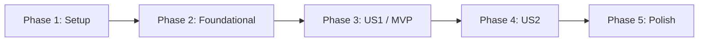

---

description: "Task list for feature 007 multi-account dashboard"
---

# Tasks: マルチアカウント・ダッシュボード

**Input**: [spec.md](./spec.md)、[plan.md](./plan.md)、[research.md](./research.md)、[data-model.md](./data-model.md)、[contracts/api.md](./contracts/api.md)、[contracts/ui-menu.md](./contracts/ui-menu.md)、[quickstart.md](./quickstart.md)

**Tests**: spec.md の各 User Story の Independent Test、SC-002・SC-003（件数・所有者の境界）、SC-005（表示時間）を確認する。APIとWebの自動確認は quickstart.md に定めた範囲を作り、見た目と速度は手動でも確かめる。

**Organization**: User Storyごとに実装と確認を分ける。既存のReact/Hono/DB構成を使い、新しい画面、保存項目、依存パッケージは足さない。

## Format: `[ID] [P?] [Story] Description`

- **[P]**: 別ファイルで、未完了のタスク同士に依存せず並行できる。
- **[Story]**: [US1]・[US2] は spec.md のUser Storyに対応する。
- すべてのタスクに変更または確認する正確なパスを書く。

## Phase 1: Setup（既存構成の確認）

**Purpose**: 新しい初期化やマイグレーションが不要なことを確認し、既存の切り替え・要確認の定義を作業の基準にする。

- [X] T001 `specs/007-multi-account-dashboard/plan.md`・`contracts/api.md` と `apps/api/src/routes/me.ts`・`apps/api/src/services/draft-service.ts`・`apps/web/src/components/layout/AccountSwitcher.tsx` を照合し、`needs_review` の数え方、ownerの範囲、既存の行順と移動先を確認する。

---

## Phase 2: Foundational（共通の契約）

**Purpose**: APIとWebが同じ応答を扱うための前提を整える。US1・US2に入る前に完了する。

- [X] T002 [P] `packages/shared/src/schemas.ts` に `GET /api/me/needs-review-counts` の応答スキーマと型を追加する。各項目の制約は `accountId: string`、`needsReview: integer >= 0`、応答は `{ counts: [...] }`。0を有効な件数として受け付け、所有Accountが0件なら空配列を受け付ける（`contracts/api.md`）。
- [X] T003 [P] `apps/web/src/lib/query.ts` に横断件数専用のクエリキーを追加する。既存の `queryKeys.me` とAccount別 `draftCounts` のキーを変更せず、メニューを開いた時だけ更新できるようにする（`research.md` R3）。

**Checkpoint**: 応答の型とキャッシュの識別子が使える。

---

## Phase 3: User Story 1 - 全アカウントの要確認を見て作業先を選ぶ (Priority: P1) 🎯 MVP

**Goal**: 切り替えメニューで所有Accountの要確認件数を同時に見て、従来どおり作業先へ移れる。

**Independent Test**: 所有Account 3件に要確認5件・2件・0件を用意し、メニューを1回開いて全件の数を確認する。5件のAccountを選んでその投稿ストックの「要確認」へ進める。操作後に再度開くと更新後の数が出る。

### Tests for User Story 1

- [X] T004 [P] [US1] `apps/api/test/integration/needs-review-counts.test.ts` に、認証なしは401、ownerの3件は5・2・0、下書き0件のAccountも応答、他人・owner以外を除外、要再接続でも集計、Account別件数との一致を確認する失敗先行の結合テストを作る（`contracts/api.md`）。
- [X] T005 [P] [US1] `apps/web/test/account-switcher.test.tsx` に、3件の「要確認 N件」、0件と取得中・取得失敗の区別、件数取得失敗でも行選択・追加が可能、毎回の開閉で `/api/me` → 集計の順に再取得、古い応答の上書き防止を確認する失敗先行のテストを作る。一覧にあるAccount IDが件数応答にない場合は一覧を1回再取得し、削除済みの行は消し、なお一覧に残る行で件数が欠ければ0件とせず「取得できません」と表示することも確認する（`contracts/ui-menu.md`）。

### Implementation for User Story 1

- [X] T006 [P] [US1] `apps/api/src/services/account-review-counts.ts` に、認証済み `user.id` かつ `Membership.role = owner` のAccountだけを、`PostDraft.status = needs_review` を左結合の条件にして1回で集計する関数を作る。各所有Accountを1回だけ返し、下書きがないAccountは0、所有Accountがない場合は空配列とする。Account IDの入力は受け取らない（`data-model.md`、`research.md` R2）。
- [X] T007 [US1] `apps/api/src/routes/me.ts` に認証付き `GET /api/me/needs-review-counts` を追加し、T006の結果を `{ counts: [...] }` で返す。`Cache-Control: no-store` を付け、集計に失敗しても既存の `GET /api/me` の処理・応答は変えない（`contracts/api.md`）。
- [X] T008 [P] [US1] `apps/web/src/lib/api-client.ts` にT002の応答スキーマで検証する横断件数の読み取りを追加する。既存の `/api/me` とAccount別件数の呼び出しは変えない（`contracts/api.md`）。
- [X] T009 [US1] `apps/web/src/components/layout/AccountSwitcher.tsx` でメニューを開くたびに `/api/me` の成功した最新一覧を確定してからT008の集計を1回読む。Account IDで対応づけ、「要確認 N件」を各行に表示し、0件・取得中・取得失敗・再試行を区別する。一覧にあるAccount IDが件数応答にない場合は一覧を1回再取得し、削除済みの行は消し、なお一覧に残る行で件数が欠ければその行を0件とせず「取得できません」と表示する。古いAccount一覧や件数を現在値として見せず、連続した開閉の古い結果で上書きしない。行選択と追加は件数失敗時も動かす（`contracts/ui-menu.md`）。

**Checkpoint**: US1単独で3件の要確認数を見て作業先を選べる。T004・T005が通る。

---

## Phase 4: User Story 2 - 状態を見ながらアカウントを切り替える (Priority: P2)

**Goal**: 件数と一緒に表示中・要再接続の状態を理解でき、PC・スマートフォンのどちらでも全項目を操作できる。

**Independent Test**: 接続済み2件・要再接続1件を用意し、表示中の印と要再接続の文字を確認する。任意の行と追加へ進める。スマートフォン幅の20件で末尾の項目まで到達できる。

### Tests for User Story 2

- [X] T010 [US2] `apps/web/test/account-switcher.test.tsx` に、表示中・要再接続・要確認0件の同時表示、既存のAccountホームへの移動とドロワーを閉じる動作、長い名前、20件の描画と追加操作へのキーボード到達、読み上げ用の文言を確認する失敗先行のテストを追加する。Account AからBへ切り替えた後、Bの投稿ストックと設定にAの投稿・設定が表示されないこと、および要再接続のAccountへ移動した先に「再接続」が示されることも確認する（`contracts/ui-menu.md`、SC-003・004）。実際の幅・スクロールはT014で確認する。

### Implementation for User Story 2

- [X] T011 [US2] `apps/web/src/components/layout/AccountSwitcher.tsx` の行で、チェック印に加えて「表示中」、既知の「要再接続」、件数を文字で区別できるようにする。長い名前を省略しても識別と状態を保ち、メニュー幅は画面内・高さは表示領域内に制限して20件をスクロールできるようにする。Radixの上下キー・Enter・Esc、視認できるフォーカス、44px以上の行を保つ（`contracts/ui-menu.md`、画面イメージ）。

**Checkpoint**: US2単独の既存切り替え機能と状態表示を確認でき、US1の件数表示とも共存する。T010が通る。

---

## Phase 5: Polish & Cross-Cutting Concerns

**Purpose**: 仕様との一致、既存の操作への影響、実機幅と速度を確認する。

- [X] T012 [P] `docs/ui-design.md` のアカウント切り替えメニューに「要確認 N件」、0件・取得失敗の区別、専用画面を作らない方針を追記し、`specs/007-multi-account-dashboard/spec.md` と一致させる。
- [X] T013 `specs/007-multi-account-dashboard/quickstart.md` に沿ってAPI・Webの対象テスト、`pnpm lint`、`pnpm typecheck`、`pnpm test`、`pnpm build` を実行し、結果と未実施の項目を `specs/007-multi-account-dashboard/verification.md` に記録する。
- [ ] T014 `specs/007-multi-account-dashboard/quickstart.md` の0件時の初回追加画面、1件・3件時の切り替えメニュー、3件の要確認数（5・2・0）、承認・却下後の更新、他人の除外、Account AからBへの切り替え後の投稿・設定の分離、要再接続の表示と移動先の「再接続」、PC 1280px・タブレット 768px・スマートフォン 390px、ライト・ダーク、20件のスクロールを手動で確認し、結果を `specs/007-multi-account-dashboard/verification.md` に記録する。
- [ ] T015 `specs/007-multi-account-dashboard/verification.md` に、安定した通信下で3件のメニュー表示を20回測って19回以上が2秒以内か、件数APIの応答を20回測って19回以上が500ms以内か、件数のHTTP呼び出しがAccount数に関係なく1回か、US1の投稿ストックへの移動が30秒以内かを記録し、未達なら `apps/api/src/services/account-review-counts.ts` または `apps/web/src/components/layout/AccountSwitcher.tsx` を調整して再確認する。

**Checkpoint**: 各User Storyの受け入れ条件とSC-001〜005を確認し、未解決の制約が記録されている。

---

## Dependencies & Execution Order

### Phase Dependencies

- Phase 1 → Phase 2 → US1・US2 → Phase 5。
- US1（P1）はMVP。US2（P2）の実装は同じ `AccountSwitcher.tsx` を編集するため、US1の完了後に重ねる。
- DBマイグレーション、別画面、定期処理は不要。



### User Story Dependencies

- **US1**: Phase 2の応答スキーマとクエリキーの後に開始する。T004・T005を先に失敗させ、T006とT008を並行できる。T007はT006の後、T009はT007・T008の後。
- **US2**: 表示中・要再接続・追加の既存操作を基に単独で確認できる。コードの同時編集を避けるため、この一覧ではUS1の後にT010→T011と進める。
- **Polish**: US1・US2の完了後。T012は検証作業と別ファイルなので並行できる。

### Parallel Opportunities

- T002（共通スキーマ）とT003（クエリキー）は別ファイルで並行できる。
- T004（APIテスト）とT005（Webテスト）は別ファイルで並行できる。
- T006（API集計）とT008（Web APIクライアント）は別ファイルで並行できる。
- T012（UI設計文書）は、US1・US2の実装後、T013以降の確認と並行できる。

### Parallel Example: User Story 1

```text
T004: apps/api/test/integration/needs-review-counts.test.ts — 所有者と5・2・0件の失敗先行テスト
T005: apps/web/test/account-switcher.test.tsx — 件数・再取得・失敗分離の失敗先行テスト

（両方が失敗した後、別ファイルで）
T006: apps/api/src/services/account-review-counts.ts — 1回の所有Account集計
T008: apps/web/src/lib/api-client.ts — 応答の読み取りと検証
```

### Parallel Example: User Story 2

```text
T010: apps/web/test/account-switcher.test.tsx — 状態・20件・操作の失敗先行テスト
T011: apps/web/src/components/layout/AccountSwitcher.tsx — 行の状態と操作・画面内スクロール
```

US2の2タスクは同じ挙動を先にテストで決めてから実装するため、順に進める。

---

## Implementation Strategy

### MVP First (User Story 1 Only)

1. Phase 1とPhase 2を完了する。
2. US1のT004・T005を先に失敗させ、T006〜T009を実装する。
3. US1のIndependent Test（3件の5・2・0件、切り替え、再度開いたときの更新）を確認する。この時点でPRD FR-11の中心価値を試せる。

### Incremental Delivery

1. US1 → 件数を見て作業先を選べるMVP。
2. US2 → 状態を文字で見分け、狭い画面と多いAccountでも操作できる。
3. Phase 5 → 全件の確認・速度・文書を仕上げる。

## Notes

- [P]はファイルと依存が独立している場合だけに付けた。
- テストは各User Storyの実装より先に失敗を確認する。
- タスクの完了印は、コード・結果・確認の記録を見てから付ける。
