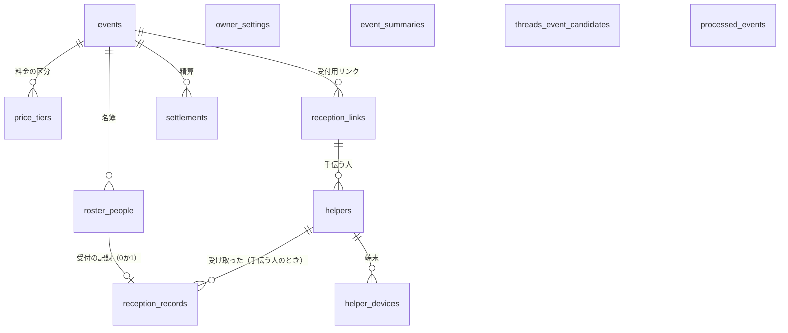
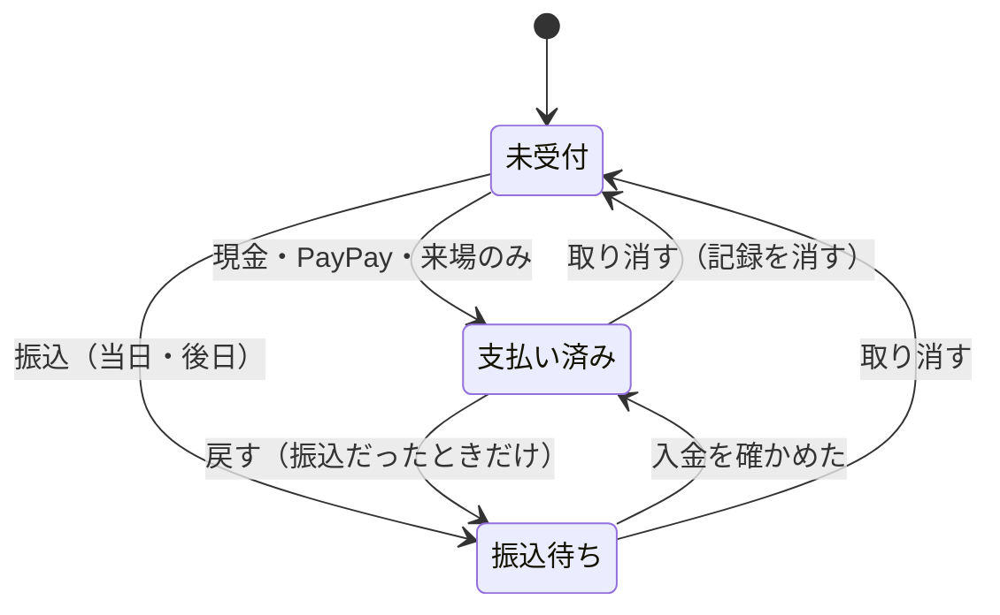

# データの形（Data Model）：当日の集金

**作成**：2026-11-12 | **対象**：[spec.md](./spec.md) Key Entities | **決めた理由**：[research.md](./research.md)

表はすべてPostgresのスキーマ`collect`に置く（R1）。共通の表への外部キーは張らず、利用者は番号の値（uuid）で持つ（R2）。外部キーは集金管理の表の中だけに張る。

## 1. 表の一覧

## 2. 表ごとの列

### 2-1. `events`（イベント）

| 列 | 型 | 決まり |
|---|---|---|
| id | uuid PK | |
| owner_user_id | uuid | 主催者（共通の利用者の番号。外部キーなし）。索引 |
| name | text | 必須・1〜100文字 |
| starts_at | timestamptz | 必須 |
| ends_at | timestamptz null | `starts_at`より後 |
| venue | text null | 100文字まで |
| capacity | integer null | 1〜10,000 |
| methods | text[] | `cash`・`paypay`・`transfer`の1つ以上。初めは3つとも |
| next_number | integer | 次に振る受付番号。初めは1（R8） |
| version | bigint | 受付の画面に関わる変更のたびに1上げる（R4） |
| closed_at | timestamptz null | 締めた時刻 |
| closed_version | bigint null | 締めたときの`version`。今の`version`と違えば「締めのあとで変わった」 |
| paypay_checked_at | timestamptz null | PayPayを「履歴と合った」にした時刻 |
| source_threads_promotion_id | text null | Threadsから作ったときの元の宣伝内容の番号（値だけ。User Story 6） |
| source_changed_at / source_deleted_at | timestamptz null | 元が直された・消された時刻（FR-063） |
| created_at / updated_at | timestamptz | |

### 2-2. `price_tiers`（料金の区分）

| 列 | 型 | 決まり |
|---|---|---|
| id | uuid PK | |
| event_id | uuid FK → events ON DELETE CASCADE | |
| name | text | 1〜20文字（例：通常・早割・紹介割・招待） |
| amount | integer | 0〜999,999（円） |
| position | integer | 並び順 |

- イベントに1つ以上。名簿の人か受付の記録が使っている区分は消せない（409 `TIER_IN_USE`。サービスで先に確かめる）。
- **外部キーの消し方**：イベントを消すと、`events`から`ON DELETE CASCADE`で料金の区分・名簿・受付の記録・リンク・手伝う人が同じ文の中で消える。`price_tier_id`・`receiver_helper_id`を`RESTRICT`にすると、消す順番によってはその場で確かめられて止まるので、**`NO ACTION`（文の終わりで確かめる）にする**。

### 2-3. `roster_people`（名簿の人）

| 列 | 型 | 決まり |
|---|---|---|
| id | uuid PK | |
| event_id | uuid FK → events ON DELETE CASCADE | |
| number | integer | 受付番号。`(event_id, number)`一意。使い回さない |
| name | text | 1〜50文字 |
| name_key | text | `nameKey(name)`（R9）。`(event_id, name_key)`に索引（一意ではない） |
| kana | text null | 50文字まで |
| kana_key | text null | `nameKey(kana)` |
| media | text | `minato`・`kokuchpro`・`tunagate`・`jimoty`・`peatix`・`youtrust`・`walk_in`・`other`（表示名は`@meguru/shared`） |
| price_tier_id | uuid FK → price_tiers（ON DELETE NO ACTION） | 1人に1つ。申込のときの予定の区分 |
| memo | text null | 200文字まで（紹介割の紹介者など） |
| added_by_helper_id | uuid null FK → helpers ON DELETE SET NULL | 飛び入りを手伝う人が足したとき |
| created_at | timestamptz | |

### 2-4. `reception_records`（受付の記録）

| 列 | 型 | 決まり |
|---|---|---|
| roster_person_id | uuid PK・FK → roster_people ON DELETE CASCADE | 1人に1行（二重の記録を止める。R6） |
| event_id | uuid FK → events ON DELETE CASCADE | 索引 |
| method | text | `cash`・`paypay`・`transfer_today`・`transfer_later`・`none` |
| price_tier_id | uuid FK → price_tiers（ON DELETE NO ACTION） | 記録したときの区分（受付で変えたら変えたもの。名簿の区分は変えない。FR-032） |
| amount | integer | 0〜999,999。`none`は0 |
| amount_overridden | boolean | 区分の金額から直接変えたか（FR-032） |
| receiver_kind | text | `owner`・`helper` |
| receiver_helper_id | uuid null FK → helpers（ON DELETE NO ACTION） | `receiver_kind = helper`のとき必須 |
| payment_status | text | `paid`・`awaiting_transfer`（振込のときだけ`awaiting_transfer`で始まる） |
| transfer_confirmed_at | timestamptz null | 入金を確かめた時刻 |
| recorded_at | timestamptz | |
| client_request_id | uuid | 一意（送り直しで二重にしない。R6） |

### 2-5. `reception_links`（受付用リンク）

| 列 | 型 | 決まり |
|---|---|---|
| id | uuid PK | |
| event_id | uuid FK → events ON DELETE CASCADE | |
| token_hash | text | 一意。引くため（R7） |
| token_ciphertext / token_iv / token_key_version | text / text / integer | 主催者がQRを出し直すため（`sealInviteToken`と同じ形） |
| expires_at | timestamptz | 既定は、開催日の日本時間23:59:59と、終わりの時刻（なければ開始の時刻）の1時間後の遅い方（R7） |
| stopped_at | timestamptz null | 止めた時刻 |
| created_at | timestamptz | |

- 使えるリンクは、イベントに1つだけ（`stopped_at IS NULL`の行が1つ。部分一意索引）。

### 2-6. `helpers`（手伝う人）・`helper_devices`（端末）

| 表 | 列 | 型 | 決まり |
|---|---|---|---|
| helpers | id | uuid PK | |
| | event_id | uuid FK → events ON DELETE CASCADE | |
| | link_id | uuid FK → reception_links ON DELETE CASCADE | 入ったリンク |
| | name / name_key | text | 1〜20文字。同じ`name_key`は、名前を入れた人が「別の人」と答えたときだけ2行になる（R7） |
| | joined_at | timestamptz | 同じ名前の人を見分ける印にも使う |
| | （数える） | | 端末の数＝`helper_devices`の行数。主催者の一覧に出す（FR-072） |
| helper_devices | id | uuid PK | |
| | helper_id | uuid FK → helpers ON DELETE CASCADE | |
| | secret_hash | text | 一意。端末の印のハッシュ |
| | created_at / last_seen_at | timestamptz | |

- リンクを止めた・期限が過ぎた：端末の印があっても、受付の呼び出しは410 `LINK_INACTIVE`。

### 2-7. `settlements`（精算）

| 列 | 型 | 決まり |
|---|---|---|
| event_id | uuid FK → events ON DELETE CASCADE | |
| receiver_key | text | `owner`か、手伝う人の番号。`(event_id, receiver_key)`がPK |
| counted_amount | integer null | 渡された額（主催者自身は数えた額） |
| settled_at | timestamptz null | 「精算した」「確かめた」の時刻 |

- 受け取った人ごとの合計（あるはずの額）は、`reception_records`の`method = cash`から毎回数える（持たない）。

### 2-8. `owner_settings`（主催者の既定値）

| 列 | 型 | 決まり |
|---|---|---|
| owner_user_id | uuid PK | |
| paypay_qr | bytea null | 300KB以内（R10） |
| paypay_qr_type | text null | `image/png`・`image/jpeg` |
| bank_text | text null | 振込先の案内。300文字まで |
| updated_at | timestamptz | |

### 2-9. `event_summaries`（イベントのまとめ）

| 列 | 型 | 決まり |
|---|---|---|
| id | uuid PK | |
| owner_user_id | uuid | 索引 |
| name / starts_at | text / timestamptz | 消したイベントのもの |
| roster_count / attended_count | integer | |
| by_method | jsonb | 払い方ごとの`{count, amount}` |
| by_media | jsonb | 媒体ごとの`{roster, attended, paid, awaiting}` |
| awaiting_transfer | jsonb | `{count, amount}` |
| event_deleted_at | timestamptz | |

- 参加者の名前・手伝う人の名前は入れない（FR-014）。

### 2-10. `threads_event_candidates`（イベントの候補。User Story 6）

| 列 | 型 | 決まり |
|---|---|---|
| promotion_id | text PK | Threadsの宣伝内容の番号 |
| threads_account_id | text | |
| owner_user_id | uuid | 見せる人（R15）。索引 |
| name / starts_at / ends_at / venue / capacity | | 届いた値 |
| fee_amount / fee_note | integer null / text null | 料金の区分の下書き |
| posted_media | text[] | 掲載済みの媒体（`roster_people.media`と同じ値） |
| deleted_at | timestamptz null | 消された印 |
| last_occurred_at | timestamptz | 古い出来事を捨てるため |

### 2-11. `processed_events`（受け取った出来事）

| 列 | 型 | 決まり |
|---|---|---|
| event_id | text PK | 出来事の番号 |
| processed_at | timestamptz | |

- 029が受け取りの共通の手助けを作るなら、そちらに合わせて置き換える（R12）。

## 3. 状態の移り変わり

**受付の記録**

- 取り消せるのは、主催者はすべて、手伝う人は自分が受け取った記録だけ（FR-039）。精算した人の現金の記録を取り消したら、その人の精算は「精算したあとで変わった」と出す。

**受付用リンク**：使える →（止める・期限が過ぎる）→ 使えない。出し直すと、新しいリンクが「使える」で始まる。

**イベント**：受付中 →（締める）→ 締めた。締めたあとに`version`が上がると「締めのあとで変わった」。消すと、まとめだけが残る。

## 4. 画面に返す数字（毎回数える）

| 数字 | 数え方 |
|---|---|
| 来場 | `reception_records`の行数 / `roster_people`の行数 |
| 現金・PayPay | `method`ごとの`amount`の合計 |
| 振込待ち | `payment_status = awaiting_transfer`の件数と合計 |
| 受け取った人ごとの現金 | `method = cash`を`receiver_kind`・`receiver_helper_id`ごとに合計 |
| 媒体ごと | `roster_people.media`ごとの名簿の人数・来場の数・支払い済みの合計・振込待ちの合計（金額は受付の記録の`amount`） |

1イベントの名簿は数十〜数百人を見込むので、索引（`event_id`）があれば、毎回数えても足りる。

## 5. マイグレーション

- スキーマ`collect`と上の表を、新しいマイグレーション（番号は作るときの`develop`の次）で作る。一度`develop`に入ったファイルは書き換えない（release-runbook.md 3）。
- 029がスキーマの作り方（`pgSchema`の置き方・マイグレーションの分け方）を決めたら、それに合わせる。
