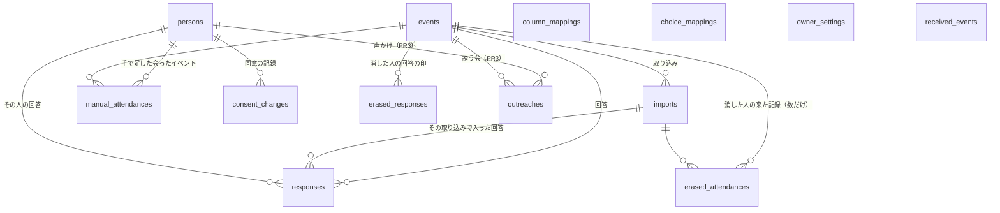
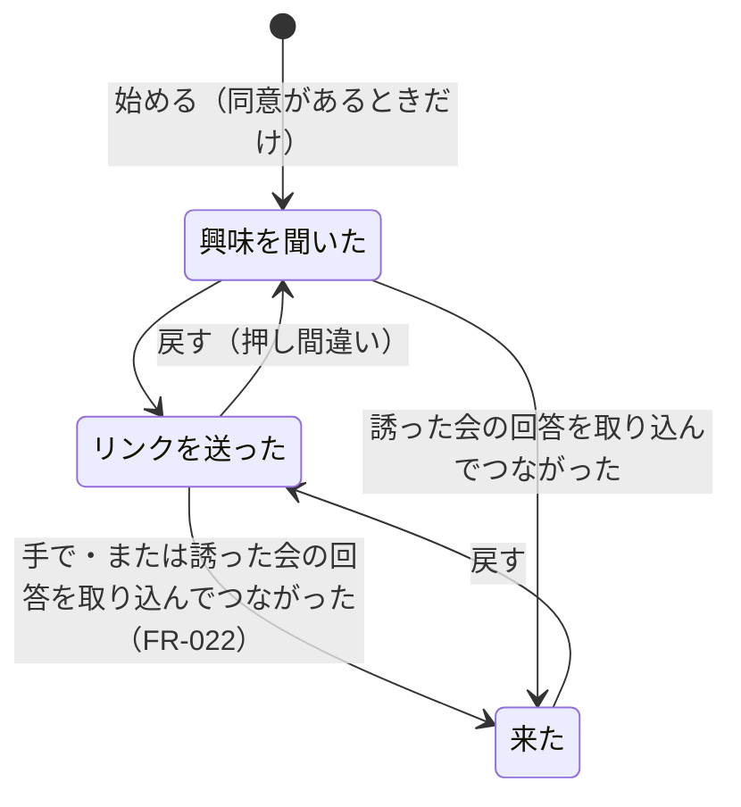
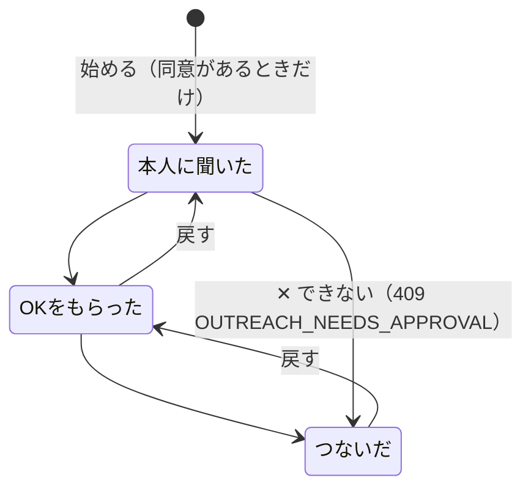

# データの形（Data Model）：人物メモ

**作成**：2026-11-13 | **対象**：[spec.md](./spec.md) Key Entities | **決めた理由**：[research.md](./research.md)

表はすべてPostgresのスキーマ`people`に置く（R1）。共通の表への外部キーは張らず、作り手は`user_id`（共通の利用者の番号。uuid）の値で持つ（R2）。外部キーは人物メモの表の中だけに張る。すべての表に`user_id`の索引を置き、すべての問い合わせを`user_id`で絞る（FR-032・R18）。

名前の列に一意の印は付けない（Postgresのエラーに名前が出ないように。R18）。名前の比べ方は`nameKey()`（R9）で作った`*_key`の列で行う。

## 1. 表の一覧

| 表 | 作るPR | 中身 |
|---|---|---|
| `events` | PR1 | イベント |
| `imports` | PR1 | 1回の取り込み（取り消しの単位） |
| `column_mappings` | PR1 | 質問文と項目の対応（覚えたもの） |
| `choice_mappings` | PR1 | 同意の選択肢と目的の対応（覚えたもの） |
| `persons` | PR1 | 人 |
| `responses` | PR1 | 回答（来た記録になる） |
| `manual_attendances` | PR1 | 手で足した「会ったイベント」（使うのはPR2から） |
| `consent_changes` | PR1 | 同意が変わった記録 |
| `erased_attendances` | PR1 | 消した人の来た記録（数だけ。使うのはPR2から） |
| `erased_responses` | PR1 | 消した人の回答の印（ハッシュだけ。使うのはPR2から） |
| `received_events` | PR1 | 受け取った出来事の番号 |
| `outreaches` | PR3 | 声かけ |
| `owner_settings` | PR3 | 誘いの文の型・リピーターの目標 |

## 2. 表ごとの列

### 2-1. `events`（イベント）

| 列 | 型 | 決まり |
|---|---|---|
| id | uuid PK | |
| user_id | uuid | 作り手。索引`(user_id, held_on)` |
| name | text | 必須・1〜100文字 |
| held_on | date | 必須。開催日（日本時間の日付） |
| is_own | boolean | 必須。自分の会か（初めは真） |
| created_at / updated_at | timestamptz | |

- 参加者数・初めて・前にもは持たない（毎回数える。4章）。
- 消すときは、取り込みの取り消しと同じ扱いをしてから消す（R14）。外部キーで`imports`・`responses`・`manual_attendances`・`erased_attendances`・`erased_responses`・`outreaches`が消える。

### 2-2. `imports`（取り込み）

| 列 | 型 | 決まり |
|---|---|---|
| id | uuid PK | |
| user_id | uuid | 索引 |
| event_id | uuid FK → events ON DELETE CASCADE | 索引 |
| row_count | integer | CSVの行数（見出しを除く）。0〜500 |
| imported_count | integer | 入った回答の数 |
| created_people_count | integer | 新しく作った人の数 |
| linked_count | integer | 前からいる人につないだ数 |
| skipped_count | integer | 取り込まなかった行（LINE名が空・もう取り込んだ・消した人・「取り込まない」を選んだ）の数 |
| created_at | timestamptz | 取り込んだ時刻 |

- ファイル名は持たない（名前が入ることがあるため。R18）。

### 2-3. `column_mappings`（質問文と項目の対応）

| 列 | 型 | 決まり |
|---|---|---|
| user_id | uuid | `(user_id, question_key)`がPK |
| question_key | text | `questionKey(質問文)`（R6）。1〜500文字 |
| question_text | text | 最後に取り込んだときの質問文。1〜500文字 |
| field | text | `line_name`・`real_name`・`submitted_at`・`next_attendance`・`bring_friends`・`wanted_connections`・`career_interests`・`contact_consent`・`other`のどれか（check） |
| updated_at | timestamptz | |

- 取り込み（書く方）が成功したときだけ上書きする（R6）。

### 2-4. `choice_mappings`（同意の選択肢と目的の対応）

| 列 | 型 | 決まり |
|---|---|---|
| user_id | uuid | `(user_id, choice_key)`がPK |
| choice_key | text | `questionKey(選択肢の文)`。1〜500文字 |
| choice_text | text | 最後に取り込んだときの選択肢の文。1〜500文字 |
| purpose | text | `invite`・`work`・`decline`・`ignore`のどれか（check） |
| updated_at | timestamptz | |

### 2-5. `persons`（人）

| 列 | 型 | 決まり |
|---|---|---|
| id | uuid PK | |
| user_id | uuid | 索引 |
| real_name | text null | 本名。1〜100文字 |
| real_name_key | text null | `nameKey(real_name)`。索引`(user_id, real_name_key)` |
| line_name | text null | 今のLINE名（R10）。1〜100文字 |
| line_name_key | text null | `nameKey(line_name)`。索引`(user_id, line_name_key)` |
| entered_line_name | text null | 手で足したときに入れたLINE名。1〜100文字 |
| entered_line_name_key | text null | `nameKey(entered_line_name)` |
| memo_appearance | text null | 見た目の特徴。300文字まで |
| memo_talk | text null | 話したこと。1,000文字まで |
| consent_invite | boolean | 交流会への誘いの同意。初めは偽 |
| consent_work | boolean | 仕事の相談先へのつなぎの同意。初めは偽 |
| consent_source | text | `none`・`response`・`manual`（check）。初めは`none` |
| consent_basis_on | date null | 今の同意のもとになった日（回答ならイベントの開催日、手直しなら直した日。R11） |
| consent_updated_at | timestamptz null | 同意が最後に変わった時刻 |
| created_by_import_id | uuid null FK → imports ON DELETE SET NULL | その人を作った取り込み（取り消しで消す人を見分ける。R14） |
| created_at / updated_at | timestamptz | |

- check：`real_name`か`line_name`のどちらかがある。
- 表示名＝`real_name`、なければ`line_name`。
- 別名は持たない（回答のLINE名＋`entered_line_name`から作る。R10）。
- 「書き足しのある人」（R14）＝`memo_appearance`か`memo_talk`がある、声かけがある、`consent_changes`に`source = manual`の行がある、`manual_attendances`がある、のどれか。

### 2-6. `responses`（回答）

| 列 | 型 | 決まり |
|---|---|---|
| id | uuid PK | |
| user_id | uuid | 索引`(user_id, line_name_key)` |
| event_id | uuid FK → events ON DELETE CASCADE | |
| import_id | uuid FK → imports ON DELETE CASCADE | 索引 |
| person_id | uuid FK → persons ON DELETE CASCADE | 索引 |
| dedupe_hash | text | 64文字の16進。`(event_id, dedupe_hash)`一意（R8） |
| submitted_at | timestamptz null | 回答の時刻（読めたときだけ。R8） |
| line_name | text | 回答のLINE名。1〜100文字 |
| line_name_key | text | `nameKey(line_name)` |
| real_name | text null | 回答の本名。1〜100文字 |
| real_name_key | text null | |
| next_attendance | text null | 次回参加の答え。500文字まで |
| bring_friends | text null | 友達を誘えるかの答え。500文字まで |
| wanted_connections | text[] | 欲しいつながり（`splitChoices`で分けたもの。R7）。30個まで・1つ500文字まで。初めは空 |
| career_interests | text[] | キャリアの興味。同上 |
| consent_choices | text[] | 個別の案内の答え（分けたもの）。同上 |
| consent_invite | boolean | この回答の交流会への誘いの同意（取り込んだときの対応で決めた値。R7） |
| consent_work | boolean | この回答の仕事のつなぎの同意 |
| answers | jsonb | すべての列の`[{ q: 質問文, a: 答え }]`（CSVの列の順。項目にあたらない答えも入る。FR-005） |
| created_at | timestamptz | 取り込んだ時刻 |

- 回答があることが「そのイベントに来た」記録（R12）。
- 1つの取り込みで、同じ人に2つの回答はつながない（R9）。まとめる（R15）では、同じ人に同じイベントの回答が2つになることがある（来た記録は1つに数える）。

### 2-7. `manual_attendances`（手で足した会ったイベント）

| 列 | 型 | 決まり |
|---|---|---|
| person_id | uuid FK → persons ON DELETE CASCADE | `(person_id, event_id)`がPK |
| event_id | uuid FK → events ON DELETE CASCADE | 索引 |
| user_id | uuid | 索引 |
| created_at | timestamptz | |

### 2-8. `consent_changes`（同意の記録）

| 列 | 型 | 決まり |
|---|---|---|
| id | uuid PK | |
| person_id | uuid FK → persons ON DELETE CASCADE | 索引`(person_id, changed_at)` |
| user_id | uuid | |
| invite | boolean | 変わったあとの交流会への誘いの同意 |
| work | boolean | 変わったあとの仕事のつなぎの同意 |
| source | text | `response`・`manual`（check） |
| response_id | uuid null FK → responses ON DELETE SET NULL | 回答から変わったとき |
| basis_on | date | 事実の日（R11） |
| changed_at | timestamptz | |

- 同意が変わったときだけ書く。手直しの事実（R11）は、この表の`source = manual`のいちばん新しい行。

### 2-9. `erased_attendances`（消した人の来た記録。数だけ）

| 列 | 型 | 決まり |
|---|---|---|
| id | uuid PK | |
| user_id | uuid | |
| event_id | uuid FK → events ON DELETE CASCADE | 索引 |
| import_id | uuid null FK → imports ON DELETE CASCADE | その来た記録のもとの取り込み（同じイベントに回答が2つあれば古い方）。手で足した会ったイベントなら空 |
| erased_at | timestamptz | |

- 名前・答えは入れない（R13）。

### 2-10. `erased_responses`（消した人の回答の印）

| 列 | 型 | 決まり |
|---|---|---|
| event_id | uuid FK → events ON DELETE CASCADE | `(event_id, dedupe_hash)`がPK |
| dedupe_hash | text | 消した回答の`dedupe_hash` |
| user_id | uuid | |
| erased_at | timestamptz | |

- 取り込みを取り消しても残す（同じCSVの上げ直しで、消した人を戻さないため。R13）。イベントを消すと消える。

### 2-11. `outreaches`（声かけ。PR3）

| 列 | 型 | 決まり |
|---|---|---|
| id | uuid PK | |
| user_id | uuid | 作り手（判断した人。R16）。索引 |
| person_id | uuid FK → persons ON DELETE CASCADE | 索引 |
| purpose | text | `invite`・`work`（check） |
| event_id | uuid null FK → events ON DELETE CASCADE | 誘う会。`purpose = invite`のとき必須、`work`のとき空（check） |
| target_name | text null | 相談先の名前。`purpose = work`のとき必須・1〜100文字、`invite`のとき空（check） |
| target_key | text null | `nameKey(target_name)` |
| stage | text | `invite`：`asked`・`link_sent`・`attended`、`work`：`asked`・`approved`・`connected`（check） |
| asked_at | timestamptz | 必須（始めた時刻） |
| link_sent_at | timestamptz null | `invite` |
| attended_at | timestamptz null | `invite` |
| approved_at | timestamptz null | `work` |
| connected_at | timestamptz null | `work`。check：`stage = connected`なら`approved_at`がある（FR-023） |
| created_at / updated_at | timestamptz | |

- 部分一意索引：`(person_id, event_id) WHERE purpose = 'invite'`、`(person_id, target_key) WHERE purpose = 'work'`（同じ声かけは1つ。FR-021）。相談先の名前は参加者の名前ではないので、一意の印に入れてよい。

### 2-12. `owner_settings`（作り手の設定。PR3）

| 列 | 型 | 決まり |
|---|---|---|
| user_id | uuid PK | |
| invite_template | text null | 誘いの文の型。1〜500文字。空なら初めの型（R17） |
| repeater_goal | integer null | リピーターの目標。1〜10,000 |
| updated_at | timestamptz | |

### 2-13. `received_events`（受け取った出来事）

| 列 | 型 | 決まり |
|---|---|---|
| event_id | uuid PK | 共通の出来事の番号 |
| received_at | timestamptz | |

- Threadsの`threads.received_events`と同じ形（029 contracts/platform-entry.md 3）。

## 3. 状態の移り変わり

**声かけ：交流会への誘い**

**声かけ：仕事の相談先へのつなぎ**

- 戻したら、それより先の日時を空にする（R16）。

**取り込み**：取り込んだ →（取り消す）→ 行ごと消える。その取り込みだけで作られた人は消える（書き足しのある人は、確かめて残すか消す。R14）。

**人の同意**：`none`（初めの人）→ 回答の事実・手直しの事実で、日付のいちばん新しい事実の値になる（R11）。

## 4. 画面に返す数字（毎回数える）

| 数字 | 数え方 |
|---|---|
| 来た記録 | `responses`の`(person_id, event_id)` ∪ `manual_attendances`（重なりを除く） |
| 最後に会った日 | 来た記録のイベントの`held_on`のいちばん新しい日 |
| 前に来た | `is_own = true`のイベントの来た記録が1つ以上 |
| リピーター | `is_own = true`のイベントの来た記録が2つ以上の人の数 |
| 自分の会の参加者数 | その会の来た記録の人数＋その会の`erased_attendances`の行数 |
| 初めて／前にも来た | その会に来た人のうち、その会より前の`held_on`の自分の会の来た記録がない／ある人の数（同じ日は前に数えない）。消した人は「消した人」として分ける |
| いちばん新しい回答 | 人ごとに、イベントの`held_on`の新しい順 → `submitted_at`の新しい順 → `created_at`の新しい順で最初の回答（R10・R22） |

作り手1人の人は数百〜数千人、イベントは月に数件を見込むので、`user_id`・`event_id`・`person_id`の索引があれば、毎回数えても足りる。

## 5. 入力の上限（取り込み）

| 項目 | 上限 | どこで確かめるか |
|---|---|---|
| ファイル | 1MB | 画面（読む前） |
| 行（見出しを除く） | 500行 | 画面・API（zod） |
| 列 | 60列 | 画面・API |
| 見出し（質問文） | 1列500文字 | 画面・API |
| 値 | 1つ5,000文字 | 画面・API |
| 本文 | 1.5MB | API（`bodyLimit`） |
| LINE名・本名 | 100文字（超えた行は「取り込めない行」） | API |

上限を超えたら400 `IMPORT_TOO_LARGE`（どの上限か）。

## 6. マイグレーション

- PR1：スキーマ`people`と、2-1〜2-10・2-13の表。PR3：2-11・2-12の表。どちらも`pnpm --filter api db:generate`で作り、番号は作るときの`develop`の次（030・集金管理が先に入れば、その次）。一度`develop`に入ったファイルは書き換えない（release-runbook.md 3）。
- テストの片づけ：`apps/api/test/helpers/app.ts`の`TRUNCATE`に人物メモの表を足す。`e2e/tests/helpers.ts`の`schemaname IN ('public', 'threads')`に`'people'`を足す。
